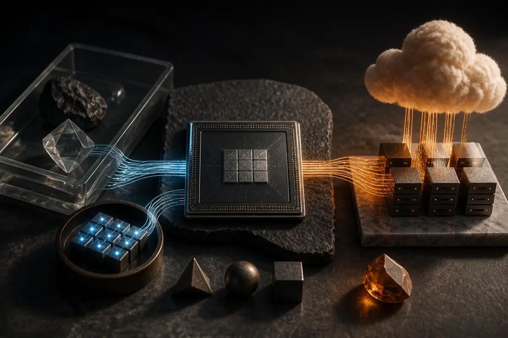

TL;DR: A 100B-parameter model on a phone by 2028 only matters if it runs within real memory, battery, heat, and latency limits, not if “100B” becomes another empty spec.

## What did Qualcomm’s CEO actually signal?

The primary item here is the r/LocalLLaMA submission titled “Qualcomm CEO reveals AI companies want phones running 100-billion-parameter models continuously by 2028,” linking to a Fireside Alpha post on X. That is a thin public claim, but it points at a real pressure line: AI companies want the phone to become the default always-available inference device.

Not just “run a chatbot locally.” Continuously means something different. It implies background agents, local memory, sensor-aware assistants, private context, app actions, and maybe real-time multimodal understanding. The phone is the most personal computer most people own, so the product desire is obvious.

The engineering gap is also obvious.

A 100B-parameter model in FP16 is roughly 200 GB just for weights. At 4-bit quantization, it is still around 50 GB before runtime overhead, KV cache, adapters, system memory pressure, and everything else the phone is already doing. At 2-bit, the math gets friendlier, but the quality, speed, and model architecture questions get harder.

So I would not read this as “your 2028 phone will run today’s frontier-scale model locally, all day, no compromise.” I would read it as a directional bet from a chip company that benefits if more inference moves from cloud data centers to edge devices.

## Does 100B parameters even mean the same thing on a phone?

Probably not.

By 2028, “100B” could mean dense parameters, sparse parameters, a mixture-of-experts model where only a slice activates per token, a compressed model distilled from a larger teacher, or a local system with multiple specialized models that marketing rolls up into one big number.

That distinction matters. A 100B total-parameter MoE with 10B active per token is a very different workload from a 100B dense model. A phone can plausibly host a large inactive weight pool if storage gets cheaper and memory mapping improves. It still cannot ignore memory bandwidth, thermals, and battery drain.

The better metric is not parameter count. It is tokens per watt at useful quality, with acceptable time-to-first-token, while the device is warm in a pocket and the user has 37 other apps competing for resources.

This is where the local AI conversation often gets sloppy. Local inference has real advantages: privacy, latency, offline use, lower marginal cloud cost, and deeper OS-level integration. But “continuous” local intelligence can become creepy, battery-hungry, or both if the product does not give users control.

The winning version is likely hybrid. The phone handles wake words, intent detection, summarization, embeddings, retrieval, lightweight planning, and private context. The cloud handles expensive reasoning, big synthesis, and tasks where latency matters less than quality. That is less glamorous than “100B on-device,” but it is how products usually ship.

## What should builders take from this?

Treat the Qualcomm signal as a planning constraint, not a promise. The next platform fight is not only model quality. It is where inference runs, what context stays local, and how cheaply an assistant can stay useful without constantly calling the cloud.

If you are building agents, this changes architecture decisions now. Keep private user state portable. Separate small local tasks from expensive reasoning tasks. Design fallbacks for offline and low-power modes. Do not assume every future interaction gets sent to a hosted model endpoint.

Also, watch the language. “Running continuously” sounds like magic until you define the duty cycle. Is the model always listening? Always embedding? Always planning? Always holding a long context? Those are different products, with different privacy and battery costs.

Practitioner’s take: build as if the phone will become a capable local inference node, but not as if it will become a free frontier model in your user’s pocket. Start by moving narrow, high-frequency tasks local where privacy or latency actually matters. The catch most teams miss is orchestration: the product advantage comes from deciding what runs locally, what runs remotely, and when the user should know the difference.
