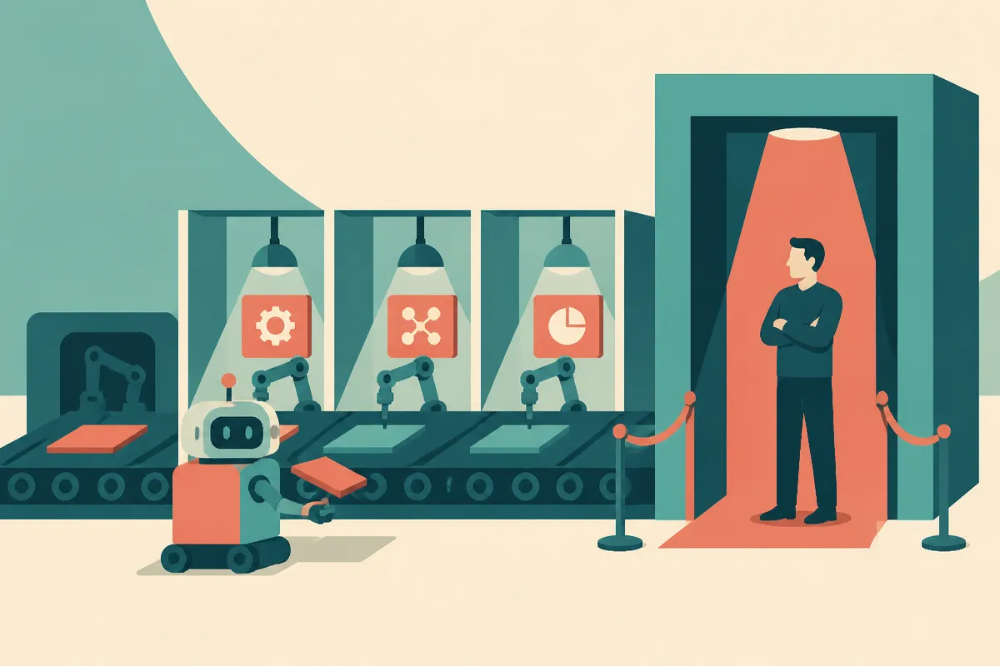

TL;DR: Marketing AI is moving from curiosity to budget line, but the defensible work is still internal workflow improvement, not autonomous customer-facing agents.

## Where is AI actually working in marketing?

Martech, citing The Martech Weekly’s “Enterprise Martech Outlook 2026,” reported a clean split: enterprise organizations are spending like AI is ready, while operating like it is not.

Two-thirds of enterprise organizations now have dedicated AI budgets. That is the demand signal. Even louder: 95.3% have AI agents on the roadmap.

But only 10.8% of agent initiatives are fully scaled in production. That is the reality check.

This fits what I see across applied AI work. The wins are not usually “the agent runs marketing.” They are smaller, duller, and more useful. Drafting. Editing. Creative variants. Reporting. Data cleanup. Analysis. Briefs. Internal research. These are jobs where the blast radius is manageable and the work can be checked by a person who already understands the context.

The Martech Weekly numbers point the same way. AI is having more visible impact on the martech stack than on customer experience, with 69.3% reporting a reasonable, clear, or substantial impact on martech, compared with 59.9% for customer experience.

That gap matters. Internal marketing operations are easier to instrument and govern. Customer experience is where bad data, brand risk, privacy rules, and weird edge cases all show up at once.

## Why are agents stuck before full production?

The bottleneck is not whether a model can produce copy, pick an audience, or summarize performance. It can.

The bottleneck is whether the organization trusts the surrounding workflow.

The harder agent use cases named in the Martech coverage are journey optimization, decisioning, audience selection, campaign creation, attribution, loyalty optimization, and offers. These are not just language tasks. They depend on messy customer data, existing business rules, platform integrations, measurement windows, consent boundaries, and judgment calls about what the brand should do next.

If attribution is already shaky, an attribution agent does not make it true. It makes the confusion faster and more expensive.

That is the part many roadmaps hide. An agent roadmap often assumes the process underneath is stable enough to automate. In marketing, that is a big assumption. Campaign calendars are political. Customer data is fragmented. Performance reporting often mixes accepted financial proxies, channel-specific metrics, and hope.

Martech reported that 40.2% of martech leaders still cannot show a clear financial contribution from their technology investments. That is before asking AI to justify its own line item.

## What should teams measure before asking for more AI budget?

The uncomfortable point in The Martech Weekly’s “Enterprise Martech Outlook 2026” is that budget growth is already tied to proof. Martech reported that teams able to show value were more likely to receive budget increases, 56% versus 37.5% for organizations relying on what the report calls “faith-based” value demonstration.

That should change how AI pilots are framed.

Do not measure an AI workflow only by output volume. More emails, more variants, more reports, more campaign ideas. That can be noise with a software bill attached.

Measure the handoff. Did cycle time drop? Did review time drop? Did error rates drop? Did campaign setup require fewer steps? Did analysts spend less time assembling slides and more time making decisions? Did content QA become easier, or did the team just move labor from writing to checking?

The human-in-the-loop numbers are also telling. Martech reported that only 1.6% of organizations allow fully automated AI-generated customer-facing content. The bigger group, 43.3%, allows external use only after review, editing, and verification. Another 24.4% limits generative AI to internal use.

That is not anti-AI. That is sane operations.

Practitioner’s take: start with one internal workflow that already has a clear owner, repeated demand, and an accepted success metric. Build the AI step into that process, not beside it. Track the review burden as carefully as the generation speed. The catch most teams miss: an AI pilot that creates more material for humans to inspect is not automation, it is inventory.
