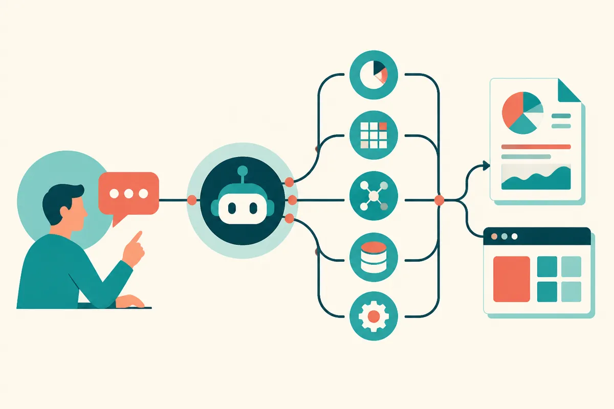

TL;DR: Oracle’s Codex use case is less about chat and more about turning report requests into governed agent workflows that can gather data, assemble analysis, and sometimes generate lightweight apps.

## What did Oracle actually say Codex is doing?

OpenAI’s primary account here is “How Oracle Uses Codex to Help Business Users Get Answers,” an OpenAI-published customer story featuring Oracle Applications Lab, or OAL.

The important line is not “AI answers questions.” We have plenty of that. The important line is that Oracle describes moving from report production to outcome description.

An OAL representative said that, in the past, answering business questions depended on reports. Someone needed a question answered. A team had to define, build, and ship a report. That is familiar enterprise gravity: useful data exists, but the path to it runs through request queues, permissions, schemas, dashboards, and somebody else’s backlog.

Oracle’s claim is that business users can now describe the outcome they want, and Codex plans what to do, decides which MCP service to call, gathers the information, and presents the requested result. Oracle said that result could be an analysis, a report, or even an application.

That is a bigger claim than “better BI search.” It suggests a workflow where the model is not just retrieving a metric, but selecting tools, sequencing calls, and packaging the output in a form a business user can act on.

## Why is this different from a dashboard chatbot?

Most enterprise AI demos die in the same place: the assistant can summarize a dashboard, but it cannot do the actual work around the dashboard.

The Oracle pattern is more interesting because the unit of work is the outcome, not the query. “Show me revenue by region” is a query. “Help me understand why renewal risk changed this month and give me something I can share with the team” is closer to a business task.

That difference matters. A dashboard chatbot still assumes the right dashboard exists. An agentic reporting workflow can, in theory, decide that it needs data from several internal systems, call the right services, reconcile the answer, and generate an artifact.

But there is a catch. The hard part is not the model sounding smart. The hard part is the service layer. If MCP services expose messy, under-documented, over-permissioned enterprise systems, Codex can only be as reliable as the tools it is allowed to call. The impressive part of Oracle’s description is not that Codex writes prose. It is that OAL appears to be giving Codex a structured path into internal business operations.

That is where many companies should focus before buying the hype. Not “give everyone an agent.” Start with the handful of recurring report requests that consume analyst time, have clear data permissions, and produce repeatable decisions.

## Where could this break?

Oracle’s representative called this “business transformation,” and I get why. If business users can move from report tickets to outcome requests, decision cycles get shorter.

Still, the claim needs boundaries. OpenAI’s account does not give error rates, review flows, permission details, scope limits, latency, or deployment timelines. It also does not say how often Codex produces an application versus a conventional analysis or report. Those omissions matter.

Enterprise agents fail in boring ways. They call the wrong tool. They join data incorrectly. They produce a confident answer that hides a missing filter. They generate an artifact that looks finished but does not match policy. They expose more data than the user should see. None of that is science fiction. It is normal software risk with a language model in the middle.

So I would read Oracle’s example as a directionally useful pattern, not a proof that every business user should get a free-range agent tomorrow. The right lesson is narrower and more actionable: put agents where the inputs, tools, permissions, and acceptance criteria can be made explicit.

A builder should try this first on one painful reporting lane. Pick a repeatable request, wire the agent to approved services only, log every tool call, require citations to internal records, and keep a human approval step before anything is sent or committed. The catch most readers miss: the model is not the product. The product is the governed path from a business question to a trusted artifact.
