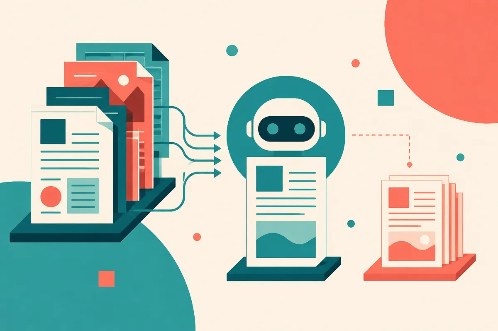

TL;DR: If you want to be cited by AI search, publish primary evidence, not another polished explainer of someone else’s work.

## What changed in ChatGPT citations?

My primary source here is Matt G. Southern’s Search Engine Journal report, “ChatGPT’s Most-Cited Sites Tilt Toward Primary Sources, Data Shows.” Southern reported that government health, research, and regulator sites climbed in ChatGPT’s U.S. citation ranks, while explainer-style sites fell.

That is a small sentence with a large implication.

For years, a lot of SEO content worked by translating primary material into simpler, more searchable pages. Read the regulation. Summarize the study. Explain the symptom. Define the term. Add schema. Add internal links. Win the query.

That playbook is not dead. But AI assistants change the shape of the reward. If ChatGPT can summarize the explainer, and it can also cite the original agency, journal, regulator, or dataset, the assistant has less reason to credit the middle layer.

This is not proof that every brand needs to become a research lab. It is also not proof that ChatGPT citations are now “better” than Google rankings. Southern’s report is about citation ranks in ChatGPT’s U.S. results, not the whole search market, not all assistants, and not every query class.

Still, the direction makes sense. Models and answer engines need defensible sources. A government health page, regulator notice, standards document, original survey, benchmark, dataset, or firsthand product doc gives the system something cleaner to point at than a content farm’s rewritten version.

## What should SEO teams do with this?

The lazy answer is “make better content.” That phrase is useless.

The practical answer is to make pages that contain something cite-worthy. Original measurements. Firsthand testing. Clear methodology. Screenshots from your own workflow. Pricing and availability from your own product, if you are the vendor. A changelog. A comparison based on real usage. A glossary that includes your own definitions because you operate in the field, not because a keyword tool found a gap.

I run Lucky Domains, where part of the work is SEO and search visibility for real websites, and this shift makes me care more about source quality than content volume: 

If your page only restates what a regulator, vendor, or research lab already said, expect pressure. Not only from ChatGPT. From Google AI Overviews, Perplexity, Gemini, Claude search features, and every other interface trying to answer before the click.

The better question is: what can your site say that the assistant cannot get from the upstream source?

For a medical site, that might mean clinician review plus local service details. For a SaaS company, it is product documentation and real customer implementation notes. For a finance site, it is methodology, disclosures, and data provenance. For a niche publisher, it is field reporting, interviews, original photos, tested workflows, or maintained reference pages.

## Where is the catch?

The catch is that primary sources are not always the best user experience. Regulator pages can be dense. Research papers can be unreadable. Government health pages can be cautious to the point of vagueness. Explainers still have value when they help a real person understand what to do next.

But the explainer has to add judgment. It cannot just compress.

That is the line I would draw from Southern’s reporting. AI search may cite upstream sources more often, but humans still need translation, prioritization, context, and application. The middle layer survives when it does work the primary source does not do.

For builders, I would test this directly. Pick ten pages that currently get organic traffic from informational queries. For each one, add one primary artifact: a table from your own data, a short methodology section, a dated field note, a product test, an expert quote, or a maintained source list. Then query ChatGPT, Gemini, Perplexity, and Google AI Overviews over several weeks and record whether your page appears, what it is cited for, and what the assistant prefers instead. The catch most teams miss: AI citation is not won by sounding authoritative. It is won by being the page other authoritative pages cannot replace.
