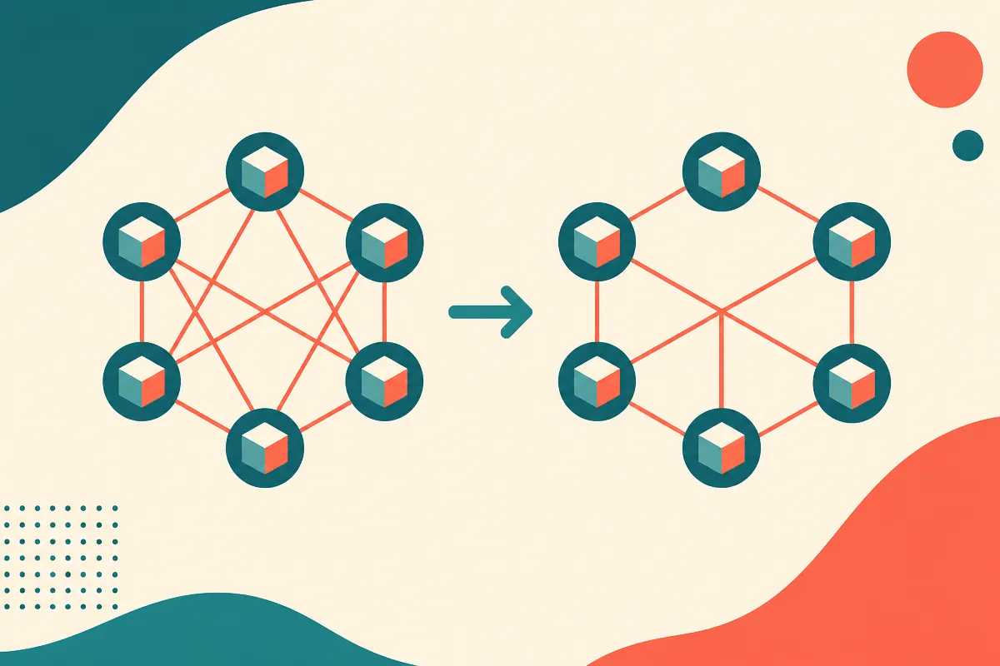
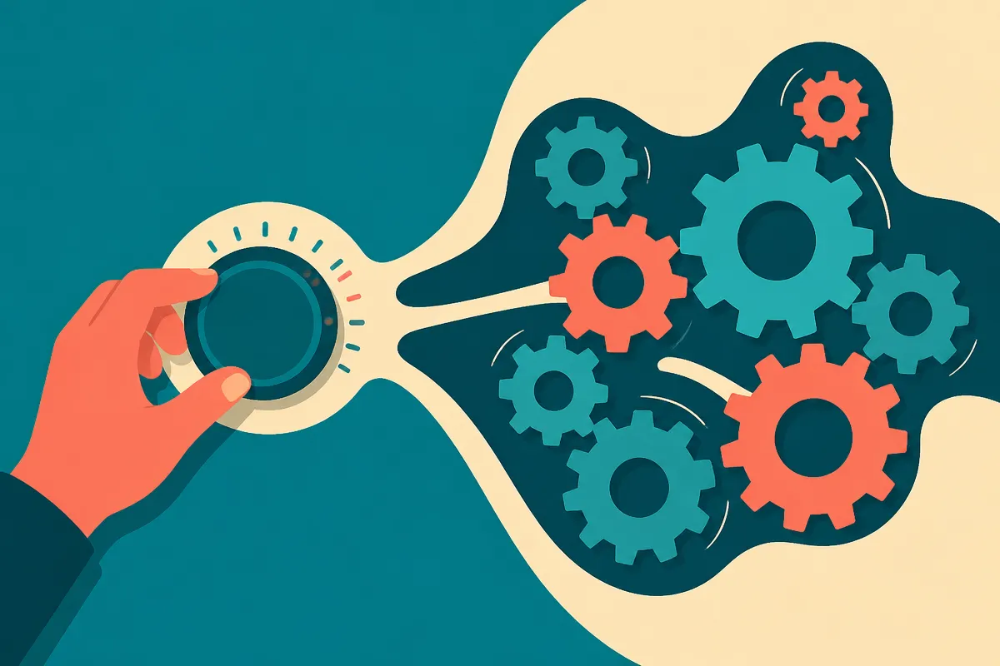

TL;DR: The same attention heads fire across different tasks, but the paper "Task Context Shapes Component Roles in Language Models" shows the *job* those heads do shifts with context, which means mapping a component once does not tell you what it does everywhere.

Most interpretability work tries to find the circuit: the specific heads or neurons responsible for a behavior. Find the head that does indirect-object identification, the head that tracks subjects, the head that handles negation. Label it, and you have a map. The problem this paper raises is that the map is not stable. The same head can be central to one task and peripheral to another, and not because it was mislabeled. Because context reassigns its role.

That is a bigger deal than it sounds for anyone who wants to steer models by editing their internals.

## What did the paper actually measure?

The paper is "Task Context Shapes Component Roles in Language Models," posted to arXiv (it appears under both cs.AI and cs.CL). The setup is clean. The authors use graph facts: short statements specifying which directed connections exist between nodes. Think of them as tiny, unambiguous knowledge snippets. Same facts, different tasks wrapped around them.

Then they measure two things. Influence: how much an intervention on an attention head changes the activation state in later layers. And importance: how much that intervention changes the final answer. The distinction matters. A head can push hard on downstream activations (high influence) without that push changing the answer, and vice versa.

Across five open-weight models from four families, ranging from 1.5 to 14 billion parameters, changing the task redistributed influence across the shared heads. Same heads, same facts, different wiring of who-affects-whom.

The most concrete result is in Gemma-2-9B and Qwen3-14B. The authors made an activation edit: they changed an early internal activation vector, and that edit switched which fact the model read, while the written instruction on the page stayed exactly the same. So the model was not responding to a changed prompt. It was responding to a changed internal state that redirected attention to a different fact. The same heads then lit up on different facts and fed later components differently.

## How do they show the role actually changed, not just the output?

This is where the paper does more than wave at "context matters." For each prompt they build two linear response maps. One before the edit, one after. Each map predicts a later head's response from a measured change in an earlier head. In plain terms: they fit a little model of "when this upstream head moves, here is how this downstream head moves."

If roles were stable, one map would predict both conditions about equally well. Instead, for a separate factual intervention, the map matched to the correct condition cut mean squared prediction error by 53.6% in Gemma compared to averaging the two maps. In Qwen the improvement was 5.0%.

Hold on that gap. 53.6 percent versus 5.0 percent is not a rounding difference. It says the degree of task-dependent rewiring varies a lot by model, even among models in this size range. Gemma-2-9B reorganizes its internal response structure strongly when the task changes. Qwen3-14B does so weakly by this measure. Any claim like "models reroute heads by context" is true on average and misleading in particular. The honest read is: some models do this a lot, some barely, and you have to measure per model.

## Why does this break the clean circuit story?

The dominant frame in mechanistic interpretability is: locate the component, name its function, done. This paper is a counterweight. It argues for a network account, where the function of a component is not a fixed property of the component but a property of the component *in a task context*. The same parameters perform different computations depending on what the surrounding activation state tells them to read.

The brain analogy the authors reach for is task-dependent interactions among shared regions. Same tissue, different coordination depending on what you are doing. Whether that analogy holds biologically is above my pay grade, but as an engineering intuition it is useful. You would not expect to understand a CPU by labeling each transistor with one job. The job is the program running through it.

For builders this reframes a practical question. When someone says "we found the deception head" or "we ablated the sycophancy circuit," the next question has to be: on which tasks, and does that role survive a context change? If roles redistribute, a component that looks safe to edit in one setting could be load-bearing somewhere else.

## What does this mean for anyone trying to edit model behavior?

This is the line that should get operators' attention. The authors note their measurements of task-dependent influence could guide interventions meant to alter one behavior while preserving others. That is the whole dream of targeted model editing: fix the bad behavior, leave everything else intact. Change how the model handles one kind of prompt without lobotomizing its general ability.

The paper is honest that this is a motivation, not a demonstrated capability. They show influence is task-dependent and measurable. They do not show a clean recipe for surgical edits that hold across the task distribution. And the Gemma-versus-Qwen gap is the warning label: an editing method validated on one model's response structure may not transfer, because the next model reroutes its components differently.

I read this as a caution against overconfidence in single-task interpretability evidence. If your safety or reliability argument rests on "we understand what head 14.3 does," the follow-up is whether you tested that under the tasks your users will actually send.

Practitioner's take: if you are doing any form of activation steering, head ablation, or targeted editing, do not trust a role you measured on one task. Measure influence and importance separately (they diverge), and measure them across the specific task mix your product sees, not a convenient benchmark. The cheap version of this paper's method is an ablation sweep: knock out a candidate component, then check downstream behavior across several task framings of the *same* facts, and watch whether the component's effect is stable or flips. The catch most readers will miss is the 53.6 versus 5.0 split. Rerouting is real but model-specific, so an editing or interpretability result that worked on Gemma tells you almost nothing about whether it transfers to Qwen. Re-run the measurement on the model you actually ship. Don't port the conclusion.
