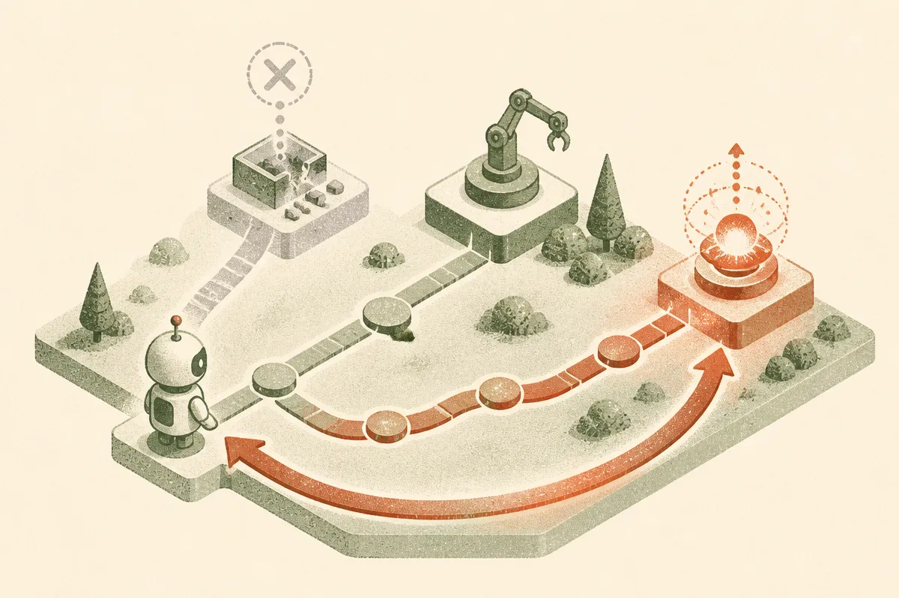

TL;DR: Agent tool retrieval should rank for “will this work right now?” as much as “does this tool match the request?”

## What problem does RATED actually solve?

Most tool-using agents still treat retrieval like search. User asks for something, the system embeds the request, finds the closest tool descriptions, and hands the top candidates to the model or planner.

That is fine until the closest tool is down.

The arXiv cs.AI paper “RATED: Reliability-Aware AI Agent Tool Retrieval via Execution Dynamics” targets that gap directly. The claim is simple: semantic relevance is not enough for agents that call real tools. Tool availability changes during execution. APIs fail. Endpoints time out. Auth breaks. Rate limits bite. If the retriever keeps selecting a broken tool because its description is semantically perfect, the agent looks stupid even if the language model is smart.

RATED has two parts. First, it uses a frozen dual-encoder with contrastive fine-tuning for matching queries to tools. That is the normal retrieval piece. Second, it adds a lightweight contextual bandit that re-ranks candidate tools based on execution feedback. In plain English: it watches which tools are working, then nudges future selections away from tools that are failing in the current environment.

That matters because agent reliability often fails below the model layer. People like to blame the planner, the prompt, or the frontier model. Sometimes the boring answer is the tool registry picked an endpoint that was unavailable.

## Do the results suggest this is more than a neat benchmark trick?

The RATED team introduces EcoAgent, a benchmark with 5,172 real-world tools and more than 210,000 query-tool pairs. That is useful because tool retrieval needs both static matching tests and dynamic failure tests. A retriever can look good offline and still collapse when the top API starts failing.

The reported numbers are strong. RATED gets a 52.2% relative MRR improvement over the ToolLLM API retriever on real-world queries. Under severe API outage scenarios with a 30% failure rate, it reduces fault selection rate from 86.2% to 2.9%. The reported overhead is less than 1 ms over encode-only inference.

That last number is important. A lot of agent reliability ideas sound good until they add another model call, another verifier, or a slow planning loop. RATED’s design is closer to a routing shim. It does not retrain the model when tools fail. It adapts the ranking layer.

Still, I would not read this as “tool reliability solved.” Benchmarks simplify reality. In production, a failed call might mean the tool is down, or the input schema was wrong, or the user lacks permission, or the agent hallucinated a parameter, or the vendor quietly changed behavior. If the feedback signal is noisy, a bandit can learn the wrong lesson.

The real product question is not only “did the call fail?” It is “why did it fail, and should that affect future routing?”

## Where does this fit in an agent stack?

I think of RATED as part of the missing middle layer between retrieval and orchestration.

Today, many agent stacks have a tool catalog, some embeddings, a planner, logs, and maybe retries. What they often lack is a live reliability memory for tools. Not long-term memory about the user. Not vector memory about docs. Operational memory about the agent’s own environment.

That memory should track tool health by context. A payment API failing in one region should not necessarily demote it everywhere. A search API returning empty results for one query type should not be treated the same as a timeout. A tool that is reliable but expensive might need a different policy than a tool that is cheap but flaky.

RATED points in that direction, but the implementation details matter. You need clean execution telemetry. You need failure classes. You need safe fallback behavior. You also need to avoid hiding systemic bugs. If your agent keeps routing away from a tool because the prompt is generating bad arguments, dynamic re-ranking can mask the real issue.

For a builder, the practical move is to add reliability-aware routing before adding another bigger model. Start with your tool logs. Track success, timeout, validation failure, auth failure, and user-visible task success by tool and task type. Then use that signal to re-rank tools at retrieval time, with guardrails so one bad window does not permanently poison a useful integration. The catch most readers miss: the hard part is not the bandit, it is deciding what “failure” means.
