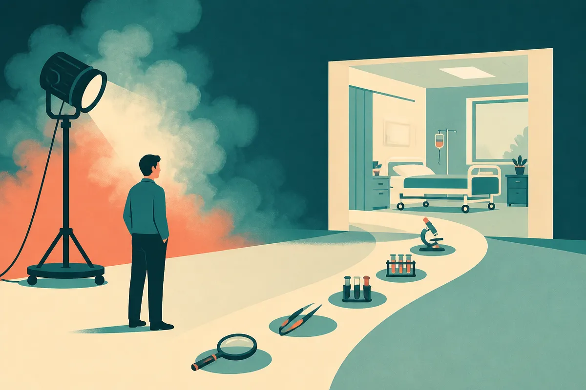

TL;DR: Treat “AI will cure cancer” as a product requirement, not a belief system: the useful work is measurable clinical progress, not theatrical confidence.

## Are AI researchers really smoking to prove AI will cure cancer?

Decrypt, in “AI Researchers Are Smoking Cigarettes to Prove AI Will Cure Cancer, Says Palantir Exec,” reported that Palantir CTO Shyam Sankar said many AI researchers have taken up smoking to signal their faith that AI will cure cancer.

That is a wild claim. It may also be more anecdote than dataset. Decrypt attributes the line to Sankar, and the point lands because it compresses a real mood in AI into one absurd image: smart people acting as if timelines are so short, and medical progress so guaranteed, that personal risk stops mattering.

I would not treat the cigarette story as evidence about AI researchers at large. It is too broad, too social, and too convenient as a quote. But I would treat it as evidence of something else: the AI world still rewards exaggerated confidence. Especially around medicine.

Cancer is not one problem. It is a large family of diseases with different causes, tissues, stages, genetic profiles, immune responses, treatment histories, and failure modes. “AI cures cancer” sounds like a single finish line. In practice, progress looks like better screening, faster pathology review, improved trial matching, earlier detection, new target discovery, cleaner protein design, better clinical documentation, and fewer missed signals in messy patient records.

Less cinematic. Much more useful.

## What would “AI cures cancer” actually mean?

If someone says AI will cure cancer, ask which part of the care chain they mean.

Discovery is one answer. Models can help search large chemical spaces, propose molecules, analyze proteins, and find patterns in genomic or imaging data. That is not the same as a therapy that works in humans.

Diagnosis is another. Computer vision systems can assist with radiology, pathology, dermatology, and triage. That is not the same as replacing clinicians, and it is not the same as reducing mortality unless it changes downstream care.

Operations matter too. Cancer care is full of coordination problems: referrals, prior authorizations, scheduling, eligibility checks, clinical trial matching, follow-up, symptom tracking, and patient communication. AI can help there without “curing” anything directly. It can still improve outcomes if it gets patients to the right treatment faster.

The hard part is translation. Biology is noisy. Hospitals are fragmented. Trials are slow for good reasons. False positives can hurt people. False confidence can hurt more.

That is why the cigarette story is the wrong metaphor. The right metaphor is a long bench-to-bedside pipeline, with many gates where a model has to prove it helps.

## What should builders watch instead of hype?

Watch for claims tied to endpoints.

Did the system improve sensitivity without flooding clinicians with false positives? Did it shorten time to treatment? Did it match more eligible patients to trials? Did it find a target that survived wet-lab validation? Did it improve survival, quality of life, cost, or clinician workload in a real deployment?

Also watch who bears the risk. In consumer AI, a bad answer can waste time. In medical AI, a bad answer can change treatment. That changes the bar for evals, monitoring, human review, data provenance, privacy, liability, and product design.

The AI industry likes proof by charisma. Medicine does not. Medicine eventually asks for protocols, cohorts, inclusion criteria, adverse events, reproducibility, and outcomes. Good.

I am optimistic about AI in cancer care. I am not optimistic about slogans doing any work. The gap between “model finds a pattern” and “patient lives longer” is where most of the real engineering, science, regulation, and clinical adoption lives.

For builders, the move is to pick one narrow cancer workflow and define the before-and-after metric before touching the model. Trial matching accuracy. Pathology turnaround time. Follow-up adherence. Prior auth cycle time. Clinician review burden. Then design the AI around that metric, with a human checkpoint where harm would be expensive. The catch most readers miss: in medical AI, the winning product may not look like a miracle cure. It may look like a boring workflow tool that quietly removes delay, error, and administrative drag from care.
