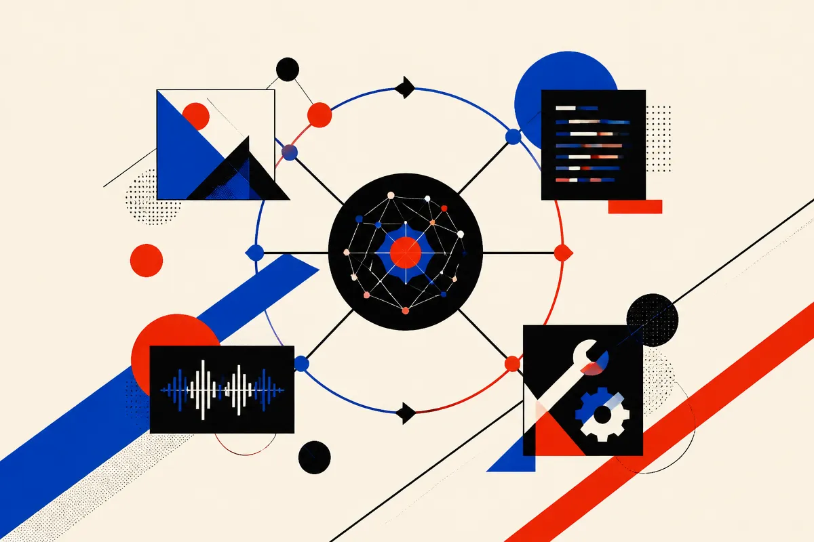

TL;DR: Gemini 4 Argon looks most interesting when it is driving tools over long, multimodal tasks, not when it is treated as another leaderboard chatbot.

## Is Gemini 4 Argon actually the best model?

My primary source here is Sam Witteveen’s hands-on report, “Gemini 4 Argon - Out and Tested!!”, with Matt Wolfe’s “Google Just Caught Up (Gemini-4 Argon)” as a second practical read on early benchmarks and demos.

The headline is not clean. Witteveen’s take is blunt: Argon is “really, really, really good,” but he does not think it is clearly the best model overall. I think that is the right frame. The frontier model conversation keeps collapsing into a single scoreboard, then builders get surprised when the “best” model is not the best fit for their workload.

Wolfe reported that Argon is state of the art on the Val’s index, Automation Bench, legal work, and Deep Suite for agentic coding. He also said Artificial Analysis places it at 53, around Fable, but behind Opus 5.5, Sonic 5.5, and Muse’s Wonder model. That is exactly the kind of split signal that matters. One benchmark cluster says “top tier for professional work and coding.” Another says “not the overall smartest by this aggregate.”

That is not a contradiction. It is the shape of the market now. Models are specializing by task, harness, and training diet. The old question, “which model wins,” is getting less useful every month.

## Where does Argon look different?

The most interesting Argon claims are about long tool-driven work, not short chat answers.

Wolfe reported a 1 million token output limit, roughly 750,000 words. That is a strange number if you think of the model as a Q&A box. It starts to make more sense if you imagine code generation, exhaustive planning, multi-file rewrites, simulations, reports, or agent traces where the model has to produce large artifacts rather than tidy answers.

Witteveen’s strongest examples were visual, code, and media tasks in one loop. He prompted the Gemini app to build a ReBirth-style music maker with 808, 909, 303, filters, effects, and a Roland-style step sequencer. His point was not that single-shot prompting is how real software gets built. It was that the model could infer a lot from a short creative spec, build a complex interface, and generate interactive audio behavior in one pass.

He also pointed to Google demos involving Blender, custom audio, game-like scenes, and scripted animation. Witteveen connected that behavior to reinforcement learning environments and post-training around tool use. That claim is his read, not a Google technical disclosure in the material here, but it matches the pattern: Argon seems tuned for agentic loops where the model can use a real environment, inspect results, and keep going.

This is the part I care about. A model that is merely good at answering questions is useful. A model that can operate inside Blender, a codebase, an app builder, or a test runner is a different product category.

## What should builders test first?

Do not start with trivia. Do not start with “write me a blog post.” Start with an ugly task that mixes constraints.

Give Argon a small app to build, with design, state, audio, or file structure. Give it a broken repo and ask for a fix with tests. Give it a product workflow that requires reading artifacts, generating code, revising output, and explaining tradeoffs. Then compare it to your current default model on time, correction count, test pass rate, and whether you can trust the intermediate steps.

Be careful on availability and platform details. Witteveen said Argon would be in the paid tier of the Gemini API, Antigravity, the Gemini app, and many Google surfaces, with some access beyond Ultra for features like AI Mode. Wolfe said access arrived for higher-end paid plans. Those are reported details from hands-on creators, not first-party Google docs in the provided material, so I would verify before building a production plan around access, limits, or cost.

Practitioner's Take: I would test Argon as a tool-using builder model, not a general assistant replacement. Pick one workflow where your current model stalls after the first draft, like generating an interactive prototype, refactoring a feature across files, or producing a long technical artifact with checks. The catch most readers miss: the model may only look special when it has the right harness, tools, and feedback loop. Without that, you are just comparing chat bubbles.
