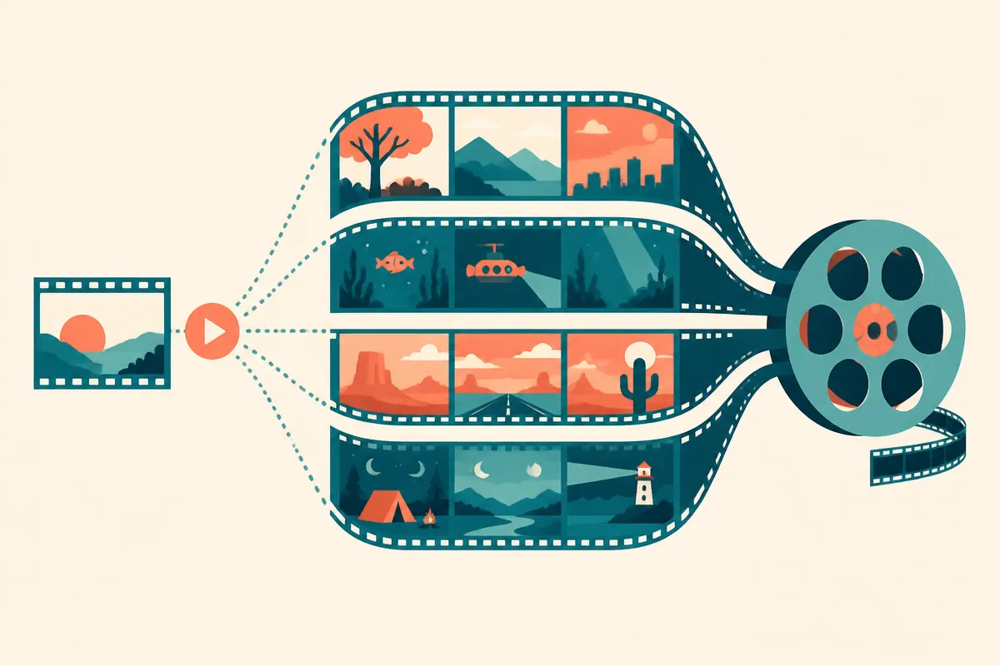

TL;DR: Longer AI video is becoming less about generating a clip and more about whether the creator can direct, revise, and control a sequence that is long enough to matter.

## What changes when AI video gets past the one-minute wall?

OpenAI’s announcement, titled “Higgsfield takes AI video from 1 minute to over 10,” says Higgsfield is bringing creators longer videos with GPT-6 Astra, more precise visuals with GPT-Image-2.5, and a path toward voice filmmaking with GPT-Live.

That is a big framing shift.

The first wave of AI video was mostly clip magic. A dog in sunglasses. A camera flying through a fantasy city. Five seconds, then eight, then a minute if you were willing to accept drift, weird cuts, and the feeling that the model was improvising harder than the director.

Over 10 minutes is a different job. It stops being a demo format and starts rubbing against real production workflows: scene structure, continuity, voice, timing, music, revisions, rights, export formats, team review, and brand control.

That does not mean “movies are solved.” I would be skeptical of that claim unless Higgsfield and OpenAI show the boring mechanics. Can a character stay visually consistent across scenes? Can a creator lock a shot and only revise the background? Can the voice performance be edited like a track, or is the whole sequence a fragile generation? Can teams version, annotate, and approve it without rerolling the entire piece?

Those details matter more than the headline duration.

## Is this filmmaking, or just longer generation?

The honest answer is probably both, depending on the controls.

OpenAI’s post names three model directions: GPT-6 Astra for longer videos, GPT-Image-2.5 for precise visuals, and GPT-Live for voice filmmaking. That bundle points toward a product idea where text, image, video, and voice sit in the same creative loop. If it works, the creator is not just prompting a model once. They are building a scene, inspecting it, adjusting it, adding performance, and pushing it forward.

That is closer to directing than prompt roulette.

But the trap is calling any long generated output “filmmaking.” Duration alone is cheap if the result feels mushy. A ten-minute video with weak continuity is not ten times more useful than a one-minute video. It may be ten times harder to fix.

For operators, the useful threshold is not cinematic quality in the abstract. It is whether the output can survive a real use case. A founder video. A product explainer. A training module. A campaign concept. A music visualizer. A creator short with a beginning, middle, and end.

That is where AI video can become practical before it becomes Hollywood-grade. Not by replacing a production crew on a prestige film, but by making lower-budget video work easier to prototype, localize, and iterate.

## What should builders test first?

I would test control before quality.

Quality is obvious. Everyone can see whether a shot looks good. Control is what determines whether the tool fits into a workflow. Give Higgsfield the same short script three times. See if it can preserve character identity, visual style, pacing, and voice across the whole piece. Then change one thing: the setting, the ending, the narration tone, the product shot. If small changes force full regeneration chaos, it is still mostly a toy for many teams.

The second test is revision speed. A 10-minute generated video sounds powerful until a client asks for “just a small tweak” at minute seven. Traditional editing tools are built around tiny changes. AI video tools need to meet that expectation, or the time savings disappear in reruns.

The third test is source material. The best near-term workflows may not start from blank prompts. They may start from a storyboard, brand guide, product images, voice reference, rough footage, or a human-written script. The winner here may be the system that respects constraints, not the one that makes the wildest first draft.

For builders, I would try this as a pre-production and content-ops tool before treating it as a final-film machine. Feed it a real script, require continuity, run a revision cycle, and measure how much human editing remains. The catch most readers miss: long generation is only valuable if the system gives you edit handles. Without those handles, “over 10 minutes” is impressive, but hard to operate.
