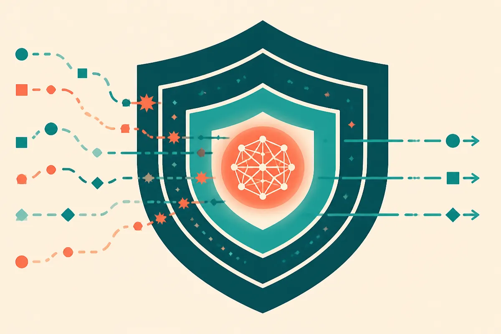

TL;DR: Treat Google DeepMind’s “Developing Gemini 4 Argon responsibly and safely” as a prompt to inspect deployment controls, not as proof that the model is safe for your use case.

## What is Google DeepMind actually signaling?

The primary source here is Google DeepMind’s announcement, “Developing Gemini 4 Argon responsibly and safely.” That title alone tells you something important: DeepMind wants the model conversation to start with governance, not just capability.

That is not trivial. The frontier model race has trained everyone to scan for context length, coding scores, multimodal demos, latency, price, and API access. Safety posts are often treated as furniture. Nice to have. Not where the action is.

I think that is backwards for operators.

The useful question is not, “Did Google DeepMind say the word safety?” Everyone says that now. The useful question is, “What has to be true for me to trust this model inside a real workflow?” Different bar.

A chatbot for drafting internal notes has one bar. A coding agent that can open pull requests has another. A customer support agent connected to refunds, account changes, or medical intake has a much higher one. “Responsible development” only matters when it turns into controls: eval coverage, red-team scope, refusal behavior, monitoring, logging, rollback paths, and clarity on where the model should not be used.

I am not reading this as a capability claim. I am reading it as a deployment signal. Google DeepMind is telling the market that Gemini 4 Argon should be judged partly by how it behaves under pressure, not only by what it can do in a polished demo.

## What should builders ask before using it?

The first builder question is boring and essential: what can this model touch?

If Gemini 4 Argon sits behind search, drafting, summarization, or classification, your risk is mostly bad output, missed context, or quiet hallucination. If it drives tools, writes code, sends messages, updates records, or triggers payments, you now have an agentic risk surface. Same model family. Very different operating reality.

This is where safety claims need to meet product design. I would want to know whether the model has been evaluated against prompt injection, data exfiltration attempts, long-context confusion, tool misuse, sycophancy, and high-stakes advice. I would also want to see whether those evals resemble real workflows, not toy prompts.

That last point matters. A model can look clean in isolated safety tests and still fail when given a messy task with files, user messages, stale docs, hidden instructions, and tool access. Most production failures are not movie-villain failures. They are mundane. The model follows the wrong instruction. It over-trusts retrieved text. It takes an irreversible action too early. It summarizes a policy page and drops the exception.

So the practical move is to build your own acceptance tests. Not because Google DeepMind’s internal work is irrelevant. Because your workflow is not their benchmark.

Use the announcement as a reminder to write down the failure modes you actually care about. Then test those before you wire the model into anything with consequences.

## Safety is not a product feature until it changes the workflow

The market still talks about model safety as if it is a property inside the model. Some of it is. Training, post-training, system instructions, policy tuning, and refusal behavior all matter.

But for builders, safety is mostly an architecture decision.

Do you let the model act, or only recommend? Do you require human approval before external actions? Do tools expose broad permissions or narrow ones? Do retrieved documents carry trust levels? Can users see citations? Can admins audit what happened? Can you replay a bad run? Can you shut off one tool without taking down the whole product?

Those choices decide whether a frontier model is usable in production.

That is the catch with safety-framed model announcements. They can sound abstract, but the downstream work is concrete. If you are adopting Gemini 4 Argon, Claude, GPT, Qwen, Mistral, or anything else, the vendor’s safety work is only the floor. Your product still needs guardrails at the workflow layer.

For builders, the move is simple: pick one real workflow, list the five failures that would embarrass you or cost money, then build evals and permissions around those failures before expanding usage. Try Gemini 4 Argon where outputs can be reviewed, logged, and compared against another model or human baseline. The catch most teams miss: the safest model choice will still fail if you give it vague goals, broad tools, and no recovery path.
