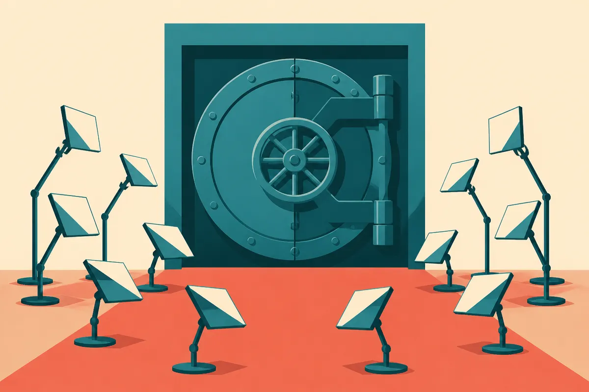

TL;DR: You can now place bets on OpenAI and Anthropic valuations through crypto derivatives and watch AI fear ripple through Korean chip stocks, but neither signal tells you much about the companies, so treat both as sentiment plumbing, not information.

Two things are happening at once, and they are easy to confuse. On one side, crypto exchanges are building products that let you take a position on what private AI companies are worth. CoinDesk reported that MNX is offering pre-IPO futures tied to the future valuations of OpenAI, Anthropic, and DeepSeek, going up against similar products from OKX and Bitget. On the other side, public equity markets are moving on AI sentiment in a way that bleeds into crypto. CoinDesk also reported that South Korea's Kospi sold off sharply, led by chipmakers, on concerns about AI spending and Chinese competition, while bitcoin held above its summer lows.

Put those together and you get the current state of a strange corner of the market: people want exposure to the AI buildout, the actual equity is locked up in private companies, and crypto venues are rushing to manufacture synthetic access. This is a pillar on where that stands, what is real, what is noise, and what an operator should actually do with it.

## What is MNX actually offering, and who else is in this market?

Here is what the sources support and nothing more. CoinDesk reported that MNX is offering "pre-IPO futures" that let traders take positions on the future valuations of private AI companies, naming OpenAI, Anthropic, and DeepSeek. The same report frames MNX as competing with OKX and Bitget, which have offered similar products.

That is the extent of what is confirmed by the material in front of me. I do not have MNX's own documentation, so I cannot tell you the exact contract mechanics, the settlement method, the fees, the position limits, or the oracle that determines a "valuation" for a company that does not trade publicly. Those details belong to MNX, and CoinDesk's summary is a pointer to the story, not a spec sheet. Treat any specific number you see floating around about these contracts as reported until MNX publishes the terms.

The important structural fact is simple. A pre-IPO future on a private company is not a share. You are not buying a slice of OpenAI. You are entering a derivative whose payoff depends on some reference valuation, and the hard question is always: reference to what? Private valuations are set by funding rounds, which happen infrequently, are negotiated, and often carry structure (liquidation preferences, ratchets, tranches) that a single headline "valuation" number hides. A clean last-trade price, the thing that makes an equity future legible, does not exist here.

So what are you actually trading? Sentiment about a number that itself is a negotiated fiction updated a few times a year. That is not a reason to dismiss the product. It is a reason to understand that the price discovery you see on these venues is discovery of crowd opinion, not of underlying company value.

## Why are crypto exchanges the ones building this?

Because they can, and because the demand is real while the legitimate supply is thin.

Private AI equity is the most wanted asset class of this cycle and one of the least accessible. The companies stay private longer. The rounds are oversubscribed by institutions. Retail and most funds have no entry point. That gap is exactly the kind of thing a derivatives venue exists to fill, and crypto exchanges have two advantages here: they already run perpetuals and futures infrastructure, and they operate in jurisdictions where listing a synthetic contract on a private company is easier than it would be under, say, full US securities treatment.

This fits a pattern I keep writing about. Crypto's genuine near-term utility in the AI story is rails and plumbing, not the hype layer. Agent payments are heading toward real rails before they need crypto narratives, as I argued in [AI agents need payment rails before they need crypto hype](/blog/2026-09-23-ai-agents-need-payment-rails-before-they-need-crypto-hype/). Coinbase's agent work is payments plumbing, not an AI pivot, which I covered in [Coinbase's AI agent bet is payments plumbing, not an AI pivot](/blog/2026-07-27-coinbases-ai-agent-bet-is-payments-plumbing-not-an-ai-pivot/). Bitcoin Lightning joining x402 made agent payments marginally more real, per [Bitcoin Lightning joins x402, and agent payments get a little more real](/blog/2026-09-25-bitcoin-lightning-joins-x402-and-agent-payments-get-a-little-more-real/). Pre-IPO futures are the same instinct pointed at a different target: take a demand crypto can see and build a venue for it.

The difference is that payment rails have a clear use. A synthetic valuation future has a murkier one. It is useful for speculation and, at best, for hedging if you somehow have private AI exposure you want to offset. For most people buying it, it is a way to express a view. Nothing wrong with that, as long as you call it what it is.

## Is the Kospi AI selloff telling me anything real about the companies?

Short answer: it is telling you about spending expectations and supply chains, not about model quality or company health.

CoinDesk reported that South Korea's chipmakers led a sharp Kospi selloff, driven by concerns over AI spending and Chinese competition, and that bitcoin diverged by holding well above its summer lows. A separate CoinDesk note described bitcoin and ether slipping and rebounding as Korean stocks slid, with investors positioning ahead of bank earnings and US inflation data.

The signal in a chipmaker selloff is about capex and competition. When the market worries that AI infrastructure spending might slow, or that Chinese competitors will undercut Korean memory and logic suppliers, those companies get sold. That is a bet on the buildout's pace and the supply chain's pricing power. It is not a verdict on whether OpenAI's next model is good or whether Anthropic's revenue is growing. The infrastructure layer and the model layer move on different clocks, and conflating them is a classic mistake.

I have written about this infrastructure layer as its own story. The energy and compute buildout is frequently a power story, not an AI story, which is the whole point of [Riot's reported Anthropic deal is a power story, not a bitcoin story](/blog/2026-08-11-riots-reported-anthropic-deal-is-a-power-story-not-a-bitcoin-story/). Ex-mining assets getting repurposed into AI infrastructure is a real trend, as with [Ionic Digital's Nasdaq debut puts ex-Celsius mining assets in the AI infrastructure lane](/blog/2026-07-29-ionic-digitals-nasdaq-debut-puts-ex-celsius-mining-assets-in-the-ai/). The thread through all of it: the money chasing AI mostly touches power, chips, and real estate, not the intelligence itself. A Kospi chip selloff is a vote on that physical layer.

## Why did bitcoin hold up while AI equities sold off?

The sources show a divergence worth sitting with. CoinDesk's framing in both notes is that bitcoin held above its summer lows and diverged from the Korean equity slide, with crypto slipping and rebounding rather than cratering alongside chip stocks.

I would not over-read a few days of relative strength. But the divergence lines up with a thesis that keeps showing up: the "AI trade" in equities and the crypto market are driven by overlapping but distinct flows. When the worry is specifically AI capex and chip competition, that pain concentrates in semiconductors and the companies tied to their earnings. Bitcoin's drivers at that moment, per CoinDesk, were more about macro positioning ahead of bank earnings and US inflation data. Same calendar, different stories.

The useful takeaway is not "bitcoin is a safe haven." It is that correlation between crypto and the AI equity complex is regime-dependent. Sometimes they move together because both are risk assets. Sometimes they split because the catalyst is specific to one. If you are trying to use crypto as a read on AI sentiment, or vice versa, you need to know which regime you are in, and most of the time you will only know in hindsight.

## What should an operator actually do with any of this?

Separate the three layers and act on the one you can actually touch.

Layer one is the companies themselves: OpenAI, Anthropic, DeepSeek. Their actual trajectory shows up in products, pricing, model releases, and enterprise adoption, not in a synthetic future or a chip index. If you want a read on Anthropic, watch Claude's capability and enterprise traction, not a derivative that references a stale round valuation.

Layer two is infrastructure: chips, power, data centers. This is where the Kospi move lives and where the most durable money is going. If you operate in this space, the signal is real but blunt. Capex sentiment and Chinese competition are the variables, and they move the whole supply chain at once.

Layer three is the speculation wrapper: pre-IPO futures, perpetuals, the crypto venues manufacturing access. This is the layer to approach with the most caution. The guardrail I hold for anything tradable applies in full here: no price calls, no buy or sell advice. What I will say is structural. A contract that references a negotiated, infrequently-updated private valuation carries basis risk you cannot see, counterparty risk on a venue whose terms you may not have read, and the ever-present scam adjacency of any hot, under-regulated product. CoinDesk named the venues; it did not vouch for the mechanics, and neither can I.

The practical move for most operators is boring and correct: use the companies' real outputs to make real decisions (which model to build on, which vendor to trust), treat the equity and chip moves as context on the buildout's pace, and treat the crypto synthetic-valuation products as entertainment or expression, not as information about the underlying businesses. If you are building agents that transact, the interesting crypto story is still the rails, where user-controlled gates and real payment plumbing are maturing, as in [Binance Agent OS puts trading agents behind user-controlled gates](/blog/2026-08-21-binance-agent-os-puts-trading-agents-behind-user-controlled-gates/).

## What is settled, what is contested, and what to watch next?

Settled: demand for private AI exposure is real and underserved, crypto venues are rushing to manufacture synthetic access to it, and AI sentiment now moves public equity markets hard enough to slide a national index. CoinDesk's reporting supports all three.

Contested: whether these synthetic valuation products provide any real price discovery, or just amplified sentiment. Whether the bitcoin-versus-equities divergence is signal or noise over a short window. Whether chip selloffs on "AI spending concerns" reflect a genuine slowdown or just crowded-trade jitters. The sources describe the moves; they do not resolve the cause, and I will not pretend to.

Unconfirmed and worth flagging: every specific mechanic of the MNX product beyond "pre-IPO futures on OpenAI, Anthropic, and DeepSeek." Settlement, oracle, limits, fees, jurisdictions, all of it is unverified from the material here. If you see those details cited confidently elsewhere, check them against MNX's own documentation before you believe them.

What to watch next: whether a real secondary market for private AI equity develops through regulated channels, which would make the crypto synthetics look like a stopgap. Whether any of these pre-IPO futures venues publish transparent settlement methodology, which would be the difference between a legible product and a casino. And whether the infrastructure selloff narrative, the thing hitting Korean chipmakers, deepens into an actual capex pullback or fades as positioning noise. The chip and power layer is where I would put my attention, because that is where the AI story meets physics and balance sheets, the two things that do not bluff.

A builder would take exactly one action from this: stop treating crypto AI-exposure products as a read on the companies, and start reading the companies directly. The MNX futures and the Kospi wobble are both sentiment instruments, one manufactured and one emergent, and both tell you how the crowd feels about AI, not how AI is doing. If you want to know how Anthropic is doing, use Claude and watch its enterprise deals. If you want to know about the buildout, watch power and chips. The catch most readers miss: the synthetic-valuation products feel like information because they have a price and a chart, but a price on a referenced fiction is still a fiction with a chart, and the moment you confuse the two you are trading your own vibes back to yourself at a fee.
