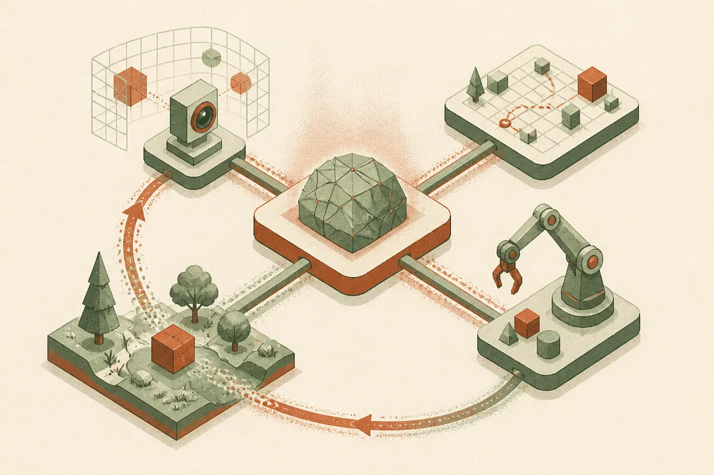
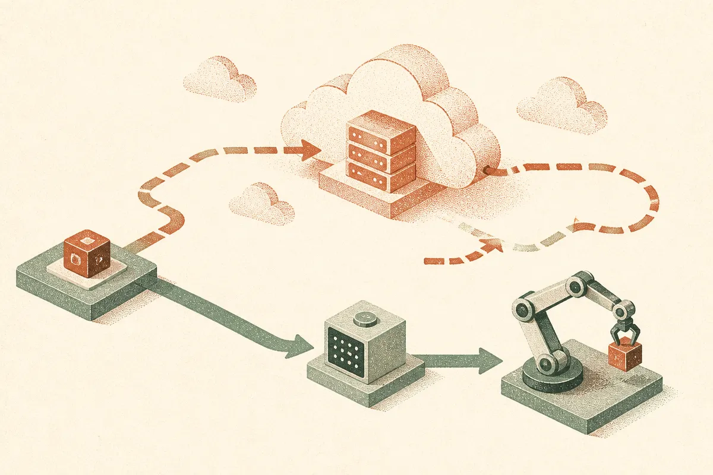
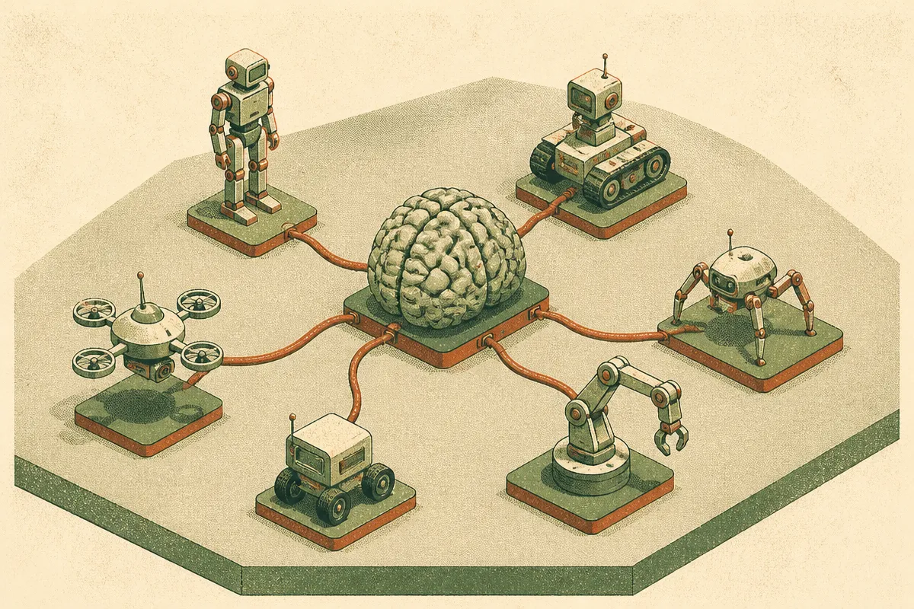

TL;DR: Google DeepMind has announced Gemini 4 Argon for Robotics, but the public specifics are still thin enough that the honest move is to separate what a robotics-tuned model can plausibly do from what has actually been shown.

Here is the situation as of today. Google DeepMind put out an announcement titled "Gemini 4 Argon for Robotics." That is the primary source. There is a Hacker News thread pointing at the same release. Beyond the name and the framing, the detailed claims, benchmarks, hardware partners, availability, and pricing are not something I can verify from the material in front of me. So I am going to do the thing I wish more coverage did: tell you what the release signals, what questions it should answer before anyone gets excited, and how to read a robotics model without getting played by a demo reel.

## What is Gemini 4 Argon for Robotics?

Based on the title from Google DeepMind, Argon is a variant of Gemini 4 positioned specifically for robotics. The naming pattern matters. Google has been shipping robotics-flavored models for a while now, and the lineage runs through the Gemini Robotics line that paired a vision-language-action model with a reasoning layer. "Argon" reads as a named configuration or checkpoint inside the Gemini 4 family, tuned for embodied tasks rather than chat.

What a robotics model actually needs to be good at is different from what makes a chatbot impressive. It has to ground language in physical space, reason about objects it can see, plan a sequence of motions, and recover when the world does not match the plan. The last part is where most systems fall apart. A model that writes a perfect essay can still fail to pick up a cup because the gripper slipped two centimeters.

So the interesting question for Argon is not "can it reason" but "how tightly does the reasoning couple to action and feedback." Google DeepMind's framing suggests that is the pitch. Whether the release backs it with on-robot results across varied hardware is exactly the detail I cannot confirm from the announcement title alone, and I am not going to invent numbers to fill the gap.

## Why does a robotics-specific model matter at all?

General models have been creeping into robotics for two years because the hard part of robots was never the motors. It was the brain that decides what to do in an unstructured kitchen or warehouse. Language models gave robotics a way to turn "clear the table" into a plan without hand-coding every step.

The catch is latency and reliability. A robot acting in the world cannot wait seconds for a cloud round-trip on every motion, and it cannot tolerate the kind of confident wrong answer that is merely annoying in a text box but dangerous near a human. A robotics-specific variant usually means the lab has made tradeoffs: smaller or distilled components for on-device control, tighter grounding to sensor input, more training on physical interaction data rather than internet text.

If Argon follows that playbook, the win is not a higher benchmark score. It is a model that behaves predictably across hardware it was not specifically trained on, and degrades gracefully instead of freezing or flailing. That generalization claim is the one I would want proof for, because it is the one every robotics demo is engineered to suggest and very few systems actually deliver in a stranger's building.

## How should a builder read this announcement right now?

With discipline. Robotics releases are the most demo-friendly and the most misleading category in all of AI, because video is persuasive and video is also the most heavily curated artifact a lab produces. A clip of a robot folding laundry tells you the robot folded laundry once, on camera, probably after many takes, in a controlled setup. It does not tell you the success rate, the reset time between attempts, or how it does in a room with different lighting.

So the checklist I apply to any robotics model, Argon included:

First, success rate on unseen tasks and unseen environments, reported as a number, not a montage. Second, which hardware it runs on and whether the impressive behavior transfers across embodiments or is tuned to one arm. Third, what runs on-device versus in the cloud, because that determines real-world latency and whether it works without connectivity. Fourth, failure behavior, since a robot that stops safely is a product and a robot that improvises wildly is a liability.

None of those four are things I can answer from the announcement title today. That is not a knock on Google DeepMind so much as a note on timing: the name is out, the receipts may follow, and the Hacker News discussion is doing what Hacker News does, which is speculate ahead of the documentation. Treat early thread claims as speculation until Google DeepMind's own docs or a technical report confirm them.

## What would make Argon genuinely important?

The thing that would move this from "another named checkpoint" to a real shift is cross-embodiment generalization backed by published evaluation. If Gemini 4 Argon can take a single policy and run it usefully on multiple robot platforms without per-robot retraining, that changes the economics of deploying robots the way a good foundation model changed the economics of building apps. You stop training a bespoke brain per machine and start adapting one.

The second thing is a clean story on the control loop. Reasoning models are slow by design, and robots need fast reflexes. The labs that win here are the ones that split a slow deliberate planner from a fast reactive controller and keep them in sync. If Argon ships that architecture with latency numbers, that is the detail worth reading closely.

I want to be fair to the release and honest about its limits. The signal is real: Google DeepMind is still investing in robotics as a first-class target for its frontier family, and a Gemini 4 generation model aimed at embodied use is a logical and welcome step. The limit is that an announcement title is not a spec sheet, and I am not going to pretend otherwise.

Practitioner's take: if you build with robots or plan to, bookmark the Google DeepMind announcement and wait for the technical report or model card before you change a roadmap. When it lands, skip the demo video on the first pass and go straight to three things: per-task success rates on environments the model did not train in, the list of supported hardware, and the on-device versus cloud split. If those three are strong, the demos are real; if they are missing, the demos are marketing. The catch most readers miss is that "for robotics" in a model name is a positioning claim, not a capability claim, and the gap between the two is exactly where deployment projects quietly die.
