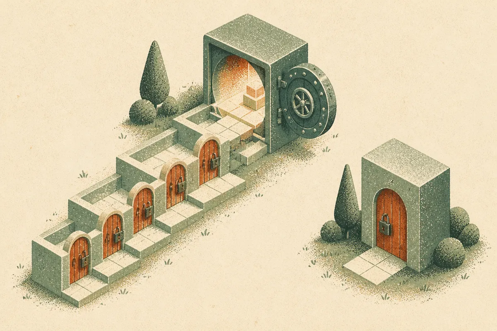
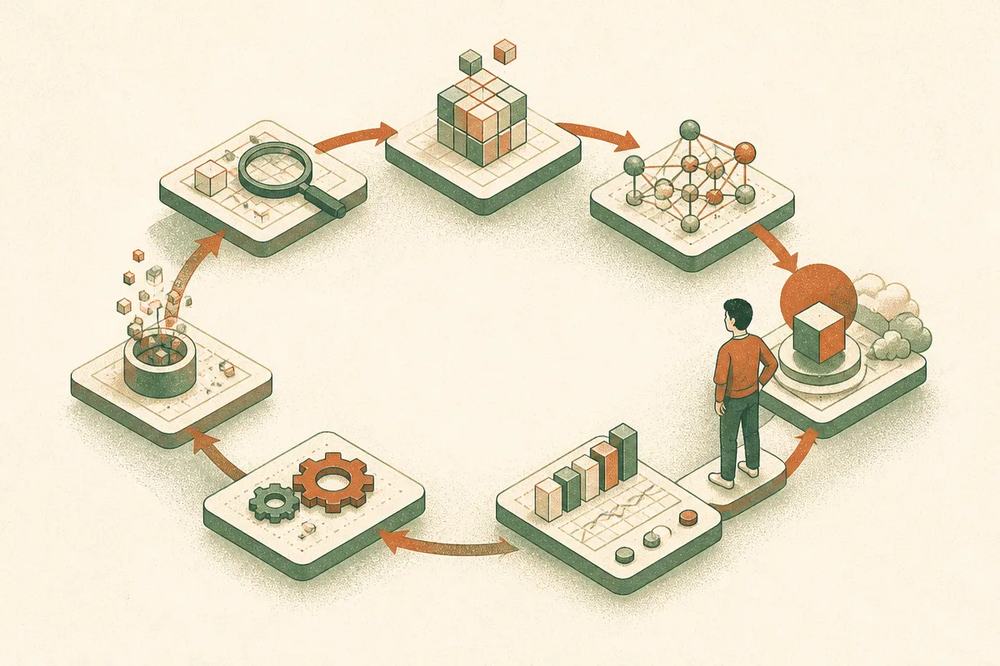

TL;DR: The news is not that AI can find bugs, it is that AI can now reason about chains of bugs the way a human attacker does, and that capability is symmetric: it helps whoever runs it, defender or attacker.

The clearest framing I have seen on this comes from Block's security team in OpenAI's own customer video, "Block on Finding and Fixing Security Risks with OpenAI." The line that stuck with me: "Every attacker potentially has an advanced capability in their pocket." That is the whole story compressed into one sentence. The same model that lets a small security team punch above its weight is available, for a few dollars of inference, to anyone who wants to break your software.

Let me pull apart what Block is actually describing, because the specifics matter more than the headline.

## What is new here when static analysis already existed?

Static analysis tools have flagged bad code for decades. Linters, SAST scanners, dependency checkers: all of these will tell you "here is an error in your code." Block's team is explicit that this is different. In their words, older tools "could hunt through software and say here's a error in your code overall," but what they are doing now is "chain together with hypothesizing about attack patterns crossing trust boundaries and chaining together a series of attacks to give you an end-to-end compromise."

That phrase, crossing trust boundaries, is the tell. A single-bug finder treats each flaw in isolation. A real attacker thinks in paths: this input validation gap lets me reach that deserialization call, which lets me pivot to the service that holds the credentials. Each step alone might be low severity. Chained, they are a full compromise. Modeling that chain used to require a skilled human who could hold the whole system in their head and hypothesize. Block is saying the model does the hypothesizing now.

I want to be careful here. This is Block describing their own workflow in a video OpenAI produced, so treat it as a customer testimonial, not an independent benchmark. We do not get a vulnerability count, a false positive rate, or which models they ran. What we do get is a credible description of the capability shape, from a real security team at a real company, and that shape is consistent with what people have been building with agentic coding tools all year.

## How does the full loop actually work?

The part I found most useful is that Block does not stop at discovery. They describe a complete loop: "You find you know where it is in software. You find who owns that software. You propose a patch for that. You confirm exploitability and then you verify that you have fixed it overall with a human in the loop guiding it and deploying the code."

Read that as six distinct jobs an agent is doing in sequence:

- Locate the vulnerability in the codebase.
- Identify the owning team or service, which in a large org is its own hard problem.
- Draft a patch.
- Confirm the bug is actually exploitable, not a theoretical finding.
- Verify the patch closed it.
- Keep a human guiding and deploying.

The "confirm exploitability" step is the one that separates this from noise. Anyone who has run a traditional scanner knows the pain: hundreds of findings, most of them unreachable in practice, and a security team that burns out triaging them. If a model can actually attempt the exploit and tell you "yes, this path works" versus "this is theoretical," that changes the economics of triage more than the finding itself does. That is the real productivity story, not the raw discovery.

And the human-in-the-loop detail is not a throwaway. Block is deploying code based on this. You do not let an unsupervised agent write and push security patches to production. The agent compresses the investigation; the human still owns the deploy decision.

## Who does this capability actually favor?

Here is where I part ways with the comfortable reading. The optimistic version is "defenders now have superpowers." True, but incomplete. Block says it themselves: every attacker has this too.

Think about what changes for an attacker. The scarce resource in offensive security has always been skilled human attention. You need someone who understands your stack deeply enough to chain those low-severity bugs into a compromise. That expertise gated the whole thing. A nation-state could afford it; a random opportunist mostly could not. When the chaining reasoning drops to the cost of inference, the floor rises. More actors can attempt more sophisticated attacks against more targets.

The defender has a real advantage: they can run this on their own code, before anyone else, with full source access and the ability to deploy fixes. The attacker is working from outside, often without source. That asymmetry is genuine and it favors defense. But it only helps you if you actually run the tooling. The organization that does not adopt this gets the worst of both worlds: attackers with the capability, defenders without it.

Block captures the emotional reality of this cleanly. Finding a years-old vulnerability is "scary of course like you know that this maybe has existed for years and you didn't know about it but now you know and now you can take action before someone else knows." That last clause is the entire game. Before someone else knows.

## What should a builder do with this now?

The mistake would be to treat this as a reason to panic or a reason to wait. Both are wrong.

If you ship software, assume adversaries are already running agentic recon against your attack surface, because the capability is cheap and available. That means the defensive version is not optional, it is table stakes. Start by pointing an agentic security pass at your own highest-value, internet-facing code paths: auth, payment flows, anything that crosses a trust boundary. Not your whole monorepo on day one. Pick the targets an attacker would pick.

Keep the human in the loop exactly where Block puts it: at exploit confirmation and at deploy. Let the model do the tedious investigation, the ownership mapping, the patch drafting. Do not let it push to production on its own judgment. The value is compression of expert time, not replacement of expert accountability.

The catch most people will miss: the win is not the finding, it is the confirmed exploitability plus the patch plus the verification, all in one loop. A tool that only finds bugs adds to your triage backlog. A loop that finds, proves, fixes, and verifies actually reduces risk. When you evaluate tooling in this space, ask vendors to show you the full loop with a human gate, not a dashboard of raw findings. And budget for the fact that your attackers are running the fast half of this loop whether you buy anything or not.
