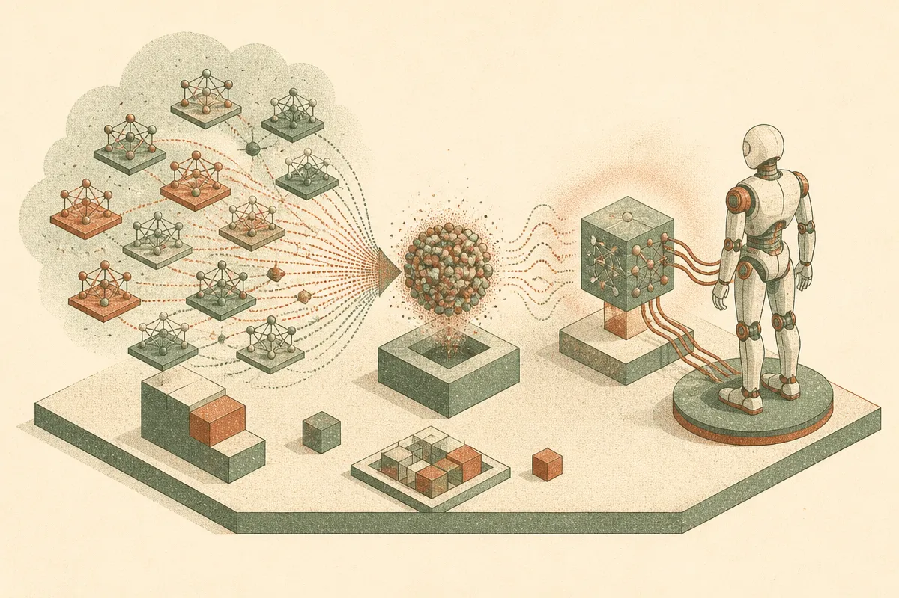

TL;DR: Diffusion is being used to generate working humanoid control networks directly in weight space, which matters less as a stunt and more as a new way to inspect, remix, and maybe standardize robot skills.

## What does it mean to generate a robot policy in weight space?

The primary source here is the arXiv paper titled “Modeling and Understanding Neural Weights of Humanoid Policies with Diffusion,” with additional material at https://humanoid-weight-diffusion.github.io/. The paper asks a strange but useful question: instead of training one robot controller at a time, can you model the distribution of trained controllers themselves?

Not prompts. Not trajectories. Not videos of robots doing parkour.

Weights.

The setup is fairly clean. The researchers collected actor networks from reinforcement learning for a Unitree G1 humanoid robot. Then they trained a latent diffusion system on those network parameters. A linear autoencoder compresses the actor network weights into a smaller latent space. A Diffusion Transformer models that latent distribution. Sampling from it produces new actor networks.

According to the paper, those generated networks were deployable on the real robot and performed motions including walking, dancing, and a spin kick. That is the part that makes this more than a visualization exercise. The generated artifact is not a description of behavior. It is the controller.

## Is this actually useful, or just a clever robot demo?

I think the demo is interesting, but the better signal is interpretability.

The paper reports a structural pattern in the first-layer weights that consistently reflects the robot’s kinematic prior. Plain English: the learned weights appear to encode something about the body plan of the humanoid. Even more interesting, the same kind of prior shows up under both reinforcement learning and imitation learning. The paper argues this suggests the structure is not just an artifact of one optimizer, but may reflect shared knowledge tied to humanoid embodiment.

That is a bigger idea than “diffusion makes another thing.”

Robot policies are usually treated as outputs of training runs. You set up the task, reward, simulator, data, network, optimizer, and eventually you get a controller. This work treats trained policies as data. Once you do that, you can ask different questions. What does a family of good controllers look like? Which parts of the network carry body-specific structure? Can a model interpolate between skills? Can generated policies become candidates for further training instead of starting from scratch?

The paper does not prove all of that. It shows feasibility on a specific humanoid setting with Unitree G1 policies and a particular architecture. That boundary matters. Humanoid control is hard, but “works for this policy family” is not the same as “generic controller generator for robots.”

Still, the shift is real. We are used to diffusion models producing pixels, audio, video, or 3D-ish assets. Here, diffusion is producing functional neural networks.

## What changes if policies become modelable objects?

For builders, the useful mental model is a policy library with geometry.

Today, a robot skill is often a checkpoint plus notes about training conditions. If weight-space modeling matures, teams may build collections of trained policies, map their latent structure, generate variants, and test them in sim before touching hardware. That could make controller development feel a little less like isolated training runs and a little more like working inside a searchable design space.

The catch is evaluation. A generated controller that walks in one setup can still fail under shifted terrain, sensor noise, payload changes, or hardware wear. Weight-space generation does not remove the need for simulation coverage, real-world validation, safety constraints, and boring rollback systems. Especially with humanoids.

Practitioner’s take: if I were building in robotics, I would not replace my RL or imitation learning pipeline with this tomorrow. I would start by saving more policy checkpoints, not fewer, then testing whether their weights cluster by skill, morphology, training regime, or failure mode. The practical win may come before full generation: better maps of policy space, better warm starts, and faster debugging when two controllers look similar in reward curves but encode very different behavior.
