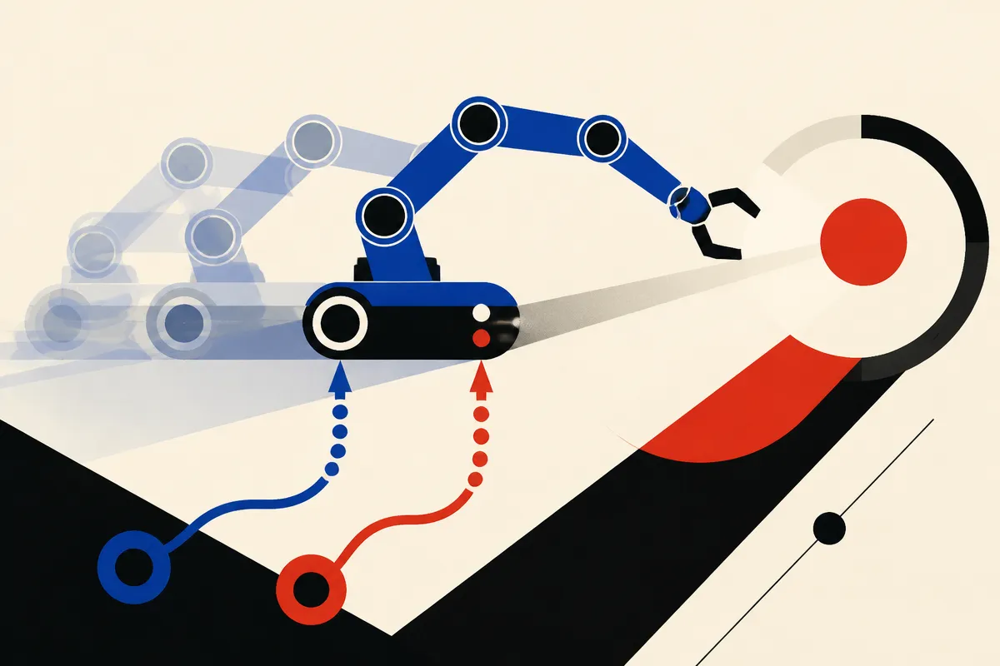

TL;DR: HiRe-MoMa is interesting because it treats real-world robot fine-tuning as a correction problem, not a full retraining problem.

## What problem is HiRe-MoMa trying to solve?

The primary source is the arXiv cs.AI/cs.LG paper titled “Hierarchical Residual Policy Learning for Real-World Mobile Manipulation with Sparse Human Guidance.” It targets mobile manipulation, the messy class of robotics where a machine has to move its base and use an arm in the same task.

That sounds simple until you try it in the real world. The base and arm are coupled. A small navigation error changes the reach problem. A slightly wrong arm motion changes what the base should do next. Training this end to end on a physical robot is expensive, slow, and easy to break.

The paper’s proposal, HiRe-MoMa, does not throw away the robot’s existing base policy. It freezes it. Then it learns residual corrections on top.

That is the practical idea worth paying attention to. In AI software, we already like wrappers, adapters, retrieval layers, and post-training. In robotics, the equivalent pattern is attractive for the same reason: you do not want every deployment to become a full retraining job.

HiRe-MoMa reports real-world experiments on a TIAGo++ platform, with performance improvements after around 30 minutes of online interaction. The paper also says its expert guidance covers under 20% of training, which matters because human teleoperation time is one of the hidden costs in robotics work.

## Why split the correction between the base and the arm?

The paper’s “Hierarchical Residual Architecture” has two important parts. First, a policy-agnostic residual learns additive corrections on top of the frozen base policy. Second, “Hierarchical Decoupling” splits that residual into mobile-base and manipulator-arm heads, with one-way conditioning.

Plain English: the system learns separate fixes for driving and reaching, instead of letting one giant correction network fight across both action spaces.

That matters because robot bodies are not just abstract action vectors. The base and arm have different physics, different failure modes, and different timing. If the correction policy treats them as one blended output, gradients can interfere. The paper frames this as aligning learning with the robot’s physical hierarchy.

The human guidance piece is also more subtle than “a person occasionally helps.” HiRe-MoMa uses Expert-Guided Value Alignment, where sparse human interventions reshape the critic’s value landscape. In reinforcement learning terms, the system is not just copying the human. It is using those interventions as priors about where exploration should go.

That is a more plausible path for real robots than pure trial and error. Nobody wants a household or warehouse robot learning by repeatedly failing near people, furniture, shelves, and inventory.

## How much should we believe from this result?

I like the direction. I would still keep the claims narrow.

The paper reports “extensive real-world experiments” on TIAGo++, and says HiRe-MoMa improves task performance regardless of base policy architecture. That is promising, but the prompt material does not give task counts, baselines, statistical spread, or failure case details. So I would not read this as “mobile manipulation is solved.” It is not.

The stronger takeaway is architectural. Frozen base policy plus structured residuals plus sparse expert guidance is a pattern that can travel. It reduces the amount of risky online learning needed. It lets teams improve deployed behavior without restarting from zero. It also gives operators a cleaner debugging surface: is the base policy wrong, or is the correction layer overfitting the deployment?

For builders, the move is to copy the shape before copying the method. Start with a competent base behavior. Freeze it. Add a small correction layer scoped to the part of the system that actually fails. Collect human interventions only at high-value failure points, not everywhere. The catch most readers miss: residual learning only helps if the base policy is already close enough. If the starting behavior is garbage, small corrections become a bandage over a broken controller.
