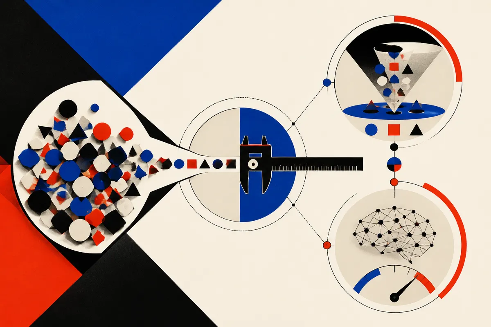

TL;DR: PrismaCoder's contribution is not the two models it ships but the rubric underneath them, a decomposed scoring system that checks whether generated code is correct, well built, and visually right once rendered, and then reuses that same signal to filter training data and drive reinforcement learning.

The paper is "PrismaCoder: Pushing the Boundaries of Open Multimodal Code Intelligence through Decomposed Rubric Synthesis," posted to arXiv across cs.AI, cs.CL, and cs.LG. Code and data live at the project page: https://qiushisun.github.io/PrismaCoder-Home/. The team releases a 2M-sample dataset (PrismaCoder-2M) and two models (PrismaCoder-9B and PrismaCoder-35B). I want to focus on why the method matters more than the leaderboard numbers.

## What is multimodal code intelligence, and why is it hard to train for?

Multimodal code intelligence is the job of writing code whose point is what it looks like when it runs. Charts. Webpages. Animations. Semi-structured documents. The model takes a text description or a screenshot and has to produce a program that renders into the right picture.

The hard part is the grading. For ordinary code, you can run tests and get a pass or fail. For visual code, pass or fail tells you almost nothing. A webpage can execute cleanly and still look broken. Two programs can produce byte-identical pixels through completely different source, so code similarity is useless as a signal. And task-specific verifiers (a checker built for charts, say) do not transfer to animations or documents.

The PrismaCoder authors name this directly: a good sample has to be correct as a program, well built, and visually right once rendered, and no existing signal covers all three. That gap is the whole reason open models have lagged proprietary ones here. It is not mainly a compute problem. It is a *what counts as good* problem.

## How does the decomposed rubric actually work?

Here is the move. Instead of one blunt pass/fail, PrismaForge (their data pipeline) synthesizes a rubric that breaks the quality question into separate checkable criteria. Correctness of the program. Quality of how it is built. Visual fidelity of the rendered result. Each becomes its own graded line item rather than a single verdict.

That decomposition is the interesting part. When you collapse everything into one score, a model can game the easy axis and ignore the hard one. Code that runs but renders wrong still passes an execution check. By pulling the three factors apart, the rubric forces a sample to earn its keep on each dimension separately, including the visual one that was previously unmeasurable at scale.

The second move is reuse. The same rubric does two jobs. First it acts as a filter: it curates the supervised corpus, throwing out samples that fail any axis. Then the exact same rubric becomes the reward function for reinforcement learning on visual-coding tasks. One signal, two stages. You are not building a separate reward model that might disagree with your data curator. The thing that decided what good data looks like is the thing that scores the model during RL.

That is cleaner than it sounds, and it is the reason I think this paper travels beyond its own models. Most synthetic-data pipelines filter with one heuristic and reward with another, then spend ages reconciling the two. Collapsing them into a shared rubric removes a whole category of drift.

## Should you trust the "rivals proprietary systems" claim?

The authors say PrismaCoder-9B and PrismaCoder-35B "lead the open state of the art by a wide margin and rival leading proprietary systems." Treat that the way you treat every self-reported headline from a model release. It is a first-party claim in an abstract, not an independent benchmark result, and the abstract I have does not give me the specific scores, the benchmarks used, or the proprietary models compared against. So I am not going to repeat a number the sources do not state.

What I will say: the mechanism is plausible, and the authors report that the rubric-based pipeline improves multimodal coding across different model backbones, not just their own. That transfer claim, if it holds up, is more important than any single leaderboard line, because it means the method is the product. A rubric that lifts multiple backbones is a reusable tool. A model that happens to top a chart is a snapshot.

The honest caveat: I have three near-identical arXiv abstracts here and the project page, not the full results tables or an outside replication. The "most diverse" and "largest to date" claims about PrismaCoder-2M are the authors' own framing. Diversity and size are also easy to assert and hard to verify from an abstract. Before I staked a production pipeline on this, I would pull the dataset, sample it, and check how often the rubric agrees with my own eyes on the visual axis. That is the axis that was impossible before, so it is the axis most worth auditing.

## Why this matters more than another open coder release

Open multimodal coding has been stuck not because nobody could train the model but because nobody had a trustworthy way to say which training samples were any good. A chart that renders wrong looks fine to an execution check and fine to a code-diff. The grading gap was the bottleneck.

PrismaForge's answer is to make the grader explicit, decomposed, and reusable. That is a pattern you can lift even if you never touch their models. If you are generating any output where *looks right when it runs* is the real spec (dashboards, generated UI, slides, diagrams), the lesson is to stop scoring it with one number. Break the quality question into the axes that actually fail independently, write a rubric that checks each, and then use that same rubric twice: once to decide what data to keep, once to score the model as it trains.

Practitioner's take: if you are building a visual-code workflow this quarter, do not wait for the leaderboard dust to settle. Clone the rubric idea now. Write down the three-to-five axes on which your generated artifacts actually go wrong (renders at all, renders correctly, matches the brief, is maintainable), and turn each into a yes/no check an LLM-as-judge or a renderer-plus-diff can grade. Use it first to filter whatever synthetic or scraped examples you are collecting, then as your reward or acceptance gate. The catch most readers will miss: the visual-fidelity axis is the one everyone underweights because it is the hardest to automate, and it is exactly the one that decides whether users trust the output. Spend your auditing time there, not on the code that merely compiles. And when you pull PrismaCoder-2M, sample it by hand against your own eyes before trusting the filter did its job.
