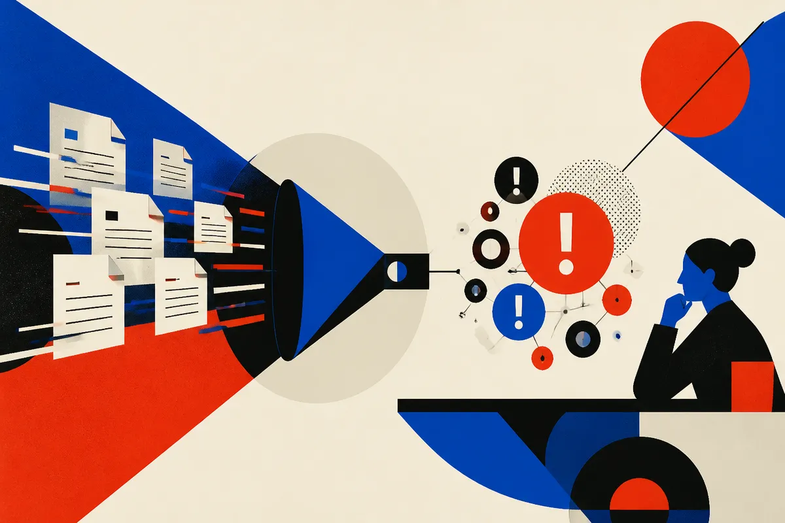

TL;DR: The useful version of legal AI is not a general lawyer-in-a-box, it is a narrow review system built around expert judgment, known document types, and human accountability.

## What is Agreement Analyzer actually claiming?

OpenAI’s announcement, “Sullivan & Cromwell brings legal expertise into agreement review,” says Sullivan & Cromwell worked with OpenAI to develop Agreement Analyzer, an AI tool for identifying issues in a draft agreement.

That is a small claim, and that is why it is interesting.

Not “AI negotiates the deal.” Not “AI replaces associates.” Not “AI gives legal advice to anyone with a browser.” The claim is issue identification inside draft agreements, developed with a major law firm that already has the expertise, training data context, review patterns, and risk instincts to know what “issue” means.

That matters because legal review is full of repeatable judgment calls, but not all of them are safe to automate end-to-end. A tool can scan a draft, flag missing terms, spot inconsistent clauses, compare language to a firm’s preferred positions, and surface review points for a lawyer. That is different from letting a model decide whether the client should accept the risk.

The distinction sounds boring. It is the whole ballgame.

## Why does this workflow fit AI better than generic legal chat?

Agreement review has structure. Contracts have sections, defined terms, obligations, exceptions, governing law, termination rights, indemnities, assignment clauses, confidentiality language, payment mechanics, and fallback positions. The model does not need to understand “law” as an abstract universe. It needs to compare a draft against a known review frame.

That is where AI systems are strongest in real enterprises: bounded input, bounded output, clear escalation, and expert users who can reject bad suggestions.

The business value is also easier to see. In a law firm or in-house legal team, draft review is high-volume, time-sensitive, and expensive when it bottlenecks a deal. If AI can reduce first-pass review time or make issue spotting more consistent, that is useful even if every final judgment stays with a lawyer.

But this is also where the hype check belongs. OpenAI’s post, based on the material available here, does not give public details on pricing, model choice, accuracy, evaluation design, deployment scope, or whether Agreement Analyzer is available beyond Sullivan & Cromwell. So I would not treat this as proof that legal AI has “solved” contract review. I would treat it as evidence of a product shape that makes sense.

The missing details are the important ones: false negatives, false positives, privilege handling, data retention, version control, audit logs, and how the tool behaves when a draft is weird, adversarial, or outside the expected deal type. Legal teams do not just need answers. They need defensible process.

## What should builders copy from this?

The pattern to copy is not “add AI to legal.” It is “put AI inside an expert workflow where the definition of quality already exists.”

A law firm has playbooks, precedent, training practices, partner preferences, client-specific positions, and institutional memory. Those are not nice-to-have context. They are the product. Agreement Analyzer sounds useful because it is tied to Sullivan & Cromwell’s legal expertise, not because a language model can read a contract.

The same pattern applies outside law. In finance, flag anomalies before analyst review. In healthcare administration, check claims before submission. In procurement, compare vendor terms against policy. In marketing ops, review campaigns against brand and compliance rules. The common thread is not autonomy. It is assisted review with a clear standard.

The trap is building a chatbot when the job is a checklist, comparator, classifier, and reviewer. Chat is often the least interesting interface. The better interface is a marked-up document, a risk queue, a confidence trail, and a way for experts to correct the system so the workflow improves over time.

For a builder, I would start with one document type, one review playbook, and one user group that already performs the task manually. Capture the issues they look for. Build the AI around surfacing those issues, not around sounding smart. Then measure missed issues, noisy flags, review time, and user overrides. The catch most readers miss: the model is only one part of the product. The real moat is the expert review standard wrapped around it.
