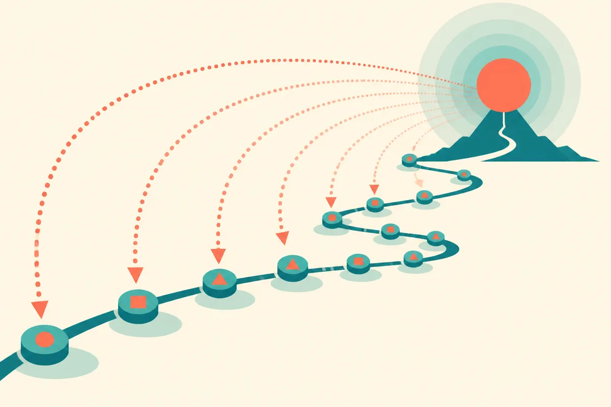

TL;DR: MLExpert raised its average Kaggle medal rate from 37.9% to 72.7% by rewarding chunks of agent behavior between experiment results instead of individual actions, and that windowing trick is the part builders should steal.

The paper is "MLExpert: Towards a Generalist Agentic Model for Autonomous Machine Learning Engineering," posted to arXiv (cross-listed under cs.AI and cs.CL). It describes a 35B Mixture-of-Experts agentic model trained to run machine learning engineering tasks end to end: read a problem, write code, run experiments, read the results, adjust, repeat. The pitch is "AI for AI," models that improve AI systems, framed as a step toward recursive self-improvement. Set the grand framing aside for a second. The interesting engineering is in how they handled the reward signal.

## Why is long-horizon agent training so hard to reward?

Here is the core problem the authors are solving, and it is one every agent builder hits.

When an agent runs a long task, the useful feedback comes rarely and late. In machine learning engineering, you find out whether a choice was good only after you train a model and score it, which can be many steps and a lot of compute later. By then the agent has made dozens of smaller decisions: which features to engineer, what architecture to try, how to set up validation. Each experiment result reflects all of those decisions tangled together. So how do you assign credit? Which of those twenty moves actually earned the good score?

Classic reinforcement learning wants a reward per action. But in this setting a per-action reward is either impossible to measure or wildly noisy. And the runs are expensive, so you cannot just brute-force millions of trajectories the way you can in a cheap simulated game. The authors state the constraint plainly: training has to select useful supervision from long interaction trajectories and learn from intermediate outcomes. That is the whole ballgame.

## What does Windowed Interaction RL actually do?

Their answer, which they call Windowed Interaction RL (WIRL), is almost embarrassingly sensible. Instead of trying to reward each turn, they treat the block of multi-turn decisions between two successive experiment results as a single unit, an "execution window," and hand that whole window one shared outcome-based reward.

So the natural boundary is the experiment itself. Everything the agent did to get from "last result I saw" to "next result I get" becomes one chunk, and that chunk is scored by how the experiment turned out. You stop pretending you can tell which keystroke mattered and start rewarding the coherent stretch of work that produced a measurable change.

Two supporting pieces make it practical. First, asynchronous collection and policy correction let them update the policy before a trajectory finishes, which matters when a single run is long and costly. Second, a stage they call hierarchical agentic SFT transfers general tool-use and coding ability into the MLE setting first, using outcome-guided supervision, before the RL stage refines it. They also built what they call the Kaggle-MLE Factory to turn Kaggle competitions into executable tasks with an interaction harness, so the model can actually run experiments and get real feedback instead of imagined feedback.

The shape here is: bootstrap capability with supervised fine-tuning, then shape judgment with RL on windows tied to real outcomes. That ordering is becoming a standard recipe, and WIRL is a clean variation on the reward-assignment half of it.

## How good are the results, really?

On MLE-Bench Lite, the average medal rate went from 37.9% for the base model to 72.7% after their training. That is close to a doubling, and the authors say it puts a 35B MoE model in range of larger frontier models they name as Kimi-K3 and GLM-5.3.

A few honest caveats before anyone gets excited.

MLE-Bench Lite is the "Lite" subset, a curated slice of Kaggle-style tasks, not the open world of real ML problems. "Medal rate" measures whether a solution would have placed in a competition's medal range, which is a meaningful proxy for competent ML engineering but still a proxy. Kaggle problems come with clean objectives and clear scoring. Most real engineering does not. The paper also reports gains on NatureBench Lite, on optimizing agent scaffolds, and on algorithm optimization, which is the stronger claim: that the learned skill generalizes past the exact training distribution. I take that as promising and unproven at scale. Generalization claims from a single paper's own evals always deserve a raised eyebrow until someone reproduces them.

The comparison models (Kimi-K3, GLM-5.3) are named without the kind of head-to-head detail that would let you weigh the match carefully from the abstract alone. "Comparable to" is doing some work there. The direction is real; treat the specific ranking as the authors' claim rather than a settled fact.

## Does the "recursive self-improvement" framing hold up?

The paper opens with AI4AI and recursive self-improvement, the idea that models improving AI systems could compound. I'd keep that framing at arm's length. What they actually demonstrate is a model that got meaningfully better at a bounded, well-scored engineering task because they fixed the credit-assignment problem for long runs. That is a real and useful result. It is not a machine that rewrites itself into something smarter overnight.

The gap between "agent that optimizes ML pipelines on scored benchmarks" and "system that recursively self-improves in open-ended ways" is enormous, and most of it lives exactly in the parts Kaggle removes: ambiguous objectives, no clean reward, problems where you do not know if you won. WIRL works because the experiment gives a clear number to window against. Take away the number and the method has nothing to anchor to.

## The practitioner's take

If you are building any agent that works over long horizons (a coding agent that iterates across a repo, a research agent that runs many queries, an ops agent that tries fixes and checks results), the lesson is portable and you do not need a 35B MoE to use it. Stop trying to reward or evaluate every single action. Find the natural checkpoints in your task where you get a real signal, the test suite running, the deploy succeeding, the metric moving, and treat the whole block of work between checkpoints as one unit to score. That is the WIRL idea in plain clothes, and it applies to evals and reward shaping both.

The catch most readers will miss: this only works when you have a genuine outcome to window against. If your task has no clean end-of-experiment signal, you don't have a WIRL problem, you have a measurement problem, and you have to solve that first. The method is a smart way to spend a reward you already have. It will not invent one for you. So before copying the training trick, ask the harder question: in my domain, what is the experiment, and what number tells me it worked? Answer that and you can borrow the rest.
