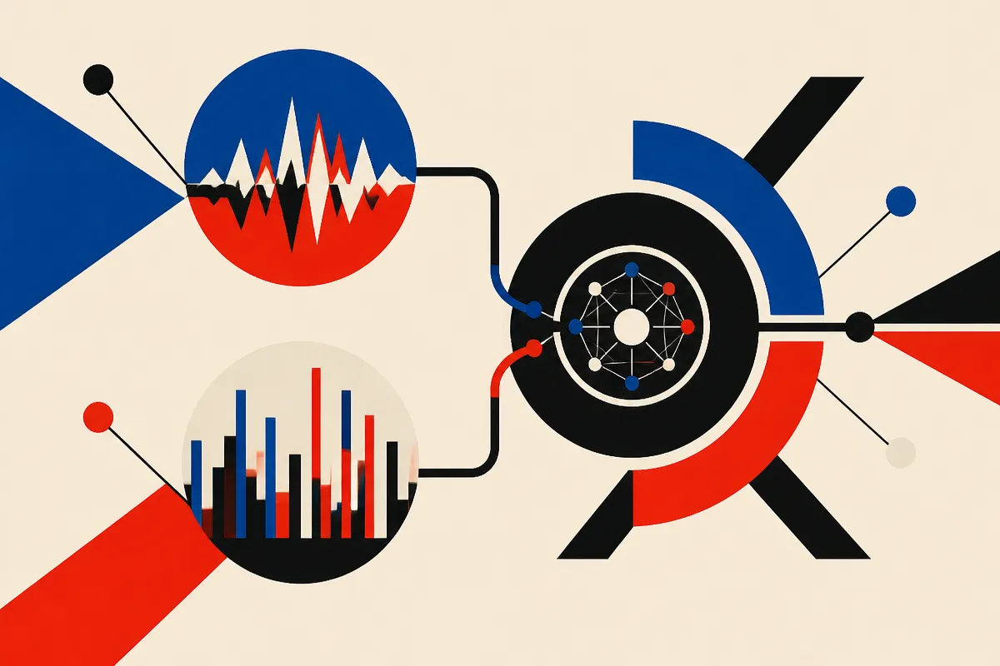

TL;DR: For time-series reasoning, the useful move is not turning every dataset into one chart, it is giving the model complementary views: one for actual values, one for temporal shape.

## What does a time-series language model need to remember?

The primary source here is the arXiv paper “Twice Upon a Time: Complementary Representations for Time-Series Reasoning,” listed under cs.AI and cs.CL. The core question is simple and practical: when a language model reasons over temporal data, what should its representation preserve, and what should it ignore?

That sounds abstract until you look at the two views the paper uses.

A line plot preserves the measurement frame. If the temperature is 42, the model can see 42. If revenue spikes from 10 to 80, the scale matters. This is the view you want when absolute values, units, thresholds, and coordinates are part of the task.

A normalized delay embedding does almost the opposite. It factors out positive amplitude rescaling and offsets, then exposes temporal structure. Translation: it helps the model see the shape of the behavior without getting distracted by where that behavior sits on the y-axis.

That distinction matters. A heartbeat pattern can be clinically similar at different amplitudes. A machine vibration signal can have a recurring structure even after sensor calibration changes. A sales curve can have the same seasonal rhythm at very different revenue levels. Sometimes the number is the point. Sometimes the pattern is the point.

Most model pipelines force one answer.

## Why do two visual views help?

“Twice Upon a Time” builds the dual-view approach on Qwen3-VL-8B. The model uses dedicated visual encoders, turns both views into visual tokens, and fuses features at multiple levels before feeding them into the shared language model.

The headline result is not tiny. The paper reports TSRBench accuracy rising from 44.5% with line plots alone to 53.2% with the dual-view setup. It also reports that this beats the strongest evaluated dedicated TSLM baseline at 36.7%. On TSExam, it reports 89.9% accuracy. On multivariate ChatTS alignment, it reports 86.8% numerical accuracy.

Those are benchmark claims, not a production guarantee. Still, the pattern is useful.

Single-view systems bake in a fixed bias. If you only show line plots, the model has access to real measurements but may overfit to scale, offset, or visual framing. If you only show normalized structure, the model can miss the literal values that make many time-series tasks operationally meaningful.

The paper’s evaluation-time interventions also matter because they test whether the two views actually behave differently. According to the paper, they do: the views show distinct invariance profiles. That is the receipt I care about more than the leaderboard number. If the two inputs are redundant, this is just extra machinery. If each view drops different noise and preserves different signal, the design has legs.

## What should builders take from this?

I would not read this as “use Qwen3-VL-8B for every forecasting problem.” I would read it as a design pattern: pair a faithful view with an invariant view.

If you are building an AI workflow for logs, finance operations, industrial sensors, product analytics, medical signals, or demand planning, the same idea applies. Do not ask one representation to do every job. Give the model the raw-ish frame when exact magnitude matters. Give it a transformed frame when shape, rhythm, lag, recurrence, or phase behavior matters.

The catch is that visual time-series reasoning can look better than it is. Charts compress data. Axis choices matter. Normalization can remove the very thing the business cares about. Benchmarks can reward pattern recognition while production asks for calibrated decisions under messy drift. The paper reports strong gains on TSRBench, TSExam, and ChatTS alignment, but it does not make your alerting system reliable by default.

My practical read: if you already use an LLM or multimodal model to explain temporal data, test a two-view prompt or pipeline before fine-tuning anything. Send the model the original plot plus a normalized structural view, ask it to cite which view supports each claim, then compare errors against your current single-view setup. The missed detail most teams will skip is view-specific evaluation: measure value-sensitive tasks and shape-sensitive tasks separately, or you will not know which representation is helping.
