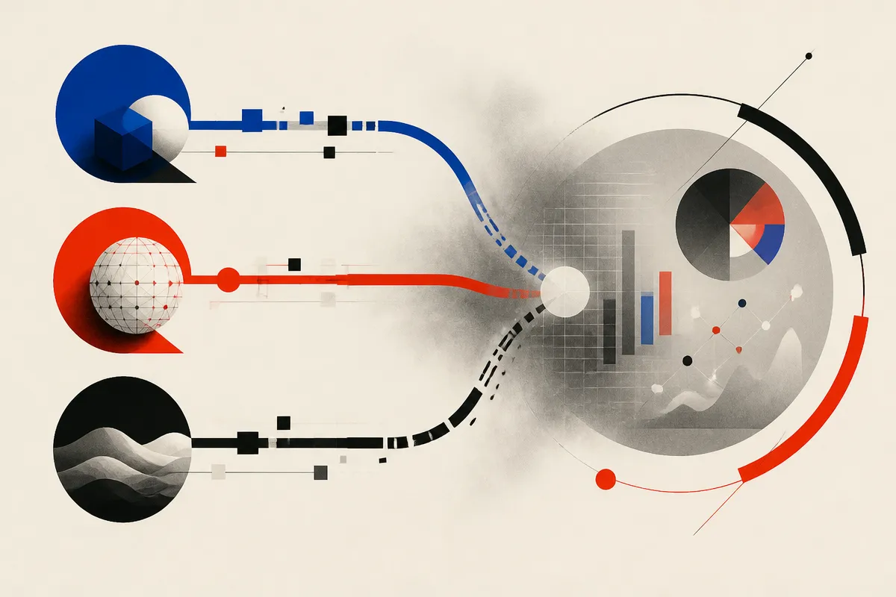

TL;DR: Treat AI search traffic as an unstable measurement layer, not a clean new channel, because rankings, links, and attribution are all shifting at once.

## What actually changed?

Search Engine Journal’s “Rank Tracker Data, ChatGPT Tags & AI Search Links – SEO Pulse,” by Matt G. Southern, pulls together three small but useful signals: a rank tracker logged Google pages missing their usual sites, some ChatGPT links reportedly lost tracking tags, and Google and Bing changed how AI search links appear.

That sounds narrow. It is. But narrow is the point.

Most AI search commentary tries to jump straight to the giant question: will AI kill SEO? This is the wrong starting place for anyone operating a real site. The better question is smaller: can you still tell where visibility came from, which page earned it, and whether the resulting visit has commercial value?

Right now, the answer is: sometimes, with caveats.

If Google pages appear without sites that usually show up, your rank tracker may record a drop before you know whether users saw fewer links, a different AI panel, a test bucket, or a reporting artifact. If ChatGPT links lose tracking tags, the visit may still happen, but attribution gets weaker. If Google and Bing adjust AI search link treatments, click behavior can move even when rankings do not.

That is not the end of search. It is the end of pretending one dashboard captures the full story.

## Why does attribution get worse in AI search?

Classic SEO measurement was never perfect, but it had a stable shape. A query led to a search results page. A result had a position. A user clicked. Analytics logged a referrer. Search Console showed impressions and clicks. Messy, yes, but familiar.

AI search breaks that shape.

A model answer can cite multiple pages, summarize without a click, rewrite intent, or place links inside a generated response instead of a ranked list. A chatbot can send traffic with tags, without tags, or through a browser context that makes the visit look direct. An AI search panel can expose a brand to the user while giving the site no session at all.

Search Engine Journal’s reported examples are useful because they sit at the plumbing layer. Not ideology. Not “SEO is dead.” Plumbing. Missing tags. Changed link displays. Ranking tools seeing unexpected absences.

I run Lucky Domains, where SEO and search visibility work means separating real demand from noisy reporting: 

That distinction matters more now. A drop in tracked rankings may be real. It may also be a snapshot of a test. A rise in “direct” traffic may be brand strength. It may be untagged AI referral traffic. A citation inside an AI answer may help trust. It may also produce zero measurable sessions.

The operator’s job is not to worship the metric. It is to know what the metric can and cannot see.

## So what should builders measure instead?

Do not throw out rank tracking. Just demote it from source of truth to one signal.

I would pair four views: traditional rankings, server logs, analytics referrers, and conversion paths. If an AI surface starts sending visits without clean tags, server logs may catch patterns that analytics hides. If rankings move but qualified leads do not, the ranking movement may be noise. If branded search rises after AI citations, that may be a real effect even without a neat referral trail.

Also watch pages, not just domains. AI systems often pull from specific explainers, product pages, comparison pages, docs, and glossary-style content. If one page becomes the cited answer for a recurring question, that page is now doing more work than a normal landing page. It should be accurate, current, and built to satisfy the next click, not just the first impression.

The catch: AI search reporting will tempt teams into false precision. A colorful dashboard will still look official when the underlying referrer data is incomplete. Builders should run small tests, annotate known changes, compare multiple logs, and ask a boring question every week: did this visibility create better users, leads, sales, signups, or trust? If you cannot answer that yet, say so, and fix the measurement before declaring the channel won or lost.
