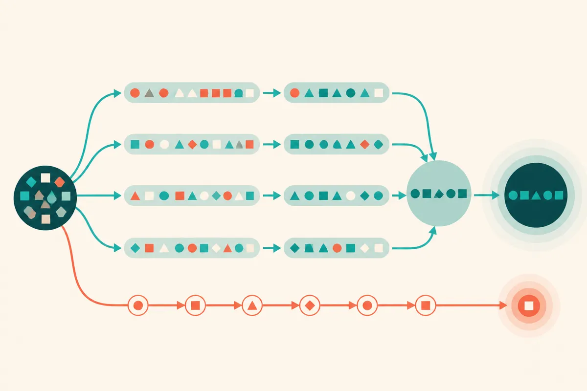

TL;DR: ORL is a serious attempt to make diffusion language models useful for fast single-request generation, but treat the 2,788 tokens/s headline as a system result, not a universal model speed.

## What did ORL actually change?

The primary source here is the ORL team’s announcement, “[Research] 2,788 tokens/s on a single RTX 5090 with a diffusion LLM — Introducing ORL (fully open source),” which points to the paper at https://arxiv.org/abs/2610.20687.

The core idea is not “diffusion, but for text” in the vague way people often say it. ORL, short for On-Policy Residual Learning, is aimed at a specific problem: diffusion language models can update many token positions in parallel, but they often need too many denoising passes before the answer is usable.

Autoregressive models emit one token after another. Diffusion LLMs can revise a whole span at once. That gives them a path to lower latency, if they can settle quickly. ORL tries to teach that settling behavior directly.

The team says the model carries forward its own previous predictions as residual context, then learns from trajectories generated by the current model rather than stale offline states. That matters because the intermediate guesses during inference are not fixed. They drift as the model changes. Training on the wrong distribution can make the model good at a fake denoising process and weaker at the real one.

The second piece is Adjacent Entropy Contraction. Plain English: each denoising step is encouraged to reduce uncertainty compared with the prior step, with a gate that avoids pushing already-confident predictions too hard. That is a training objective aimed at speed, not just final answer correctness.

## How much should we trust the speed numbers?

The numbers are eye-catching. The ORL team reports 2,788 tokens/s on a single RTX 5090 using LLaDA-2.1-mini plus ORL with NVFP4, and 7,708 tokens/s on 8× B200 using DiffusionGemma 26B MoE plus ORL with NVFP4. They also report up to 6.9× higher end-to-end throughput on QwenDLM-4B at comparable or better quality.

But the caveats are doing real work.

These are single-request decoding numbers, batch size 1, not aggregate server throughput across many concurrent users. The GPU figures are peak results on specific benchmarks, not averages over arbitrary prompts. And the system comparisons mix model behavior with inference stack behavior. ORL uses the team’s custom engine, dlmrt, while the speculative decoding baselines mentioned in the announcement use vLLM.

That does not make the results meaningless. It makes them more interesting, actually. The win is not just a training trick. It is a co-designed stack: post-training, CUDA graphs, NVFP4 on Blackwell, custom kernels, and an inference engine built around diffusion decoding.

The team reports that dlmrt runs 1.2× to 1.6× faster than SGLang or vLLM in single-H100 comparisons with identical models and decoding settings. It also captures the denoising loop in a CUDA graph so the GPU can run the loop without constant CPU launch and sync overhead. That is the kind of boring systems detail that often decides whether a model idea ships.

## Is this a threat to autoregressive LLMs?

Not yet. But it is a real pressure point.

The strongest comparison in the announcement is QwenDLM-4B plus ORL reaching 1,298 tokens/s on a single H100, versus 746 tokens/s for DFlash and 405 tokens/s for EAGLE3 under relaxed verification at comparable measured accuracy. The ORL team also reports HumanEval pass@1 improving from 82.9% to 89.6% on QwenDLM-4B after ORL.

Still, this is not “diffusion replaces transformers.” It is narrower: diffusion-style decoding may be especially useful where one user is waiting on one response and latency matters more than packed batch economics. Local inference is an obvious place to watch, especially if consumer Blackwell cards can run small diffusion LLMs with NVFP4 at useful quality.

The open-source angle matters too. The team says it released models, training code, the evaluation pipeline, and dlmrt. If that holds up under outside replication, we should see quickly whether ORL’s gains survive messier prompts, longer outputs, tool calls, RAG contexts, and non-benchmark coding tasks.

Practitioner’s take: I would not rebuild a production stack around diffusion LLMs this week, but I would test ORL where latency is the product: local assistants, code completion, short-form drafting, and agent loops that make many small calls. The catch most readers miss is that the model is only half the story. The real artifact to inspect is the full stack, including dlmrt, quantization path, benchmark setup, and whether your prompts look anything like the ones that produced the headline speed.
