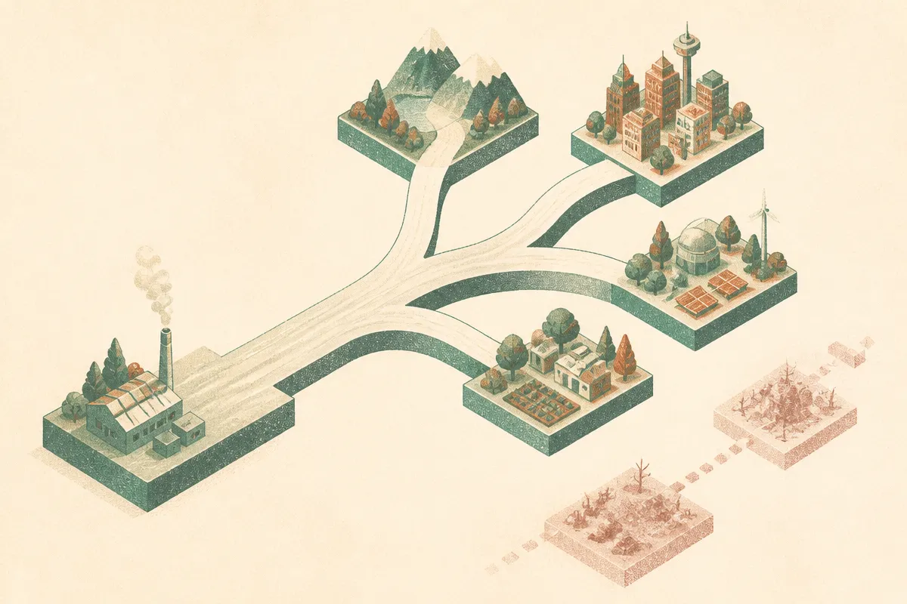

TL;DR: PathFM’s useful claim is not just better forecasting, it is that complete generated trajectories can be fast enough to use in real planning loops where marginal quantiles hide the risk.

## What does PathFM change about forecasting?

The primary source here is the arXiv cs.LG paper, “PathFM: Fast Generative Forecasting of Multivariate Trajectories.”

The core complaint is simple: many leading time series foundation models predict marginal quantiles. That can look fine on standard point and marginal scores, but it leaves the dependence structure of the future vague.

That matters more than it sounds.

If you are forecasting hourly electricity demand, daily inventory drawdown, ICU load, cloud capacity, or campaign spend, you usually care about path-shaped questions. What is the cumulative total? When does the peak happen? How long does a high-load period last? Do several variables move together, or do they take turns spiking?

A set of marginal quantiles does not answer those questions cleanly. It can tell you the distribution at each future time step, but not which future values belong together in a plausible trajectory.

PathFM tries to model the whole future path directly. It uses flow matching to generate complete multivariate trajectories, not just independent-looking future slices. That puts it closer to the kind of object an operator actually simulates with: “show me possible futures,” not “show me percentile bands.”

## Why does speed matter here?

Generative trajectory forecasting has an obvious problem: if it is slow, it becomes a research demo. Planning systems often need many samples, across many series, under repeated assumptions.

PathFM addresses that in two specific ways reported in “PathFM: Fast Generative Forecasting of Multivariate Trajectories.” First, it distills the sampler to one or two steps. Second, it shares the history attention cache across draws. The paper says those changes let PathFM generate multiple paths for a single series in roughly the time needed for one query to a quantile model.

That is the part I would pay attention to as a builder. Not because “roughly” settles deployment cost. It does not. But because it targets the right bottleneck. A forecasting model that can produce many coherent paths at near quantile-model latency is much easier to plug into downstream optimization, stress testing, replenishment, staffing, and capacity planning.

The paper also says the distilled sampler makes it practical to optimize a calibration loss directly. That is another pragmatic detail. Calibration is where many pretty forecasts become useful or useless. If generated futures are overconfident, under-dispersed, or weirdly correlated, downstream decisions inherit the mistake.

## How should we read the benchmark claims?

The paper reports that PathFM is competitive on marginal accuracy across fev-bench and TIME. That is important because path modeling would be less interesting if it came with a big basic accuracy penalty.

But the more relevant move is fps-bench, short for Forecast Path Score Bench. PathFM introduces fps-bench by augmenting fev-bench tasks with energy scores, variogram scores, and downstream metrics. On that aggregate path score, PathFM reports better results than all evaluated external baselines.

Two cautions.

First, fps-bench is introduced by the same work that reports PathFM’s win. That does not make it wrong. It does mean I would want to see independent reuse, more domains, and failure cases before treating it as the standard scoreboard.

Second, path scores are closer to operational reality, but they still are not the operation itself. A utility, retailer, hospital, or logistics network will care about its own loss function. Missing a peak by one hour may be harmless in one setting and expensive in another.

The chaotic systems result is still a useful signal. PathFM reportedly sustains long-run variability while strong baselines rapidly collapse. That is exactly the kind of failure marginal metrics can hide: forecasts that become smooth, safe-looking mush when the real system stays messy.

If I were testing this in production, I would start by replacing one forecast band dashboard with sampled trajectories, then score decisions made from those samples against the current process. Use PathFM-style path evaluation for cumulative demand, peak timing, and co-movement, not just next-step error. The catch most readers miss: the model is only half the change. You also need to decide which downstream decisions deserve path-level uncertainty, because generating better futures is wasted if the planning loop still consumes only a median line.
