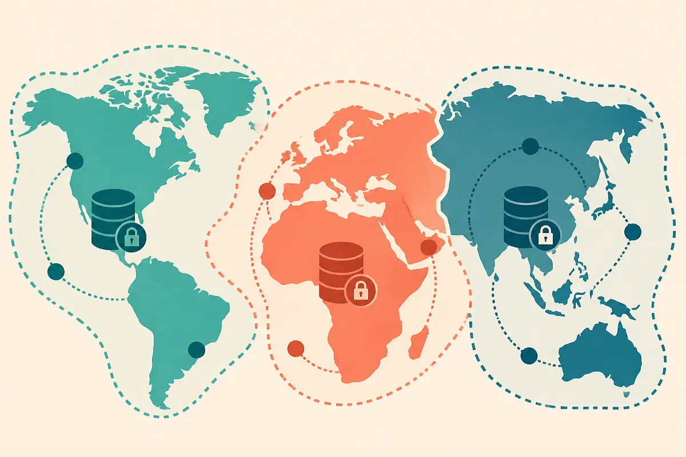

TL;DR: OpenAI shipped two openai-python releases on October 16, 2026 (v3.32.0 and v3.33.0) that quietly expose prompt-based voice creation, finer cache controls, regional processing residency, and a still-undocumented feature called "Decisions," and the SDK changelog is the earliest honest signal of where the platform is heading.

I read SDK changelogs the way some people read earnings calls. The marketing announcement tells you what a company wants you to feel. The commit log tells you what the engineers actually wired up. On October 16, 2026, OpenAI pushed two versions of openai-python back to back, v3.32.0 and v3.33.0, and the diffs are more interesting than most of what will eventually land in a blog post.

Let me be precise about what I'm working from. This is the published GitHub release notes for openai/openai-python, nothing more. Every feature below is a line in that changelog with a PR number attached. What the changelog does not give me is docs, pricing, availability windows, or model names. So I'll tell you what the commits say, what they probably mean, and where I'm guessing.

## What actually shipped in v3.32.0 and v3.33.0?

The headline items from v3.32.0, straight from the release notes:

- Cache settings and key options (PR #4087, marked "2/2," so part of a two-stage rollout)
- Prompt-based voice creation (PR #4091)
- Regional processing residency options (PR #4081)
- Response error diagnostics and model notices (PR #4086)
- Audio fixture playback in Live sessions (PR #4085)
- "Decisions" support in Live sessions (PR #4088)

Plus a bug fix declaring Realtime response error messages (#4083), a chore clarifying "Decisions request and response fields" (#4079), and a refactor sharing WebSocket connection handling (#4084).

Then v3.33.0, a day's worth of work later, adds safety identifiers to image requests and responses (#4093) and shares a "Decisions cache breakpoint parameter type" (#4092).

None of this is a product launch. It's plumbing. But plumbing is where you see the shape of the house before the walls go up.

## What is "Decisions," and should you care yet?

"Decisions" shows up four separate times across these two releases: support in Live sessions, clarified request/response fields, a shared cache breakpoint parameter type, and the cache work it ties into. When a name appears that many times in a 48-hour window and touches both the Realtime/Live stack and the caching layer, it is not a one-off. Something with a capital D is being built.

Here is what I will not do: pretend I know what it is. The changelog gives a name and some field shapes, not a description. My honest read, and I'm flagging it as inference, is that "Decisions" looks like a structured output or control-flow surface, something that lets a model return discrete choices the application acts on, now wired into live audio sessions. The fact that it shares a "cache breakpoint parameter type" with the caching system suggests Decisions and prompt caching are designed to work together, where a decision point marks where cached context ends and fresh reasoning begins.

That's a guess built from four commit titles. Treat it as a hypothesis to test the moment the API docs land, not as fact. If you build agent workflows on OpenAI's stack, the thing to watch is whether "Decisions" becomes a first-class way to get deterministic branching out of a model instead of parsing freeform text. That would matter.

## Why do cache controls and regional residency matter more than voice cloning?

The flashy line is "prompt-based voice creation" (#4091). Describe a voice in text, get a synthesized voice back, no audio sample required if the naming is literal. That's a real capability and a real liability surface, which is probably why v3.33.0 adds safety identifiers to image requests and responses the very next day. OpenAI tends to ship a generative capability and a provenance/safety hook close together now, and that pairing is the responsible version of the pattern.

But if you run anything at scale, the two lines that change your bill and your compliance posture are "cache settings and key options" and "regional processing residency options."

Cache key control is the quiet money feature. Prompt caching cuts the cost of repeated context, and letting developers set cache keys explicitly means you decide what gets reused instead of relying on the platform's automatic matching. For agent loops that resend a big system prompt on every turn, that's the difference between paying for the same tokens a hundred times and paying once. The "2/2" tag on #4087 tells you this was a planned, staged rollout, not a patch.

Regional processing residency (#4081) is the enterprise unlock nobody tweets about. If you can pin inference to a region, you clear a procurement gate that has kept a lot of regulated buyers off the API entirely. Healthcare, European data-protection regimes, public sector. This is OpenAI quietly competing with the cloud providers on the terms those buyers actually negotiate on.

## How should an operator read a changelog like this?

The discipline is separating what you can act on from what you can only anticipate.

Act on now: if you're already on openai-python, the cache key options are worth a real afternoon. Audit where your agents resend static context and wire explicit cache keys. The regional residency flag is worth a conversation with whoever owns your compliance checklist, because it may remove a blocker that was treated as permanent.

Anticipate, don't build on: "Decisions" and prompt-based voice creation. Both are visible in the SDK before they're visible in the docs, which means the surface may still move. Building a production flow on an undocumented field is how you earn a breaking change.

The meta-point: watching the SDK repo is one of the cheapest edges a builder has. These two releases landed on the same day with no fanfare, and they telegraph caching economics, a compliance expansion, a new voice capability, and an unnamed control feature. By the time any of this gets a launch post, half your competitors will have read it already.

Practitioner's Take: Subscribe to the releases feed for openai-python and whatever SDK your stack actually depends on, and skim every release the day it lands. The highest-leverage move this week is auditing your agent loops for repeated static context and testing the new explicit cache key options, because that's a cost win you can ship today with no new capability risk. Flag "Decisions" and prompt-based voice creation as watch items, not build items, until the docs exist. The catch most readers miss: a line in a changelog is an intention, not a contract. Undocumented fields ship, get renamed, and vanish between minor versions. Read them to steer your roadmap, not to pour your foundation.
