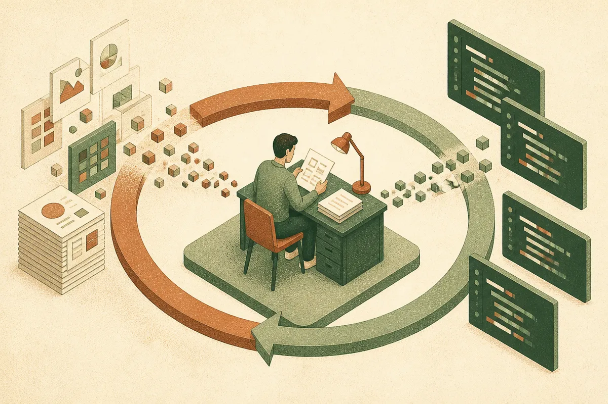

TL;DR: OpenAI's Benefit Street Partners case study shows a credit firm using Codex to build internal analysis tools and speed up code review, which is a real and sensible use, but the writeup gives you the shape of the workflow and almost none of the numbers you would need to judge it.

The source here is a single OpenAI blog post, "Benefit Street Partners answers questions faster with Codex." It centers on Anant Kumar, who builds tools to compare loan valuations and analyze credit agreements, and it credits Codex with helping on code review and faster follow-ups. That is the whole substance. So this post is less a review of a product claim and more a read on what the claim actually tells an operator, and what it conveniently leaves out.

## What is Benefit Street Partners actually doing with Codex?

Strip the case study to its load-bearing facts and you get three: one person, Anant Kumar, is building internal tooling. The tooling compares loan valuations and parses credit agreements. Codex sits in the loop for code review and for turning around follow-up questions faster.

That is a credit shop, so the work is exactly what you would expect. Loan valuation comparison means pulling numbers across deals and normalizing them. Analyzing credit agreements means reading long, dense legal documents and extracting terms that matter: covenants, maturities, interest structures, default triggers. Neither of those is glamorous. Both are the kind of repetitive, structured analysis that a coding assistant plus a human who knows the domain can genuinely accelerate.

The part I want to flag early: OpenAI frames this as Codex helping a builder ship tools, not as Codex autonomously doing credit analysis. Those are different stories. One is a developer-productivity story. The other would be a domain-agent story, and it is not what the post claims. Read it as the former.

## What does "code review and faster follow-ups" really mean here?

This is where I have to be honest about the gap between the claim and what you can verify. The post says Codex is used for code review and faster follow-ups. It does not say how much faster, against what baseline, on what volume of code, or with what error rate. There is no before-and-after. There is no team size. There is no description of what a "follow-up" is in this context.

So I will not pretend the writeup proves a productivity win. What it credibly shows is a usage pattern, and the pattern is sound.

Code review by an assistant works well for a specific reason: review is a bounded task with a clear target. You have a diff, you have an intent, and the assistant checks one against the other. That is a much easier job than open-ended generation, and it fails more gracefully. A missed bug in review is bad, but a human is still in the loop by definition. That is why "Codex for code review" is a believable use even without numbers behind it.

"Faster follow-ups" is the softer claim. In a credit setting, a follow-up is probably: an analyst or a PM asks a new question about a deal, and the tooling has to be extended or re-run to answer it. If Kumar can modify his comparison tooling in minutes instead of hours because Codex handles the boilerplate, that is a real speedup. But that is my reconstruction, not something OpenAI states. Treat it as a plausible reading, not a reported fact.

## Why does a one-person builder story matter more than a big rollout?

Here is the thing that makes this case study more useful than a splashier one would be. It describes a single person building tools, not a firm-wide deployment with change management and seat counts. That is the real shape of most useful AI adoption right now.

The pattern that keeps working: one person who deeply understands a domain uses a coding agent to build the thin internal tool that used to be too expensive to justify. Not a platform. Not a product. A script, a comparison dashboard, a document parser tuned to the exact contracts this firm sees. These tools never got built before because the cost of a developer-week did not clear the bar for a tool only a handful of people use. Codex changes that math by making the builder faster, so smaller bars get cleared.

The credit-agreement angle is a good example. A generic contract-reading tool is a crowded market. A tool that parses the specific agreement formats Benefit Street sees, with the exact fields its analysts care about, is not something you buy. It is something someone inside builds. That is the quiet story under this case study, and it generalizes far beyond credit.

## What should an operator copy, and what should they verify?

Copy the pattern, not the testimonial. The pattern is: find the domain expert who is one notch technical, give them a coding agent, and point them at the internal tooling nobody has had time to build. Code review and document analysis are both good first targets because they are bounded and checkable.

What to verify before you believe any of this applies to you: accuracy on your actual documents. Credit agreements are high-stakes, and a parser that is 95 percent right on terms is a liability, not a tool, if the 5 percent includes a covenant you missed. The OpenAI post says nothing about how Benefit Street validates output, which is the single most important thing you would want to know in a regulated, money-moving context. Do not skip it because a case study did.

Also verify the review-of-the-reviewer problem. If Codex reviews code, who reviews what Codex missed? In a finance firm the answer has to be a human with accountability, and the tooling should make that human faster, not replace them. The case study implies this (it is framed around a person, Kumar, doing the building) but implication is not a control. Write the control down.

Practitioner's take: if you want to run this play, pick one bounded, high-repetition analysis task your team already does by hand, find the one person who understands it best and can read code, and have them build the narrow tool with Codex over a week. Measure two things the OpenAI post never gives you: time saved versus the old way, and error rate on a labeled sample you grade by hand. If the error rate is unacceptable, you have a validation harness to build before you have a productivity win, and that harness is the actual product. The catch most readers miss is that the case study sells the speed and stays silent on the checking, and in any domain where the output moves money, the checking is the hard part.
