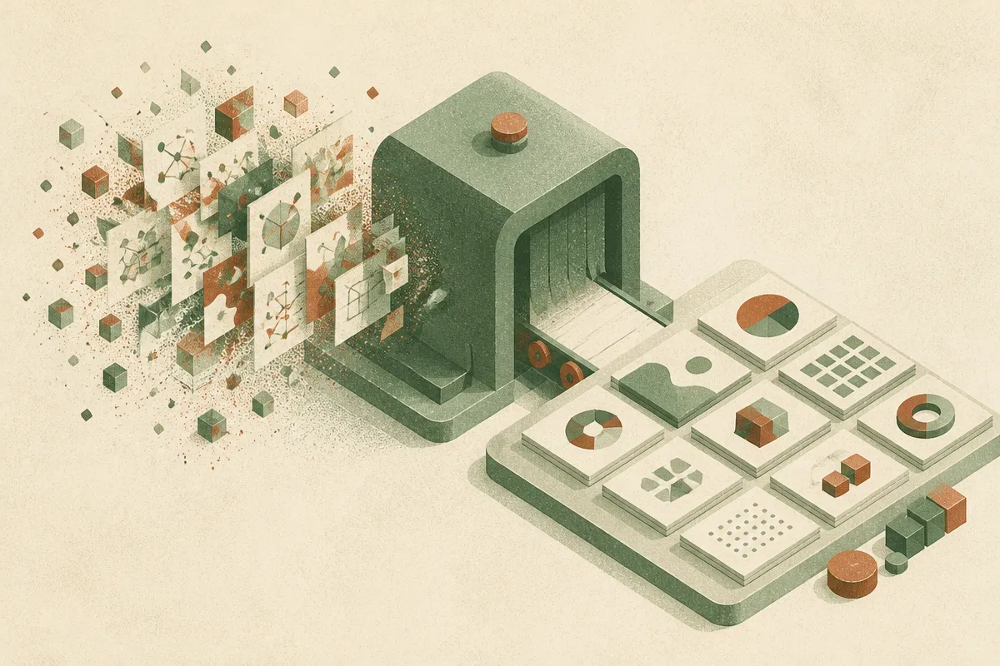

TL;DR: AI can draft diagrams quickly, but the workflow only works when those diagrams become portable, themeable assets that fit the rest of your docs.

## What is Pele actually pointing at?

The primary source for this note is the Hacker News AI listing titled “Pele – Mermaid diagrams as themeable SVG.” That is a narrow claim, and I am going to treat it narrowly. I do not have first-party docs here on install method, license, pricing, browser support, or output details beyond the title.

Still, the angle matters.

Mermaid already sits in a useful place for AI workflows because it is text. You can ask a model to turn a product flow, database relationship, incident timeline, or onboarding process into Mermaid syntax. That is much easier to review than a screenshot or a hand-drawn box-and-arrow diagram.

But Mermaid text is not the finish line. The finish line is the thing you can publish, version, theme, and reuse without rebuilding your whole docs stack around it. That is where “themeable SVG” gets interesting. SVG is portable. Themeability means the diagram does not have to look like a one-off artifact from whatever tool rendered it first.

Small feature. Big workflow difference.

## Why do AI-generated diagrams break in real teams?

The failure mode is not usually that the model cannot draw boxes.

The failure mode is that every diagram becomes its own little island. One style in the README. Another style in the customer-facing docs. A third style in a slide deck. Then dark mode breaks. Then someone exports a PNG. Then the Mermaid source gets lost, so nobody updates the diagram when the system changes.

AI makes this worse because it makes diagram creation cheap. Cheap generation means more artifacts. More artifacts mean more cleanup, unless the output path is disciplined.

This is why I like boring publishing primitives. Text in, structured graphic out. Content separated from presentation. Source kept next to the document or code. Rendered artifact produced the same way each time.

That is not glamorous agent theater. It is how teams keep docs from rotting.

## Where would this fit in a builder workflow?

The practical use case is simple: let the model draft the diagram, but do not let it own the truth.

Take a support workflow, API sequence, site architecture, or launch checklist. Ask the model to produce Mermaid. Review the relationships yourself. Commit the Mermaid source. Render to SVG with a consistent theme. Publish the SVG in the docs, the site, or the internal handbook.

That gives you a cleaner chain: messy notes become structured diagram source, source becomes styled SVG, SVG becomes a reusable asset. The human review step stays in the middle, where it belongs.

The catch is semantic accuracy. A polished SVG can make a wrong system diagram feel authoritative. That is dangerous in engineering docs, security reviews, onboarding materials, and anything customer-facing. The more professional the diagram looks, the more likely people are to trust it.

Practitioner’s take: try this on one recurring diagram type, not your whole docs library. Pick architecture overviews, onboarding flows, or SOP diagrams. Have AI draft Mermaid, review it like code, render it as a themed SVG, and keep the source next to the page. The missed detail is maintenance: if the diagram cannot be regenerated and reviewed during normal edits, it is just another stale image with better styling.
