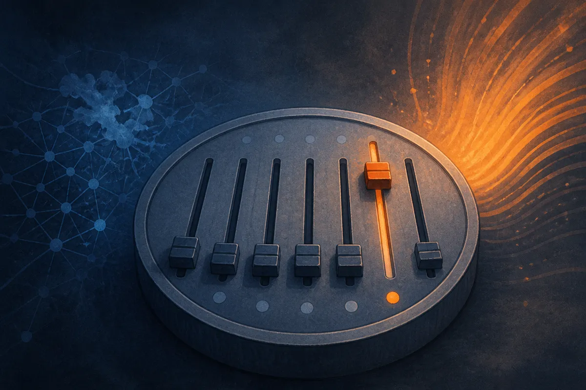

TL;DR: A community contributor shipped a mixed-precision quant of DeepSeek V4.1 Flash 1017 that runs on a 128GB Mac by keeping a 152GB backbone wired and paging a ~200GB engram table off SSD on demand, which is a preview of how the next wave of big open-weights models will actually run on consumer hardware.

Most of the attention in local AI goes to leaderboard numbers and model drops. The more interesting signal this week came from a pull request and a follow-up thread on r/LocalLLaMA, where a user going by /u/returnity posted support and a quant for DeepSeek V4.1 Flash 1017 running on antirez's dwarfstar (ds4) inference engine. Let me name the primary sources plainly: PR #1225 on antirez/ds4, "DeepSeek V4.1 Flash 1017 Support for ds4," and the companion post "DeepSeek v4.1 Flash 1017 for Dwarfstar (ds4)," both by /u/returnity. Everything below is community reporting, not a vendor announcement, and I will flag where the details are self-reported.

## What actually shipped here?

Two things, and they are worth separating.

The first is engineering plumbing. PR #1225 adds compatibility for DeepSeek V4.1 Flash 1017's file revisions, including its updated engram table and a revamped vision tower. The clever part is how small the change is. Per returnity, the architecture is unchanged, so the model "just slots into the existing kernels with no changes to the core code." The PR mostly validates that the vision and language file revisions match and raises an error on mixed pairings. That is the kind of unglamorous work that keeps an inference engine from silently loading mismatched weights and producing garbage.

The second is a quantization recipe. returnity built a Q2-to-Q8 mixed quant following what they describe as antirez's recipe for the previous checkpoint: 2-bit for the routed experts, 8-bit or higher for everything else, and the original FP8 engram table left intact. The imatrix (the importance matrix that guides which weights can tolerate aggressive quantization) was rebuilt from the 1017 checkpoint, not carried over from the original.

## How does a model this big run on a 128GB machine?

This is the part that made me stop scrolling.

The claimed footprint is 152GB wired for the backbone and 366GB total once you count the engram table. On a 128GB system that math should not work. The trick is that the model is split by access pattern. The "wired backbone" of just over 150GB streams from SSD, but with nearly all of the routed experts held in a hot cache, so in practice the expensive-to-fetch parts stay resident. The roughly 200GB engram table is not held in RAM at all. It gets paged in from SSD on demand.

If you have been watching local inference, you know the usual wall is memory. You either fit the model in RAM or VRAM, or you suffer. What returnity is describing is a more surgical version of offloading: identify which tensors get hit on every token (the routed experts), keep those hot, and treat the giant lookup-style engram structure as a cold store you fetch only when needed. The reported result is up to 20 tokens per second of decode on an M5 Max.

I want to be honest about the uncertainty. That 20tps number is self-reported from a single machine, the "initial testing looks good" language is vague, and we have no eval numbers, no latency distribution, and no measure of how badly the Q2 experts degrade quality versus a higher-precision run. Decode speed also says nothing about prompt processing time, which is often where SSD-paged setups hurt. Treat the throughput as a plausible ceiling under good conditions, not a guarantee.

## Why engrams are the interesting word in this post

The recipe keeps the FP8 engram table untouched while quantizing the experts down to 2-bit. That ordering tells you something. returnity is treating the engram table as precision-sensitive, the part you do not want to crush, and the routed experts as the part that tolerates aggressive compression.

I am not going to pretend I have DeepSeek's internal spec for what the engram table does in V4.1 Flash, and neither source defines it, so I will not invent one. What the recipe implies is a large, retrieval-like memory structure that is accessed sparsely enough to live on SSD and page in on demand, yet sensitive enough that you keep it at FP8 rather than quantizing it. That is a different design shape from a dense transformer, and it is exactly the shape that makes SSD streaming viable: a small always-hot core plus a big rarely-hot reservoir.

The revision size is also notable. returnity reports roughly 40% of the routed expert tensors changed, 30% of the engrams, and about 50% of the vision tower's expert tensors altered between the original V4.1 and the 1017 checkpoint, all on the same architecture. That is a big delta for what is nominally a point update. If accurate, it means "same architecture" is doing a lot of hiding. The weights moved a lot, which is why a fresh imatrix and a fresh quant were needed rather than reusing the old ones.

## What a builder should take from this

Here is the practical read.

The headline for builders is not "DeepSeek V4.1 Flash is the best open model," which neither source establishes with any benchmark. returnity calls it "the new leading open-weights model" based on appearances, and I would hold that claim loosely until independent evals land. The headline is the serving pattern. Access-pattern-aware offloading, where you partition a model into hot-resident and cold-paged regions instead of all-or-nothing RAM loading, is how frontier-scale open weights start running on machines normal people own. That matters more than any single model name.

If you want to actually try this: you will need antirez's ds4 with PR #1225 merged or applied, the matching 1017 vision and language quant files from returnity, a fast NVMe SSD, and realistically a high-memory Apple Silicon box in the M-series Max tier. Run your own quality check before trusting output, because 2-bit routed experts can quietly degrade reasoning on hard prompts, and nothing in these two posts measures that. Benchmark prompt processing separately from decode, since that is where SSD paging tends to bite. And watch whether antirez or others publish an official recipe, because right now the quantization approach is a community reconstruction of a previous one, not a sanctioned spec. The catch most people miss: 20tps decode on a short reply feels great in a demo and can fall apart on a 30k-token context where the cold paths get hit constantly.
