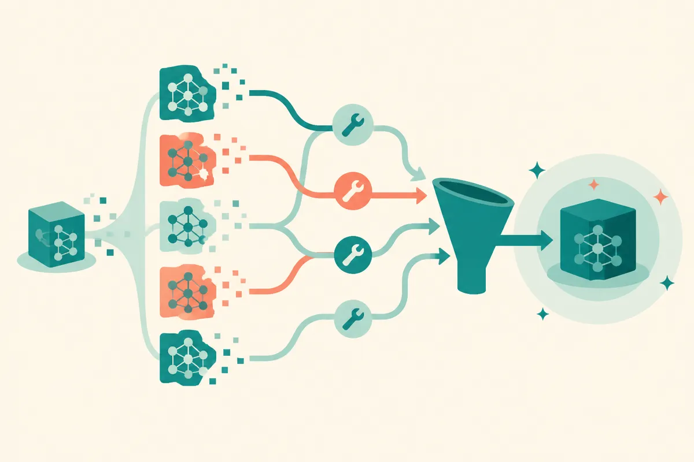

TL;DR: ReDiST is a useful reminder that reasoning traces are training materials, not magic artifacts, and they should be selected for the model that has to learn from them.

## What does ReDiST change about reasoning distillation?

The primary source here is the arXiv paper “Beyond the Answer: Student-Conditioned Trace Construction for Reasoning Distillation.” Its core claim is simple and easy to miss: a trace can be correct, evidence-rich, and still be a bad teacher for a particular student model.

That matters because a lot of reasoning distillation work treats chain-of-thought style traces as if they are portable. Big model produces a trace. Smaller model imitates it. Done.

ReDiST pushes against that. It starts from the student model’s own attempts, then builds better supervision around what that student already can or cannot do. If the student’s draft gets the answer right, ReDiST revises the draft against the supplied evidence. If the student fails, ReDiST repairs the attempt with extra guidance from the verified answer.

Then comes the important filter. A frozen student-matched reader screens and ranks the original and edited candidate traces. It checks whether the trace helps recover the answer and raises the probability of the verified answer, given the question, evidence, and candidate trace. The selected traces are then used for distillation, with training balanced between trace supervision and final-answer supervision through an auxiliary answer loss.

Construction and selection happen offline. At inference time, only the distilled student runs. That is the practical part. ReDiST is not asking builders to bolt on a second reasoning system at runtime. It is trying to make the training data more teachable before the model ships.

## Why are correct traces not enough?

Because correctness is not the same as pedagogy.

A long trace from a stronger model might contain valid intermediate steps, but still skip the exact bridge a smaller model needs. It might use evidence in a way the student cannot reproduce. It might include irrelevant reasoning that looks plausible but does not improve answer recovery. It might also overfit the source task while failing to teach something transferable.

That last point is one of the more useful parts of the paper. “Beyond the Answer: Student-Conditioned Trace Construction for Reasoning Distillation” reports that supervision recipes can rank differently on source-task benchmarks versus transfer benchmarks. In plain English: the trace format that wins on the dataset you trained around may not be the one that generalizes best elsewhere.

This is where I think the paper earns attention beyond academic QA tasks. Builders love distillation because it promises cheaper, smaller, faster systems. But bad distillation can compress the wrong behavior very efficiently. If the target model learns to mimic the surface form of reasoning without learning the evidence path, you get a model that sounds more deliberate without becoming more dependable.

ReDiST’s framing is healthier: do not ask, “Is this trace correct?” Ask, “Does this trace help this model recover the right answer from this evidence?”

## What should builders take from it?

The direct application is for teams training smaller reasoning models on evidence-grounded tasks: support QA, policy lookup, clinical-style retrieval workflows, compliance review, technical documentation, and other places where the answer should be grounded in supplied context.

The lesson is not that everyone should implement ReDiST exactly. The paper does not give us a universal recipe with public leaderboard numbers in the abstract. The lesson is to treat traces as curriculum. Start with the student’s failure modes. Generate multiple candidate explanations or traces. Score them against the student, not just against a judge model that likes polished reasoning. Then evaluate on transfer sets, not only the dataset that produced the training examples.

This also changes how I would inspect synthetic reasoning data. I would sample traces that were selected and rejected, then ask: did the chosen trace add missing evidence, shorten a confusing path, or repair the specific mistake the model made? If the answer is no, the pipeline may be optimizing for pretty explanations rather than teachable ones.

If you are building with distilled reasoning, try a small experiment before rebuilding your whole training stack: collect the student’s first attempts, create two or three repaired trace variants per example, rank them by whether the same student architecture can recover the verified answer, then fine-tune on the winners. The catch most readers miss is that the best teacher trace is not necessarily the smartest-sounding trace. It is the one your actual model can learn from and reuse off-distribution.
