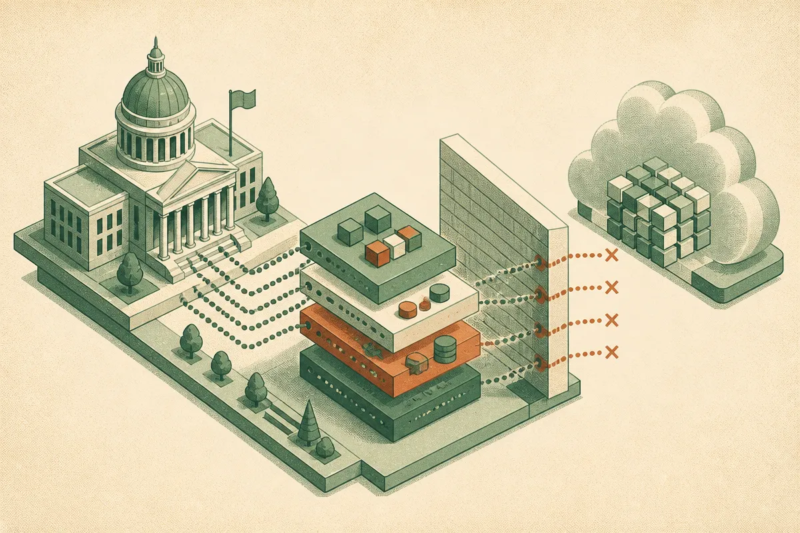

TL;DR: If Decrypt’s reporting is accurate, DHS is treating DeepSeek not as a chatbot risk but as an AI supply-chain risk, which means agencies and vendors need to know every place a model, wrapper, API, or hosted service touches sensitive data.

## What did DHS reportedly order?

Decrypt reported in “US Orders Civilian Agencies to Rip DeepSeek Out of Government Systems” that the Department of Homeland Security told civilian agencies to remove China’s DeepSeek and any service built on it from government systems, and to stop buying more. The stated concern, per Decrypt, is that sensitive data could reach Beijing.

That last phrase is doing a lot of work.

This is not just “don’t use a consumer chatbot at work.” If the order is as broad as reported, it reaches into products that embed DeepSeek behind the scenes. That could mean a coding assistant, a document tool, an internal search product, a customer support system, or a vendor workflow that routes prompts through a DeepSeek model without making that obvious to the user.

That is the hard part. The visible app is rarely the whole AI stack now. One product can call another product, which calls a model gateway, which chooses from several models based on cost, latency, or availability. The buyer may see “AI assistant.” The system may see a routing table.

## Is this about DeepSeek, China, or AI supply chains?

All three, but the most useful read is supply chains.

DeepSeek is politically sensitive because it is Chinese, and government data policy is shaped by jurisdiction, legal access, data residency, telemetry, and incident response. Those are not vibes. They are operational questions. Who receives prompts? Are completions logged? Are uploaded files retained? Can vendor staff review chats? Where are backups stored? Which subcontractors touch the data? Can the provider be compelled by a foreign government?

The wrinkle is open models. A DeepSeek-weight model running locally on an agency-controlled machine is not the same risk as sending prompts to a hosted API. But a ban on “DeepSeek and any service built on it,” as Decrypt describes it, may collapse those distinctions for procurement purposes. That is common in government policy. Clear rules are easier to enforce than nuanced rules, even when nuance would better match the technical risk.

I do not read this as a referendum on all open-weight AI. It is closer to a warning about invisible inference paths. Agencies are being told, reportedly, that model provenance matters. Not just the app vendor. Not just the cloud provider. The model itself.

That is uncomfortable for builders because many AI products have been assembled quickly, with model switching treated as an implementation detail. In normal SaaS, changing an internal service is routine. In regulated AI, changing the model can change the risk profile.

## What should builders change now?

Start with an AI bill of materials. Not a glossy trust page. A real inventory.

For every product or workflow, write down the user-facing app, the vendor, the model provider, the specific model family, the hosting path, what data is sent, whether files are stored, whether prompts are logged, and whether subcontractors can access anything. Then add a simple rule: no model substitution without review when sensitive data is involved.

This matters outside government too. Banks, healthcare companies, schools, law firms, and enterprise buyers are going to ask the same questions because they have the same problem. They may not ban DeepSeek specifically. They will still want to know whether their confidential data is being routed to a provider they did not approve.

There is a product lesson here as well. AI vendors should expose model provenance clearly. If the product uses multiple models, say so. If enterprise admins can restrict models by provider, region, or deployment type, make that easy to verify. If the product never sends customer data to third-party model APIs, document the architecture plainly. Trust is going to move from “we use AI safely” to “here is the path your data takes.”

Practitioner’s take: audit your AI stack this week as if a customer or agency asked you to remove one model family by tomorrow morning. If you cannot answer where that model appears, including through vendors, plugins, gateways, and agent tools, you do not have an AI policy yet. You have a hope.
