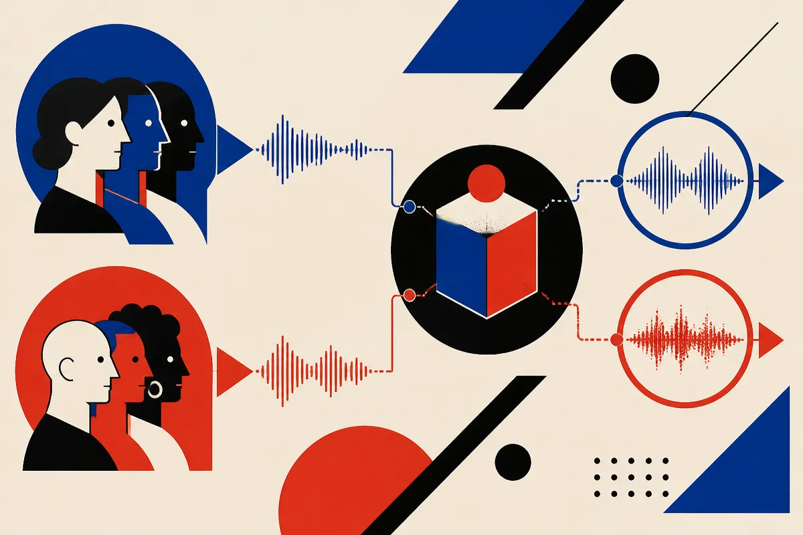

TL;DR: AfriBED matters because it turns speech recognition bias in Bemba and Nyanja from a vague fairness concern into something teams can actually test.

## What does AfriBED measure?

The primary source here is the arXiv paper titled “AfriBED: a Speech Recognition Bias Evaluation Dataset for Low Resource African Languages,” listed under cs.AI and cs.CL. The paper introduces the African speech Bias Evaluation Dataset, or AfriBED, for evaluating automatic speech recognition bias in two low resource African languages: Bemba and Nyanja.

The key word is “comparable.”

A lot of ASR bias talk gets stuck at the obvious level: systems perform worse for some speakers than others. True, but not enough. If the test audio differs wildly by topic, recording quality, speaker experience, or sentence structure, it is hard to know whether the model is biased against a subgroup or simply struggling with mismatched input.

AfriBED is aimed at that measurement problem. It is built to compare speech across subgroups of speaker attributes, specifically gender and speaker type. The Bemba portion contains 9 hours of speech, 3,928 utterances, and 80 speakers. The Nyanja portion contains 6,260 utterances, about 18 hours of speech, and 127 speakers.

That is not massive. It is not trying to be a general-purpose training corpus. It is an evaluation dataset. Different job.

## Why should builders care about low resource ASR bias?

Because “works in English” is not a product strategy.

Speech interfaces are quietly becoming plumbing. Dictation, customer support, voice agents, call summarization, classroom tools, medical intake, government services. If recognition quality varies by speaker attribute, the product does not merely feel worse. It can exclude people from basic functionality.

For low resource languages, this gets sharper. Teams often do not have large public benchmarks, broad accent coverage, or enough labeled data to diagnose failure cleanly. That creates a bad loop: the language is considered “hard,” systems underperform, fewer products ship, less data gets collected, and the next model inherits the same blind spot.

AfriBED is useful because it separates one slice of that loop. It does not solve Bemba or Nyanja ASR. It gives researchers and builders a way to ask a narrower question: when comparable speech is evaluated across gender and speaker type, do recognition errors move unevenly?

That is the kind of question product teams can act on. Not with a press release. With a regression test.

## What is the catch?

The catch is scope.

AfriBED covers two languages. It evaluates gender and speaker-type bias. The paper reports that baseline experiments show the datasets are useful for examining those biases in the target languages. That is meaningful, but it should not be stretched into a claim about all African languages, all accents, or all real-world voice conditions.

Also, evaluation data is not the same as deployment proof. A model can look fairer on a structured test set and still fail in noisy rooms, on cheap phones, over compressed calls, or with code-switching. If your product runs in those conditions, you still need field evaluation.

But I like the direction. Bias work gets more useful when it becomes boring operational practice. Build test sets. Run models against them. Track subgroup error rates over time. Watch what changes when you swap models, prompts, audio preprocessing, or vendors.

For a builder, the move is simple: if you are shipping speech recognition into a language or population that is not well covered by mainstream benchmarks, create your own small AfriBED-style eval before you scale. Keep the speech comparable across groups, log errors by speaker attribute where consent and privacy rules allow it, and treat regressions as product bugs. The catch most teams miss is that average word error rate can improve while the experience gets worse for a subgroup you never bothered to measure.
