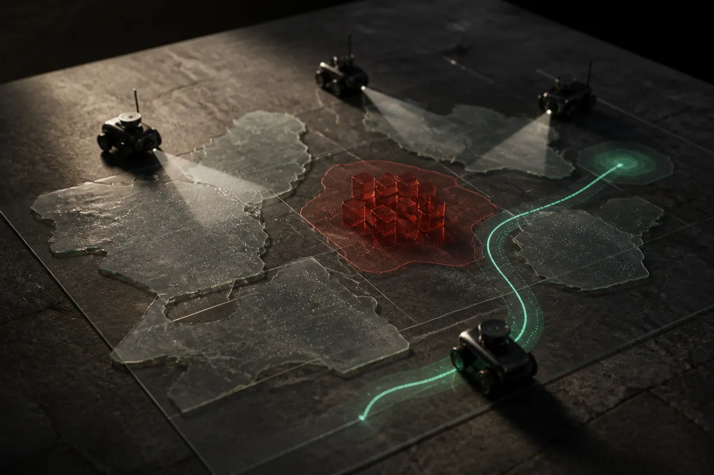

TL;DR: CoopUQ’s useful move is simple: multi-robot navigation gets safer when robots share future occupancy forecasts and treat uncertainty itself as a cost.

## What problem is CoopUQ actually solving?

The primary source is the arXiv paper “CoopUQ: Robust Multi-Robot Social Navigation via Uncertainty-Aware Cooperative Forecasting,” listed under cs.AI and cs.LG, with code and videos at https://coopuq.github.io/.

The problem is not “can a robot get from A to B?” We have plenty of demos for that.

The harder problem is a team of robots moving through shared human spaces where visibility is partial, pedestrians behave differently than training data, and one robot’s blind spot might be another robot’s clear view. Think corridors, lobbies, hospitals, campuses, warehouses with people cutting across paths. Single-robot navigation policies can look good until the environment gets crowded, occluded, or weird.

CoopUQ targets that gap. The paper says directly extending single-robot approaches to multi-robot settings often fails on safety and efficiency, especially under occlusion and out-of-distribution scenarios. That matters because most real spaces are a rolling distribution shift. People rush. Groups form. Corners hide motion. A robot that only trusts its own sensors can miss the thing another robot already saw.

The core claim is that cooperation should happen before the motion decision, not after. CoopUQ predicts future occupancy grid maps using cross-robot spatiotemporal feature fusion. Then it feeds those forecasts, plus their uncertainty, into constrained multi-agent reinforcement learning.

That sounds academic. The operator version is cleaner: build a shared guess about where people and obstacles will be soon, mark which parts of that guess are shaky, then make “driving through shaky space” expensive.

## Why does uncertainty belong inside the policy?

A lot of AI systems expose uncertainty as a warning light. Nice to have, often ignored.

CoopUQ pushes it into the cost function. The policy is penalized for navigating through regions predicted to be occupied or highly uncertain. That is the right instinct for embodied AI. If a language model is unsure, it can ask a follow-up. If a robot is unsure, it may already be in someone’s way.

This is also where the paper is more interesting than a generic “multi-agent RL for navigation” pitch. The uncertainty is not just an evaluation metric. It changes behavior. Under distribution shift, the policy can become more risk-sensitive because uncertainty has a direct price.

The reported tests cover multiple Unity3D-based simulation environments, both in-distribution and out-of-distribution, with varied layouts, pedestrian densities, and rushing behavior. CoopUQ reportedly improved prediction performance and safety over representative baselines. The paper also reports real-robot experiments across various scenes.

Good. But I would not read this as “solved social navigation.” Simulation coverage is not the same as months of ugly deployment. The abstract does not tell us enough about communications latency, dropped messages, map alignment errors, sensor calibration drift, or what happens when one robot’s forecast is confidently wrong. Those are the boring details that decide whether a fleet works.

## What should builders take from this?

The useful pattern is broader than robotics: do not separate forecasting, uncertainty, and action too cleanly.

In many AI workflows, prediction is one box, confidence is another, and decision-making is a third. CoopUQ is a reminder that the agent’s policy should feel uncertainty as friction. If the model is less sure, the system should not merely log that. It should choose a different path, ask for more evidence, slow down, escalate, or avoid the region entirely.

For robot teams, that means cooperation is not just coordination. It is shared perception plus shared doubt. One robot may not need to know everything another robot knows. It needs the parts that change future risk.

My practitioner’s take: if I were building a fleet system, I would start by copying the principle, not the full stack. Add a future-state forecast. Add uncertainty to that forecast. Make the planner pay for both predicted conflict and unclear space. Then test the nasty cases first: occlusions, rushed humans, bad localization, stale messages, and scenes unlike training. The catch most readers miss is that cooperation can also spread bad assumptions faster. Shared uncertainty helps only if the system knows when the shared picture is weak.
