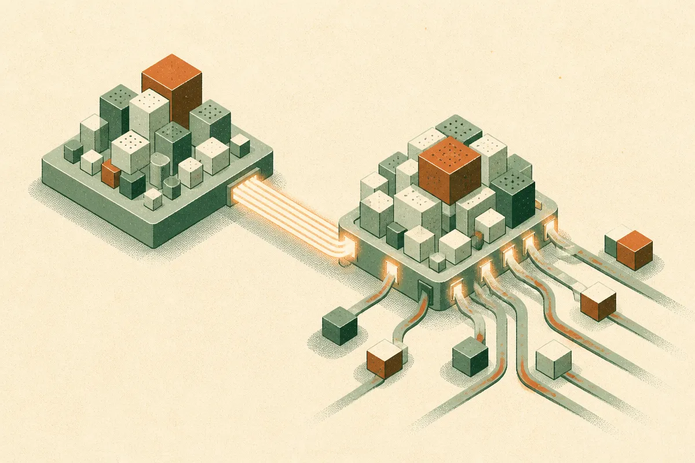

TL;DR: LatComm’s useful idea is not “compress prompts,” it is “encode shared context once, then let different LLMs query that compressed packet without rereading the full text every time.”

## What problem is LatComm actually solving?

The primary source is the arXiv cs.AI and cs.CL paper titled “LatComm: Reusable Context Compression for Latent Communication between Large Language Models.” The target is a real systems problem: multi-model AI pipelines often reuse the same context across many questions, but each model still has to process the full text again.

Think of a long article, policy binder, codebase snapshot, customer file, or research corpus. If an agent asks ten questions against that same material, the normal pattern is wasteful. You pass the same tokens again and again. Long-context windows help, but they do not remove the cost of repeatedly reading.

LatComm separates two jobs that are usually fused together. First, a frozen context encoder LLM compresses the context without seeing the question. That produces a fixed-size packet. Then a different frozen receiver LLM reads from that packet using cross-attention, with gates computed from its prompt. In plain English: one model makes a reusable latent package, another model selectively opens the parts it needs for a specific question.

That matters because most prompt compression methods are either question-specific, model-specific, or lossy in ways that make reuse awkward. LatComm is trying to hit three constraints at once: compact, reusable across questions, and readable by a different LLM.

## Is this better than just using longer context?

Not always. Long context is simpler. If your task is a one-off answer over one document, you probably do not need a latent communication layer. You just need the model to read the text, answer, and move on.

LatComm is more interesting when the same context gets reused many times. The paper reports results on 12 multiple-choice question-answering datasets, with average accuracy improving over single-vector baselines by up to 10.2 points. On QuALITY, LatComm reduced the receiver’s input by 57x and answered questions about an article 3x faster.

Those numbers are useful, but they are not a free lunch. The comparison is against single-vector baselines, not against every production RAG stack or every long-context commercial model. The tasks are multiple-choice QA, which is a clean evaluation setting but not the same as messy enterprise workflows with conflicting documents, tool calls, and partial updates.

Still, the shape is right. A lot of current AI infrastructure treats context as disposable text. LatComm treats context more like a reusable artifact. That is closer to how production systems want to behave.

## Where would this show up first?

The obvious fit is agent systems that do repeated reads over stable context. A legal agent working through the same contract package. A support agent using the same product manual across many tickets. A research assistant answering many questions about the same paper set. A coding agent keeping a compact view of a repository while different models handle planning, editing, and review.

There is also an interoperability angle. The paper’s setup has a frozen encoder LLM sending a compressed packet to a different frozen receiver LLM. If that holds up beyond benchmark settings, it hints at model-to-model communication that is not just text pasted between agents. That could reduce latency and token bills in systems where models specialize.

The caveat: latent packets are harder to inspect than text. Builders like text because they can log it, diff it, search it, and debug it. A compressed hidden representation may be faster, but it can also become a black box inside the black box. That is a real operational tradeoff, especially for regulated or high-stakes workflows where you need to explain what context the model used.

For builders, I would not rebuild a stack around LatComm today. I would steal the design pattern. If your app asks many questions over the same stable context, measure how much money and latency you burn rereading it. Try caching summaries, retrieval results, document embeddings, and structured intermediate state before reaching for latent interfaces. The catch most teams miss is reuse: the win is not compression by itself, it is avoiding repeated context ingestion when the context has not changed.
