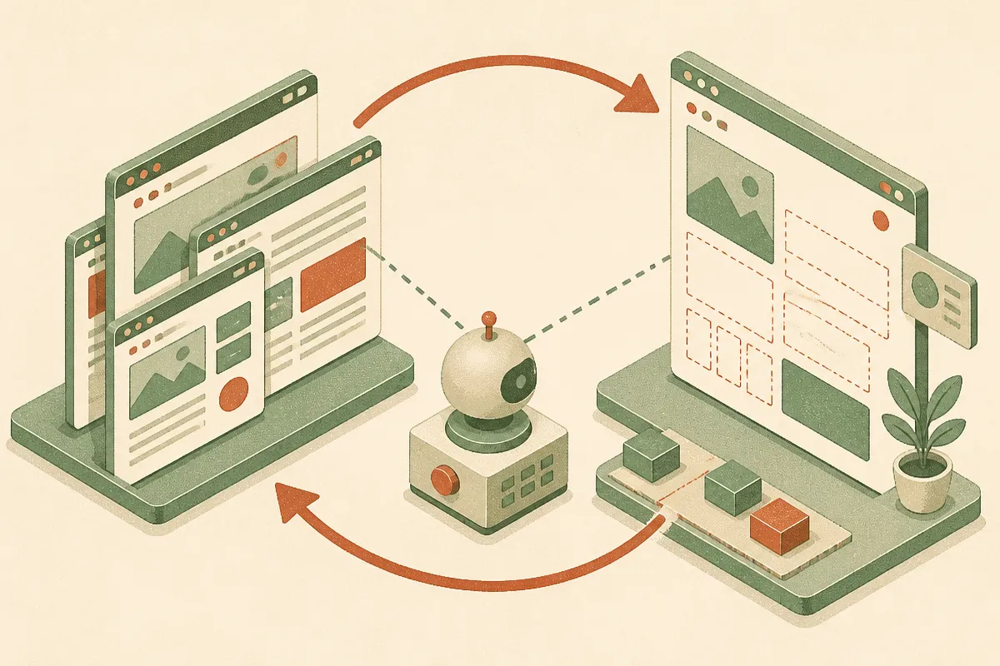

TL;DR: RefCraft is a useful reality check because today’s best multimodal coding agents still struggle to turn visual references into finished webpages without human review.

## What does RefCraft actually test?

The primary source is the arXiv cs.AI and cs.CL paper titled “RefCraft: Benchmarking Visual-Reference-Conditioned Agentic Generation through Web Development.” Its point is narrow, practical, and overdue: most web-building benchmarks do not match how people actually build pages.

In real work, a client rarely says, “Make a page from only this text prompt.” They send references. A screenshot from one site. A pricing section from another. A navigation pattern they like. Maybe a competitor page with the wrong brand but the right layout.

RefCraft turns that into an eval. It includes 300 webpage-development tasks. Each task combines natural-language instructions with screenshots from one to five reference webpages. The agent has to decide what matters, build the page, render it, inspect it visually, then refine it.

That last part matters. This is not just code generation. It is visual-reference-conditioned agentic generation. The agent needs to read images, infer structure, write front-end code, compare output to intent, and iterate. That is much closer to real production work than “clone this screenshot” or “make a landing page for a bakery.”

I run Lucky Domains, where website builds are part of the work, and this gap between “impressive first draft” and “usable page that matches the reference” is exactly where human review still earns its keep: 

## Why is 52.12 out of 100 a big deal?

Across nine frontier (M)LLMs, RefCraft reports that the strongest system scored 52.12 out of 100. That number should cool down a lot of agent hype.

Not because the tools are bad. The opposite. A few years ago this workflow would have sounded absurd: hand an AI several screenshots and instructions, let it write code, render the page, inspect the result, and revise. That is real progress.

But 52.12 says the hard part is not “can the model write HTML and CSS?” The hard part is selective interpretation. Which visual elements should transfer? Which ones should be ignored? Does “use this section as inspiration” mean copy the spacing, the hierarchy, the cards, the tone, or only the idea? Current agents still blur those lines.

RefCraft’s evaluation design is useful here because it does not rely on vibes alone. The benchmark uses independently verifiable keypoints plus programmatic and VLM judges. That mix is not perfect. VLM judges can miss subtle design failures or over-credit plausible-looking output. Programmatic checks can miss taste and intent. But together they give a more honest signal than a demo video where the agent gets one cherry-picked page right.

## What should builders do with this?

The practical lesson is to treat multimodal web agents as fast junior collaborators, not autonomous designers. They are good for producing structure, variants, boilerplate, and first-pass implementation. They are much weaker at understanding which parts of a reference are essential and which parts are decoration.

For builders, the workflow should change before the tooling changes. Give the agent fewer references, not more, when precision matters. Annotate the reference in words. Say what to copy, what not to copy, and what can be interpreted loosely. Ask for an intermediate plan before code. Force visual review after render. Keep the human in the loop for spacing, hierarchy, brand fit, responsiveness, and conversion logic.

Practitioner’s take: I would use RefCraft-style thinking as a checklist for any AI website workflow. Take one real page task, give your agent two reference screenshots and a written brief, then score the result against concrete keypoints before touching aesthetics. The catch most readers miss is that “looks close” is not the same as “used the reference correctly.” That distinction is where production quality lives.
