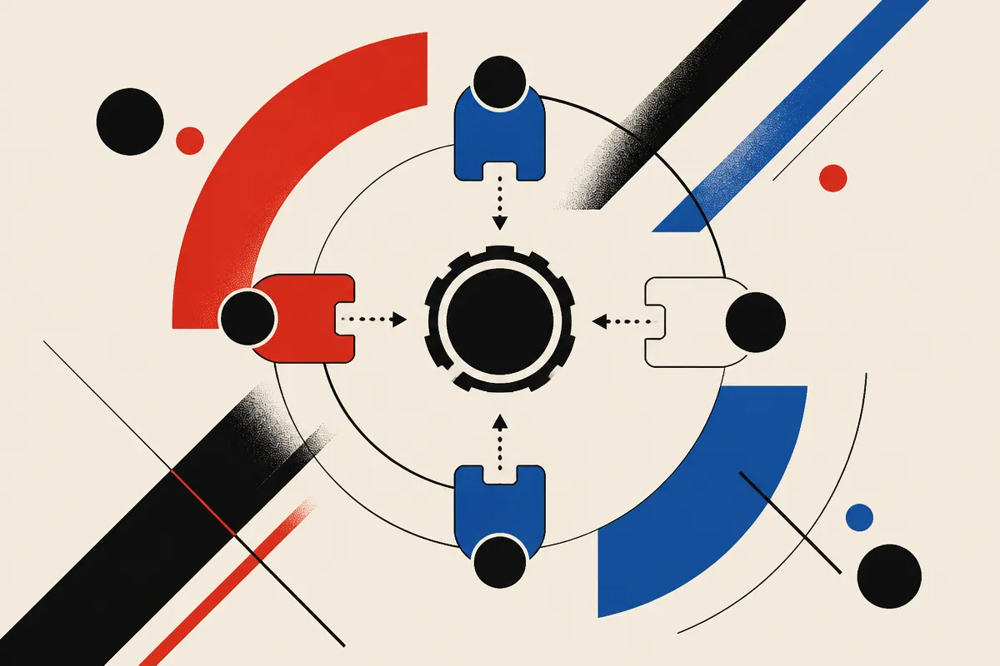

TL;DR: WeAct trains separate LoRA adapters for separate skills, freezes the base model, and lets the agent choose which adapter to load mid-run as if it were calling a tool, which dodges catastrophic forgetting and beats static adapter merging by 27.5% on deep-research benchmarks.

The paper is "WeAct: Dynamic Weight Switching as Agent Actions," posted across arXiv's cs.AI, cs.CL, and cs.LG sections. The core idea is small and worth sitting with: an agent's own weights can become part of its action space. Not just which tool to call or which search to run, but which version of itself to be at a given step.

## What problem is WeAct actually solving?

Long-horizon agents learn a grab bag of skills from messy, interleaved trajectories. A deep-research run might need web search, then careful reading, then numeric computation, then report writing. Each of those is a different capability, and they often pull the model in different directions.

The standard way to teach all of them is joint training: throw everything into one fine-tune and update shared parameters. The authors point at the familiar failure mode here, catastrophic forgetting. Teach the model to be a better writer and you can quietly make it worse at computation. Update shared weights for a new skill and the old ones degrade.

The other standard approach is static adapter merging. Train a few LoRA adapters, merge them into one fixed configuration, and run with that. The problem the paper names is that this configuration stays frozen for the whole trajectory. But a trajectory is not uniform. The step where you're searching the web wants different weights than the step where you're running a calculation. A single merged blend is a compromise that fits no stage well.

## How does weight switching as an action work?

WeAct stands for Weight-level Internal Actions. The setup has three moving parts.

First, a frozen backbone. In the experiments that's Qwen3-32B, and its weights do not change. Second, independent capability-specific LoRA adapters trained on top of it, one per skill the agent needs. Third, and this is the trick, adapter selection is added to the agent's action space. The model picks which adapter to activate using its native tool-calling interface, the same mechanism it already uses to call a search API or a code interpreter.

So mid-trajectory, the agent can effectively say "load the computation adapter now," run that step, then switch to "load the writing adapter" for the next. All of this happens in a shared context, meaning the conversation and reasoning state carry through the switches. You're not spinning up separate models with separate memories. You're reconfiguring one model's weights on demand while keeping its train of thought.

That framing is the clever part. Tool calling is already a solved interface in modern models. By expressing "change your own weights" as a tool call, WeAct gets dynamic capability composition without inventing a new control mechanism the model has to learn from scratch.

## Do the numbers hold up?

Across eight deep-research benchmarks, the authors report that Qwen3-32B with WeAct improves average accuracy by 6.2% relative to full fine-tuning, while using less compute. Against the strongest static LoRA-merging baseline, the gain is 27.5%.

Two things stand out. The win over full fine-tuning is real but modest, and the honest headline there is compute efficiency: similar-to-better accuracy for less training cost, because you're not updating the whole model. The much larger number, 27.5% over static merging, is the one the paper is really built around, and it tracks with the thesis. If a merged adapter is a bad compromise across stages, then letting the agent pick the right adapter per stage should help a lot. It does.

A few caveats I'd hold onto. This is a single backbone (Qwen3-32B) on one task family (deep research). "Eight benchmarks" sounds broad but they're all in the same genre, so I would not assume the gains transfer cleanly to coding agents, customer support bots, or anything with a different capability mix. The sources I have are the abstract across three arXiv categories, so I can't see the per-benchmark breakdown, the adapter-switching overhead at inference, or how often the agent picks the wrong adapter. All of that matters for whether this is production-ready or a promising lab result. Treat the numbers as reported, not as settled across the field.

## Why modular continual adaptation is the sleeper feature

The benchmark numbers will get the attention. The part I think ages better is what WeAct does to the update cycle.

Because each capability lives in its own adapter over a frozen backbone, you can change one skill without touching the others. The authors demonstrate exactly this: they add a brand-new code computation adapter to give the agent a capability it didn't have, and separately update the existing writing adapter to improve report quality. Both changes leave the backbone and every other adapter untouched.

That's a real operational difference. In a jointly fine-tuned model, improving the writer means a full retrain and a full regression test, because you can't be sure what else moved. Here, improving the writer is a localized change. You retrain one small adapter, validate that one skill, and ship. The blast radius is contained by construction.

This is the same logic that makes microservices more maintainable than a monolith, applied to model weights. Whether the analogy survives contact with messier real systems is the open question, but the direction is sensible.

## Practitioner's take

If you're running a long-horizon agent today and you're fighting the classic problem where fixing one skill breaks another, WeAct points at a cleaner architecture: frozen base, one LoRA per skill, adapter choice exposed as a tool call. You don't need the paper's exact code to borrow the shape of it. Train narrow adapters, keep them separate, and let your orchestration layer load the right one per step instead of merging everything into a single compromised blend.

The catch most readers will miss: the gains are reported on deep-research tasks with one model, and the hard part the abstract skips is the switching policy. An agent that picks the wrong adapter at the wrong step can underperform a boring static merge. So before you rip out your current setup, instrument adapter selection accuracy, not just final-answer accuracy. The architecture is elegant. Whether your agent actually knows which version of itself to be at each step is the thing you have to earn, and it's the thing this abstract can't prove for your use case.
