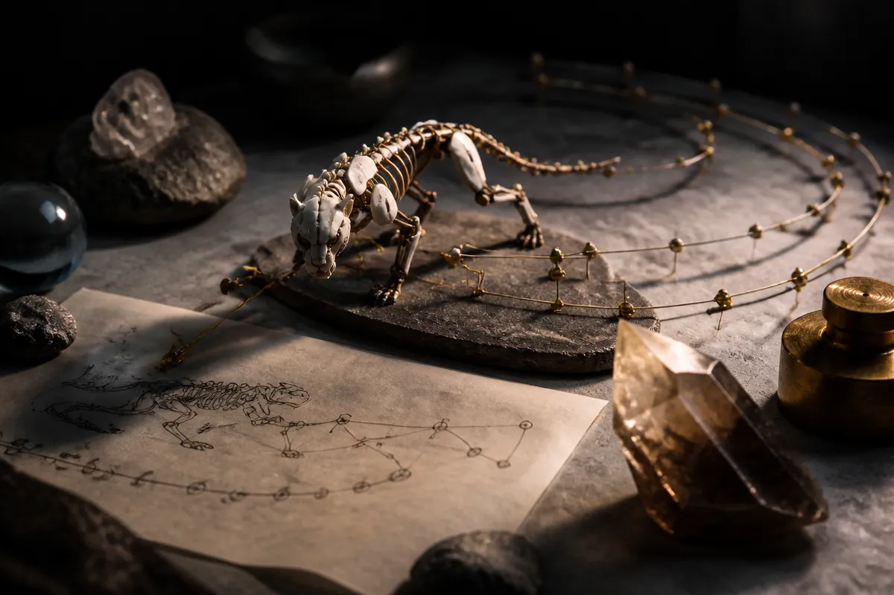

TL;DR: Video generation becomes more useful for builders when it outputs controllable 3D motion and camera placement, not just convincing pixels.

## What problem does Joints, Camera, Action solve?

The primary source here is NVIDIA’s arXiv paper and project page, “Joints, Camera, Action! Co-Generating 3D Motion and Video for Arbitrary Rigs,” from NVIDIA Research: https://research.nvidia.com/labs/par/projects/jca/.

The paper attacks a real gap in generative video. Today’s video models can make a monkey jump over a bar, a robot walk, or a creature turn in place. But the output is usually pixels. Pretty pixels, sometimes amazing pixels, but still pixels. If you want the actual 3D motion on a supplied rig, placed back into a 3D scene with the right camera, that is a different problem.

NVIDIA’s JCA model tries to generate three things together: video, 3D motion for an arbitrary rig, and a camera that registers that motion into the scene. That last part matters. A motion clip without camera and scene alignment is not production-ready. It is an ingredient someone still has to wrestle into the shot.

The useful shift is from “make me a video of this action” to “animate this specific skeleton doing this action in this scene, and show me what it looks like.” That is closer to how game studios, animation teams, simulation builders, and robotics groups think.

## Why keep motion separate from video?

NVIDIA says prior video-motion approaches often either focus on human skeletons, add billions of parameters, or infer 3D motion by triangulating from generated 2D pose maps. JCA takes a different route: keep 3D motion in a separate model that can handle arbitrary skeletons, then connect it to a pretrained video model through a small set of cross-attention layers.

That separation is the technical choice I find most interesting. Motion-only data is easier to collect, edit, augment, and reuse than paired video-and-3D-motion data. If you force the system to learn everything through paired video, you get a data bottleneck fast. NVIDIA reports using a generative video editor to place animated 3D assets into action-appropriate scenes, then curating those edits so the known motion remains valid. Combined with human and robot video, the training set reaches nearly 200,000 pairs.

That is not a web-scale number by language model standards. But for paired motion, rig, video, and camera-style supervision, it is meaningful. The paper’s real bet is that structured motion can carry a lot of the burden, while the video model supplies appearance and scene context.

## What can builders actually do with it?

NVIDIA reports that JCA can animate diverse rigs from text more faithfully than video-first pipelines, and that the generated motion responds to the surrounding scene. The paper also says the system can convert video into rig motion, rig motion into video, and support keyframe-based control of the 3D motion.

Those are the operator hooks. Text gives fast ideation. Keyframes give control. Video-to-rig gives extraction. Rig-to-video gives preview. Put together, this starts to look less like a demo model and more like plumbing for an animation workflow.

Still, this is research, not a shipping character animation product based on the provided material. The project page shows videos and additional results, but the source material here does not establish pricing, access, model weights, integration details, latency, or license terms. So I would not treat this as something you can drop into Blender, Unreal, Maya, or a robotics sim tomorrow unless NVIDIA publishes those pieces.

Practitioner’s take: if you build animation, robotics, simulation, or synthetic data tools, test your workflow around the interface JCA implies: text for intent, keyframes for constraint, rig motion as the durable artifact, and video as preview or supervision. The catch most readers miss is that the valuable output is not the generated clip. It is the reusable motion, registered to a scene, on the rig you actually need.
