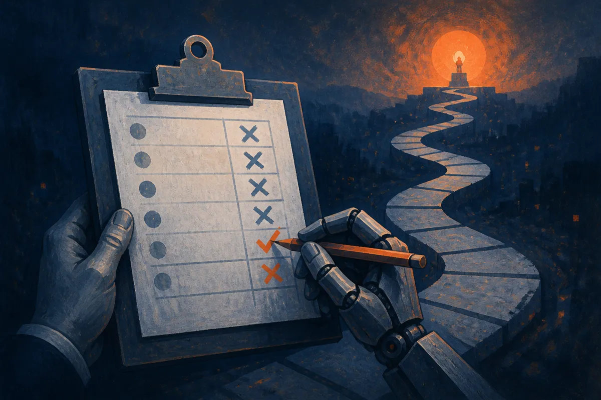

TL;DR: When you distill a capable teacher into a smaller agent by having the teacher score the student's own actions, the teacher often grades the wrong thing, and the fix is to repair the scorer before training, not to keep the student closer to the teacher.

The paper is "Capable Teacher, Myopic Scorer: Reward-Free Teacher Repair for Agentic On-Policy Distillation," posted to arXiv under cs.AI and cs.CL (project page: https://tree-shu-zhao.github.io/r2s/). It takes aim at a quietly load-bearing assumption in how people train agents cheaply, and the result is one of those findings that reframes a problem you thought you understood.

## What is agentic on-policy distillation actually doing?

Start with the setup, because the whole argument lives in the mechanics.

On-policy distillation for agents works like this. You have a small student agent that rolls out its own trajectories in some environment: a multi-turn task, tool calls, the works. As the student acts, a bigger teacher model scores every token the student produces. The student then trains to produce tokens the teacher rates highly. "On-policy" means the student learns from its own behavior rather than from teacher demonstrations, which matters because it sees the states it actually lands in, not the clean ones a teacher would have visited.

This is attractive for a practical reason. It is cheaper than full reinforcement learning, it needs no task reward signal, and it transfers a strong model's judgment into a small one that you can actually afford to run. If you are building agents on a budget, this is the kind of recipe you reach for.

The standard story about why it breaks is compounding error. The student makes a small mistake, which pushes its trajectory into states the teacher rarely sees, where the teacher's scores get unreliable, and the errors snowball. So the field responded with methods that keep training inside the region where the teacher is trustworthy: episode-length curricula, teacher-guided turns, prefix replay, teacher intervention when student and teacher disagree. All of these share one instinct. Keep the student close to home.

## Why does the "compounding error" story fall apart?

Here is the move that makes the paper worth reading. The authors run a test the compounding-error story predicts should fail, and it doesn't fail the way it should.

Take the states where the student diverges most from the teacher, the exact places where the teacher is supposedly off the map. Let the teacher take over from there and finish the task itself. If compounding error were the whole story, the teacher would also flounder in these unfamiliar states. It doesn't. The teacher's takeovers still complete the task. Meanwhile the student trained on the teacher's token scores keeps running out of turns.

So the teacher knows what to do. It just scores in a way that doesn't transmit that knowledge. The authors call this the rollout-scorer gap: the difference between what the teacher *does* when it acts and what it *rewards* when it grades.

The diagnosis is myopia. Next-token scoring rates each token without seeing where the episode ends. A move that is safe and delaying, that stalls without losing, looks fine to a token-level scorer because nothing bad happens right now. Outcome-based RL would punish exactly those moves with zero reward, because they burn turns and never reach the goal. Agentic distillation has no such penalty. So the teacher's scores quietly wave through a whole class of time-wasting behavior that the teacher itself would never commit when actually playing.

That is a sharp reframing. The problem was never that the student wandered somewhere the teacher couldn't follow. The problem is that the teacher is a better player than it is a judge.

## How does R2S repair the scorer?

Their method is Rollout-to-Scorer Distillation, R2S, and the logic follows straight from the diagnosis. Don't constrain the student. Fix the judge.

The procedure, as the paper describes it:

- Mine high-disagreement states from the *untrained* student, the places where student and teacher part ways most.
- Run teacher takeovers from those states, letting the teacher finish the episode.
- Keep only the states where enough takeovers pass a reward-free check. That check can be consensus across takeovers or an LLM judge. No task reward is used.
- Fine-tune the teacher so its scores on every assistant token, from the divergence turn onward, reflect what it learned from those successful takeovers, but crucially without the takeover itself in context.

That last detail is the clever part. You are not giving the teacher the answer and asking it to grade. You are teaching the teacher to score as if it knew how the episode would end, from the same information the student had. The teacher's scoring gets aligned with the teacher's playing.

Then you freeze this repaired teacher and run completely standard on-policy distillation with it as the sole scorer. No change to the student training loop. No task reward during repair or during training. The repair is a one-time patch on the judge.

The results: across three environments, two teachers, and four students, R2S beats three state-of-the-art agentic-OPD methods in all twelve teacher-student-environment combinations, by 12.8 success points on average over the best competing method in each cell. Winning every cell is the number I'd flag. Beating a baseline on average is easy to cherry-pick. Beating the best alternative in all twelve is harder to wave away, though I'd still want to see independent replication across more environments before calling it settled, since twelve cells from three environments is a real but narrow slice.

## What should a builder take from the rollout-scorer gap?

The transferable idea is bigger than one distillation recipe.

Any time you train one model against another model's judgment, you are assuming the judge's grading matches the judge's competence. That assumption is doing a lot of work, and this paper shows it can be flat wrong even when the judge is strong. A model can be good at a task and bad at saying, token by token, what good looks like. Those are different capabilities, and we keep conflating them in RLHF-style setups, LLM-as-judge evals, and reward modeling generally.

So the practical question stops being "is my teacher good enough?" and becomes "does my teacher score the way it would act?" That is a testable thing. Take your judge's high-confidence approvals and check whether trajectories built from them actually reach the goal. If the judge likes paths that stall, you have a rollout-scorer gap of your own, and no amount of keeping the student near the teacher will close it.

The catch most readers will miss: R2S needs the teacher to genuinely be able to recover from the student's bad states. The whole method is bootstrapped from teacher takeovers that succeed. If your teacher is only marginally stronger than your student, or if the task has states no one recovers from, there is nothing to mine and nothing to repair. This works because the teacher is a capable player with a myopic scorer. On a task where the teacher is also a mediocre player, the gap you are chasing may not exist.

If you are training small agents right now, the cheapest thing you can try tomorrow is the diagnostic, not the full method. Pull the states where your student and teacher disagree most, let the teacher drive from there, and see who finishes. If the teacher finishes and the student keeps timing out, you have confirmed the problem this paper names, and you have a concrete target to fix instead of a vague sense that distillation "just doesn't work for agents." It works. The judge was grading the wrong exam.
