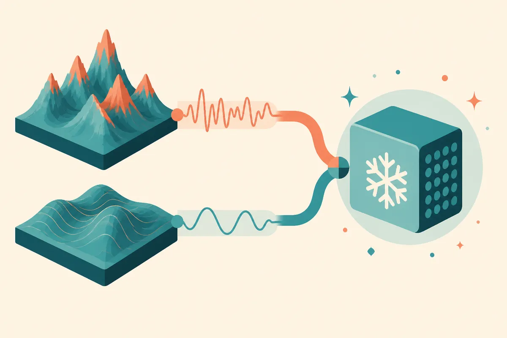

TL;DR: TS2Vec-FM is a useful reminder that foundation models do not have to mean giant attention stacks, especially for time-series classification where small frozen encoders can still do real work.

## What did TS2Vec-FM actually change?

The primary source here is the arXiv paper **“Turning TS2Vec into a Foundation Model for Time Series Classification”**, listed under both cs.AI and cs.LG. The claim is narrow, which I like: take TS2Vec, a strong 2022 self-supervised method that was normally trained fresh for each dataset, and see whether it can become a reusable frozen encoder across many time-series classification tasks.

The answer reported by the paper is yes, with three main changes.

First, pre-train on a synthetic corpus. Second, feed two views of the same signal into the model: a raw amplitude view and an instance-normalized shape view. Each gets a small stem. Third, distill the two specialist encoders back into one encoder.

The result is **TS2Vec-FM**, a **1.6M-parameter dilated convolutional network**. Kept frozen and evaluated with linear probing, it reaches **83.3% on UCR-128** and **75.3% on UEA-27**. The paper reports that this is within **0.3 percentage points of MantisV2**, described there as the current state of the art, and above TS2Vec trained separately on each target dataset.

That is the important bit. Not just the score. The shape of the solution.

## Why does this matter if everyone is chasing transformers?

Most foundation model stories in 2026 have a familiar smell: bigger context, more attention layers, more tokenization tricks, more compute. TS2Vec-FM points in another direction.

It uses an “old-school” convolutional encoder. No attention. No patch tokenizer. No intermediate-layer extraction. It operates directly on temporal samples and accepts variable-length inputs without resampling, which is not a small detail if you have messy real-world time series.

That matters because a lot of useful time-series data does not look like web text. It comes from machines, sensors, clinical devices, logs, energy systems, warehouses, vehicles, payments, and manufacturing lines. The data is often irregular, short, noisy, and specific to the site. The budgets are often not “train a giant model and pray.”

A 1.6M-parameter frozen encoder is the kind of thing you can actually imagine deploying close to the data. It can sit inside a normal pipeline. It can be audited more easily than a sprawling model. It can run where latency, hardware, or privacy make large hosted models a bad fit.

There is also a lesson in the two-view design. Raw amplitude and normalized shape encode different facts. In time series, absolute level can matter, but so can pattern independent of scale. The paper’s architecture bakes that split into training, then compresses it back into one encoder. That feels practical, not ornamental.

## What should builders take from this?

I would not read this as “convolutions beat transformers.” The paper does not prove that. It shows that, for time-series classification, a compact convolutional model can get close to a reported state of the art when trained and distilled carefully.

The synthetic pre-training angle is also worth watching. Synthetic data gets overhyped fast, but time series is one of the places where it can make sense. Many domains have known shapes, perturbations, frequencies, noise patterns, and regime changes. If those can be simulated well enough, they can teach a reusable encoder useful invariances before any customer-specific labels show up.

The catch is coverage. Synthetic corpora can miss the exact failure modes that matter in production. A model can look strong across benchmark datasets and still fail on one factory line, one ICU device, or one weird seasonal business process. Linear probing numbers are useful receipts, not a deployment guarantee.

If I were building with this, I would try TS2Vec-FM-style thinking before reaching for a large general model: freeze a small encoder, test linear probes on your labeled slices, compare against a per-dataset baseline, and inspect failures by signal type. The catch most readers miss is that the architecture is only half the story. The real product work is deciding which time-series variations should be preserved, which should be normalized away, and which never appeared in your pre-training data at all.
