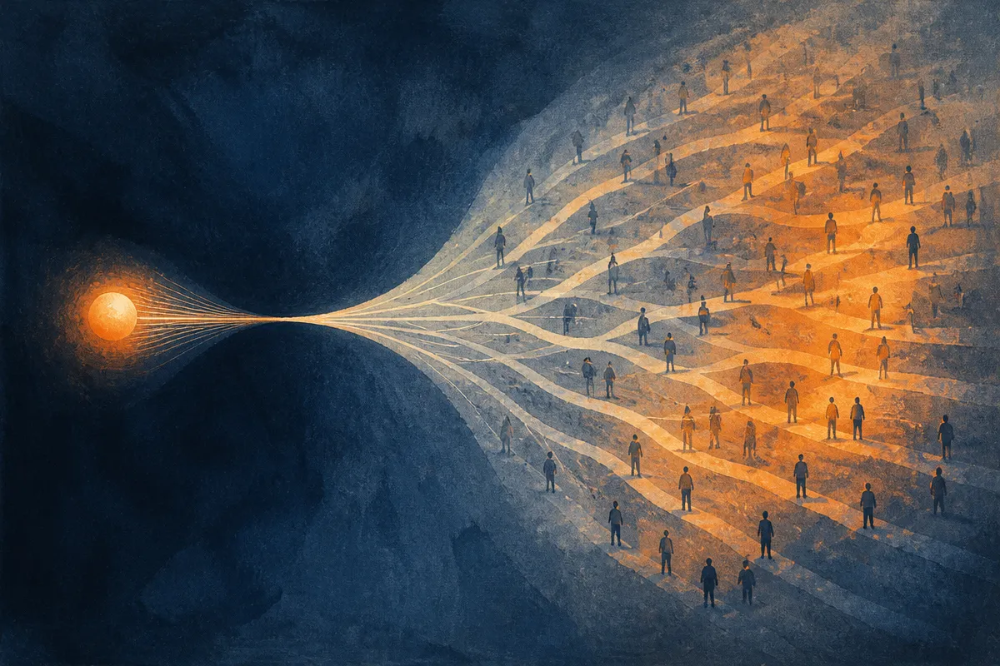

TL;DR: OpenAI's Patch the Planet is a coordination effort for the moment agents start uncovering critical open source vulnerabilities faster than humans can triage and patch them, and the hard part is not the finding, it is the response pipeline.

The primary source here is OpenAI's blog post, "Patch the Planet: global response coordination as agents uncover critical vulnerabilities," with a companion site at patchtheplanet.org that surfaced on Hacker News. I want to be upfront about what we have and do not have. The OpenAI post and the site describe an initiative to connect security researchers, maintainers, and incident responders around critical vulnerabilities in open source. The specifics past that framing are thin in the material I was given. So I am going to treat the framing as the story, because the framing is where the interesting part lives.

## What is Patch the Planet actually trying to solve?

Strip away the name and the pitch is this: automated vulnerability discovery is getting cheap, and the machinery for responding to what it finds is not.

For most of software history, finding a serious bug in a widely used library was hard, slow work. A researcher spent weeks staring at code, fuzzing inputs, chasing a crash down into something exploitable. That scarcity shaped everything downstream. Disclosure norms, embargo periods, maintainer response times, CVE assignment, the whole coordinated disclosure dance assumed a human-paced flow of findings.

Agents break that assumption. When an agent can scan a dependency tree, reason about a code path, and produce a plausible exploit candidate in minutes, the bottleneck moves. It moves from discovery to everything after discovery: verifying the bug is real, figuring out who maintains the affected package, reaching a human who can patch it, coordinating the fix across every downstream project that vendored the code, and doing all of that before the same technique lands in less friendly hands.

OpenAI is describing a coordination layer for that after-discovery world. The named participants tell you the shape of it: security researchers who find or validate, maintainers who own the code, incident responders who manage the blast radius. That is a triage network, not a scanner.

## Why does the coordination problem matter more than the scanning?

Here is the asymmetry that keeps me up at night a little.

Finding scales with compute. Fixing scales with people. You can throw more GPUs at vulnerability discovery and get linearly, maybe superlinearly, more findings. You cannot throw GPUs at a maintainer who runs a critical library in their spare time and has a day job. Open source already runs on a thin layer of volunteer attention. Log4Shell in 2021 was the lesson everyone cited: a bug in a library almost nobody thought about, embedded in half the internet, patched by a handful of unpaid people under enormous pressure.

Now imagine agents surfacing ten Log4Shell-class findings a month instead of one every few years. The discovery side gets democratized. The response side does not. Whoever has the better agents finds the bugs first, and the only question that matters is whether the people who find them are pointed at defense or offense.

That is why a coordination effort, boring as it sounds next to a flashy new model, might be the more consequential move. The scanning capability is coming regardless. Frontier labs, well-resourced attackers, and academic security groups are all building it. What does not come for free is a trusted place to route findings, verify them, and get them to the right maintainer fast, with enough structure that a flood of agent-generated reports does not just drown maintainers in noise.

Because that is the real failure mode. Not too few findings. Too many, most of them unverified, hitting maintainers who already ignore half their issue tracker. An agent that files a hundred confident-sounding but wrong vulnerability reports is worse than useless. It burns the one scarce resource in the system, which is maintainer trust and maintainer time.

## What should a builder take from this right now?

If you ship software that depends on open source, which is all of us, the practical read is about your own response readiness, not about OpenAI's program specifically.

Start with a question most teams cannot answer quickly: if a critical CVE dropped in one of your direct or transitive dependencies tomorrow, how long until you know you are affected, and how long until you ship a patched build? For a lot of teams the honest answer is days, sometimes weeks. In an agent-accelerated world where the gap between public disclosure and active exploitation keeps shrinking, days is a dangerous number.

The things that actually help are unglamorous and available today. A real software bill of materials so you know what you ship. Automated dependency scanning wired into CI, not run quarterly. A patch pipeline that can cut a release without a week of manual approvals. These are not new ideas. What changes is the urgency, because the clock on the exploitation window is about to speed up.

On the maintainer side, if you own a package anyone depends on, the thing to watch is signal quality. A verified, reproducible report with a proposed fix is a gift. A wall of AI-generated maybe-bugs is a denial of service attack dressed as helpfulness. The value of efforts like Patch the Planet will live or die on whether they filter hard before anything reaches a human, and I would judge any such program on exactly that: does it reduce maintainer load or add to it?

## What I am watching and where the catch is

I want to be honest about the gap between the framing and the proof. A coordination initiative is only as good as the incentives behind it and the trust researchers and maintainers place in it. OpenAI has a real interest in frontier security and also a commercial interest in being the entity that routes this traffic. Those can align. They do not automatically. The open questions I have not seen answered in this material: who verifies findings, what happens to disclosure timelines, how maintainer consent works, and whether the whole thing stays neutral or becomes a channel for one lab's agents.

The honest take: the problem is real and arriving fast, the framing is right, and the execution is unproven. I will believe the coordination layer works when I see maintainers say it saved them time rather than cost them time.

Practitioner's take: do not wait for a program to save you. This week, pull a dependency inventory for one service you own and time how fast you could answer "are we affected by CVE-X." That number is your actual exposure in an agent-accelerated disclosure world, and it is almost certainly worse than you think. Fix the pipeline, not the vibe: scanning in CI, an SBOM you trust, and a release path that can ship a security patch in hours. The catch most people miss is that the coming flood is not more big scary bugs, it is more noise. The teams that win are the ones who can tell a real finding from an agent's confident hallucination before a human spends a day on it, and who can act fast when it is real.
