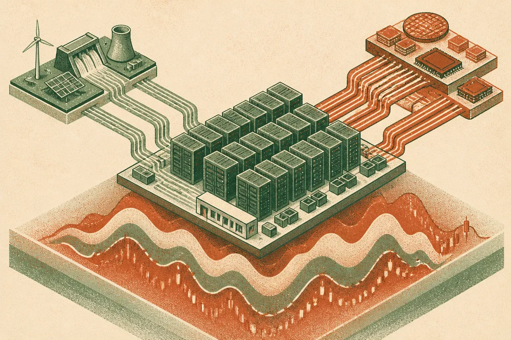

TL;DR: Treat the AI boom as an operating story, not a market bubble story, because energy prices, chip supply, and capex conditions still shape what builders can actually ship.

## What happened to the AI trade?

Decrypt reported in “Oil Climbs Above $111 as AI Stocks Slide, Dragging the S&P 500 and Global Markets With Them” that Brent crude moved above $111, a five-month high, while Nvidia, Meta, and chip stocks fell. The same report said Asian benchmark indexes were down by as much as 3.5%, following a 7.57% plunge in South Korea’s Kospi the prior week.

That is market tape, not destiny.

Still, it is a useful reminder. The “AI trade” is not just a story about better models, higher token throughput, and product adoption. It is also a story about power, fabrication capacity, server lead times, capital budgets, and investor patience.

When oil spikes, the pressure does not hit every AI company the same way. A model lab buying huge amounts of compute, a hyperscaler building data centers, a chipmaker selling accelerators, and a SaaS company adding AI features all have different exposure. But public markets tend to compress nuance. In risk-off moments, “AI” becomes a basket.

That is sloppy, but it matters. Financing costs, customer budgets, and enterprise appetite all move with the broader environment. The app layer can look magical while the infrastructure layer looks very physical.

## Why does oil matter to AI builders?

Not because every inference bill is priced directly off Brent crude. That would be too neat.

Oil matters because it is a signal for broader input-cost stress. Energy costs feed into logistics, construction, cooling, manufacturing, and policy pressure. Data centers are already local political objects in many regions because they compete for power, water, land, and grid upgrades. Higher energy stress makes those fights louder.

The AI stack has been marketed like software. In practice, frontier AI has a heavy industrial footprint. Chips need fabs. Fabs need power and materials. Data centers need interconnects, substations, backup systems, construction crews, and long planning cycles. Even the cleanest agent demo is sitting on concrete somewhere.

This is where AI optimism needs better accounting. I am still bullish on the practical usefulness of AI systems. Coding assistants, research copilots, multimodal search, automated QA, support workflows, and internal agents are real. But real does not mean immune to macro conditions.

If capital gets tighter, marginal AI projects get cut first. If power gets constrained, training and inference planning gets less casual. If chip stocks wobble, boards may ask harder questions about payback periods. That does not kill adoption. It changes the bar.

## What should operators watch instead of the stock chart?

The stock chart is a noisy proxy. Operators need lower-level signals.

Watch whether model providers change pricing, rate limits, context-window access, or enterprise commitments. Watch whether cloud providers delay regions, ration accelerators, or push customers toward specific instance types. Watch whether open-weight models improve enough to shift more workloads onto cheaper or local infrastructure. Watch whether customers are still willing to pay for AI features once the novelty fades.

Also watch the boring stuff: latency, gross margin, eval quality, support volume, and cost per successful task. Those numbers matter more than whether an AI index had a bad week.

The thin read is “AI stocks fell, so the bubble is popping.” The breathless read is “ignore markets, AI is inevitable.” I do not buy either. The better read is that AI is becoming a normal industrial platform, which means it inherits normal industrial constraints.

Builders should run their AI products through a stress test this week: What happens if inference costs rise, rate limits tighten, or a preferred model becomes unavailable for a key workflow? Try one cheaper model, one local or open-weight fallback, and one narrower workflow that produces measurable value without burning tokens. The catch most readers miss: model quality is only one dependency. Energy, compute access, and customer budget cycles are part of the product surface now.
