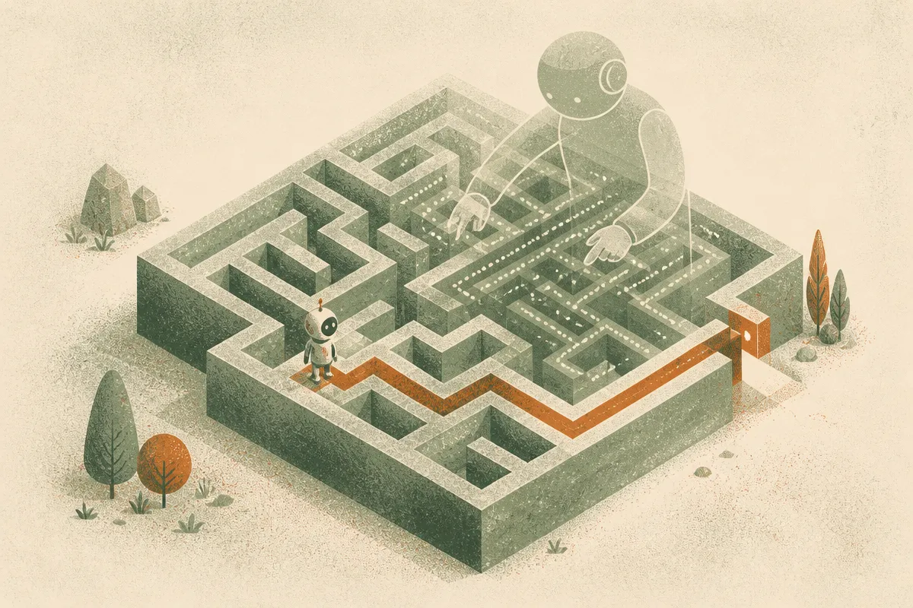

TL;DR: ASTEROID matters because it trains agents to gather missing information at test time, not just copy expert actions from clean training states.

## What problem is ASTEROID actually solving?

The arXiv paper **“Asymmetric On-Policy Distillation Learns In-Context Exploration”** is about a very practical failure mode in agents: acting under partial observability.

That phrase sounds academic. The real version is simple. The agent does not know the hidden state of the task. A robot cannot see inside the drawer. A navigation policy does not know which corridor is blocked. A game agent does not know which rule variant it is in. It has to poke around first, then act.

Classic reinforcement learning can learn that behavior, but it often pays a huge interaction cost. Offline imitation has the opposite problem. If the expert sees the true hidden state, its actions look clean and decisive. The student, which does not see that hidden state, gets averaged behavior across situations. That can produce a policy that neither explores well nor commits well.

ASTEROID, as described in **“Asymmetric On-Policy Distillation Learns In-Context Exploration,”** changes the training setup. The student first collects context using its own policy under partial observability. Then a privileged expert labels the right action conditioned on that student history. The expert still has extra information, but the label is tied to the messy trajectory the student actually produced.

That is the important move. The student is not just copying what an expert would do in a fully observed world. It is learning what to do after being uncertain for a while.

## Why does on-policy distillation beat plain imitation here?

The paper’s claim is that the policy learns a search-then-exploit pattern. While uncertain, it gathers information. Once the hidden state is revealed through its own history, it acts decisively.

That sounds a lot like the behavior people want from agents in software too. Do not hallucinate the answer. Inspect the repo. Run the test. Query the database. Ask the clarifying question. Then take the action.

The distinction is subtle but important. Plain imitation can teach “what good action looks like” when the world state is already known. ASTEROID is teaching “what useful uncertainty reduction looks like” before the action is obvious.

The reported numbers are strong. Across eleven environments, including discrete exploration benchmarks, robotic manipulation, navigation, and Procgen environments, **“Asymmetric On-Policy Distillation Learns In-Context Exploration”** reports about **2x higher returns under fixed exploration budgets** and about **100x fewer interactions than RL baselines**. It also reports better exploration than frontier models, though the supplied material does not name those models, so I would treat that claim as interesting but not fully inspectable from the abstract alone.

The robotics result is the one that caught my eye. The paper reports transfer from simulation to vision-denied real-world robot manipulation, with efficient exploration and a **+40% success gain over standard distillation**. Vision-denied is a clean stress test because the agent has to infer through interaction rather than direct perception.

## What should builders take from this?

The bigger lesson is not “use ASTEROID tomorrow.” It is that agent training should include the agent’s own bad, partial, uncertain context.

A lot of current agent evals still reward final answers more than information-gathering behavior. That misses a core skill. In real workflows, the cheap win is often not a smarter final step. It is a better first three probes.

For a coding agent, that might mean opening the failing test before editing. For a research agent, checking primary docs before writing. For a warehouse robot, touching or moving an object to infer pose. For a customer support agent, asking one narrowing question instead of guessing.

The catch is that ASTEROID still needs a privileged expert. In simulation, that can be natural because the simulator knows the hidden state. In production software systems, you may need to build that expert from logs, validators, tests, traces, or human labels. That is work. But it is a more grounded path than hoping a general model invents good exploration from prompts alone.

A builder should try this pattern on one narrow workflow: let the agent collect its own context, label the next best action with a stronger oracle, then train or tune on those histories. The missed detail is the history. If you only label ideal expert trajectories, you teach confidence. If you label what to do after uncertainty, you teach exploration.
