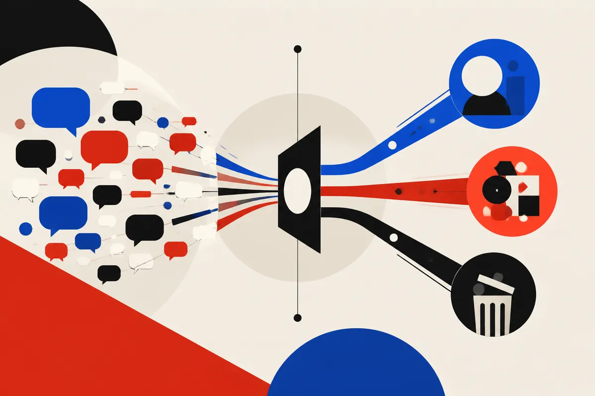

TL;DR: If ChatGPT ads work the way OpenAI reportedly described them, the key shift is not ad placement, it is that the conversation itself becomes the targeting surface.

## What is OpenAI actually changing about ads?

Search Engine Journal’s Brooke Osmundson reported in “OpenAI Details How ChatGPT’s LLM Ad Stack Selects And Serves Ads” that OpenAI explained a custom LLM orchestrator for ads inside ChatGPT. Per that reporting, the orchestrator interprets multi-turn conversations, nominates ads for auction, and drops placements that miss response deadlines.

That is a very different shape from classic search advertising.

Search ads usually start with a query. The system maps the query to intent, checks eligible advertisers, ranks ads, and serves the result. There is plenty of machine learning in that stack, but the user’s explicit query is still the main event.

A chat ad stack starts with a thread. The signal is not only “best CRM software” or “flights to Denver.” It is the path that got the user there. Prior questions. Constraints. Corrections. Maybe budget. Maybe a stated preference. Maybe a half-formed plan.

That makes the ad opportunity richer, but also messier. A model has to decide when the user is actually expressing commercial intent, when an ad would be useful, and when it would feel like an interruption. If Search Engine Journal’s account is accurate, OpenAI is putting an LLM in the middle of that judgment call, not just using one to write ad copy.

## Why does the LLM orchestrator matter?

The word “orchestrator” is doing real work here.

Per Osmundson’s report, the LLM does not simply choose a winner and paste an ad into the response. It interprets the conversation, nominates possible ads, sends candidates into an auction, and drops placements that do not return fast enough.

That last detail is practical and important. Chat products live or die on latency. A technically perfect ad that arrives after the assistant answer is already formed is not useful. So the ad stack has to act inside the response window, not after it.

This creates a three-way tradeoff: relevance, auction economics, and speed. Traditional ad systems already balance quality and bid. Chat adds conversational timing. The system has to understand enough context to be useful, but not so much processing that the answer feels slow or stitched together.

There is also an audit problem. Keyword ads can be inspected around the query. Chat ads depend on a longer, fuzzier context window. Two users may ask similar final questions, but receive different ad eligibility because their prior turns differ. That may be good personalization. It may also be hard for advertisers, regulators, and users to reason about.

## What should marketers and builders take from this?

Do not read this as “SEO is dead” or “prompt ads replace Google.” That is lazy.

The better read is that commercial intent is moving upstream. In a chat interface, the valuable moment may happen before the user types a classic buying query. It may appear while they are comparing options, explaining a constraint, or asking the assistant to build a shortlist.

For marketers, that means old landing-page thinking is not enough. If ads are nominated from conversational context, the inputs that matter are product facts, constraints, use cases, freshness, trust signals, and clean entity data. The assistant needs to know what you sell, who it fits, and when it is a bad fit.

For product teams, this is another reminder that AI interfaces need policy and measurement from day one. If an assistant can recommend, summarize, compare, and route paid placements, the boundary between answer and ad has to be legible. Not performative. Legible.

Practitioner’s take: I would test this by mapping the conversations that happen before a customer searches for you. Not the final keyword list, the messy pre-buying dialogue. What questions do they ask? What disqualifies you? What proof do they need? Then make sure that information exists in public, structured, crawlable form. The catch most teams miss: chat ads may reward clarity about who you are not for, because the model is trying to match context, not just traffic.
