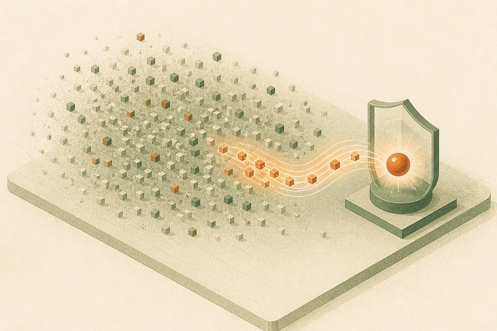

TL;DR: Private RLHF gets much more plausible if reward models can be treated as sparse, because privacy cost scales with the small set of relevant features instead of the full model dimension.

## What is the privacy problem in RLHF?

The primary source here is the arXiv paper “Differentially Private Sparse Reward Estimation with Preference Feedback,” listed in cs.AI and cs.LG. The core problem is simple: RLHF runs on human preference data, and preference data can be sensitive.

A rater may reveal political taste, safety judgments, medical context, workplace policy views, or personal boundaries through pairwise choices. Even if the final model does not quote that data, training can still leak information. Differential privacy is the formal tool for limiting that leakage.

The catch is scale. Existing private alignment methods often model rewards densely, so their error bounds depend on the ambient model size, written as `d`. For current language models, `d` is not a cute academic variable. It is huge. If your privacy math gets worse as the full parameter or feature space grows, the method can become unusable before it reaches production reality.

This paper asks a sharper question: what if human preference rewards are sparse? Not sparse in the sense that humans are simple. Sparse in the sense that, for a particular alignment task, only a much smaller subset of features actually drives the preference signal. The paper calls that subset size `s*`, with `s* << d`.

That is the useful move. It shifts the question from “Can we privately estimate everything?” to “Can we privately estimate the parts of the reward function that matter?”

## Why does sparsity change the math?

“Differentially Private Sparse Reward Estimation with Preference Feedback” studies pairwise preference feedback under the Bradley-Terry-Luce model. That means the training signal is not an absolute score, but a choice between two options. Very RLHF-shaped.

The paper gives algorithms for two privacy settings. Sample-DP protects the inclusion or exclusion of a whole training example. Label-DP protects the preference label itself, using randomized response in the method described. These are different threat models. Sample-DP is closer to protecting whether someone participated. Label-DP is closer to protecting what they said.

The reported rates are the key receipt. For squared `ℓ2` parameter estimation error, the paper gives an upper bound of roughly `Õ(s*/n + s*²/(n² ε²))` for `(ε,δ)`-Sample-DP. For `ε`-Label-DP based on randomized response, it gives roughly `Õ(s*/n + s*/(n ε²))`.

I would not read those formulas as “privacy is solved.” Read them as “the privacy penalty can track sparse reward complexity, not full model size.” That is a big difference.

The lower-bound claims matter too. The paper reports that its Sample-DP rate is nearly optimal, and that the Label-DP guarantee cannot be improved within the randomized-response framework. Translation: this is not just a trick that works because the analysis is loose. At least under these assumptions, the paper is mapping real limits.

## What should builders take from this?

The strongest assumption is also the most practical one to test: does your preference data really have a sparse reward structure?

For broad, general “make the model better” alignment, maybe not. Human taste is messy. Safety policy can be high-dimensional. Harmlessness, helpfulness, tone, refusal behavior, factuality, and style can interact in annoying ways.

But many production alignment problems are narrower than that. A support bot should avoid certain escalation failures. A medical intake assistant should follow specific safety constraints. A coding assistant should prefer patches that pass tests and preserve local conventions. A brand writing model should obey a style guide and avoid a defined set of mistakes. In those cases, it is believable that a smaller set of latent features drives many judgments.

The paper also reports better empirical performance than dense baselines on sentiment generation and safety alignment benchmarks, with a more favorable privacy-utility trade-off. No benchmark numbers were included in the provided material, so I would not overread that claim. The direction is still interesting: private alignment may work better when we stop pretending every feature is equally relevant.

There is a product lesson here too. Privacy for RLHF is not only a policy checkbox. It shapes data strategy. If you can design preference tasks around specific, auditable criteria, you may get cleaner labels, cheaper review, easier evals, and a reward model that is more compatible with formal privacy guarantees.

For a builder, I would try this on a narrow alignment loop first. Define the behavior you want, collect pairwise preferences, train a sparse reward estimator, and compare it against a dense private baseline on held-out human judgments and adversarial prompts. The catch most readers miss: sparsity is not magic compression after the fact. You need task design, feature design, and eval design that make the relevant signal small enough to protect.
