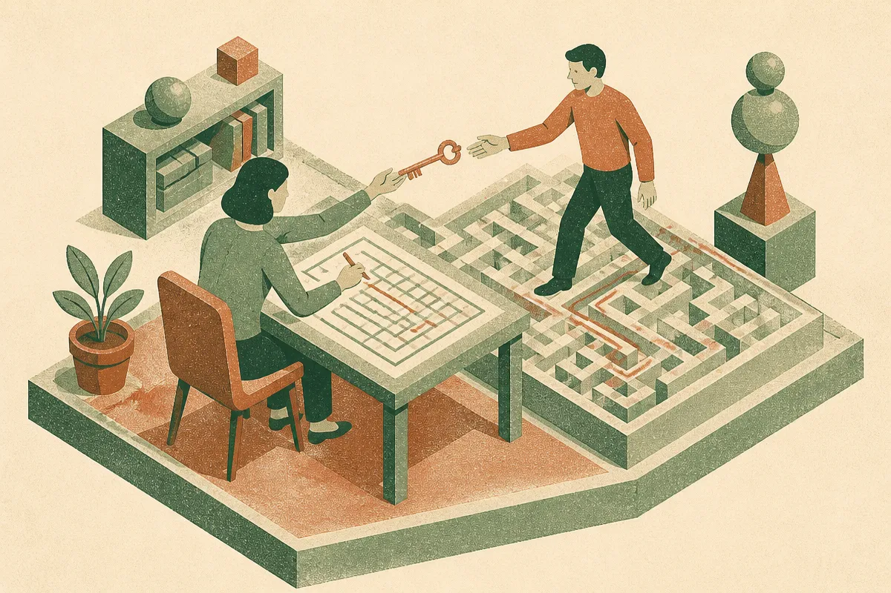
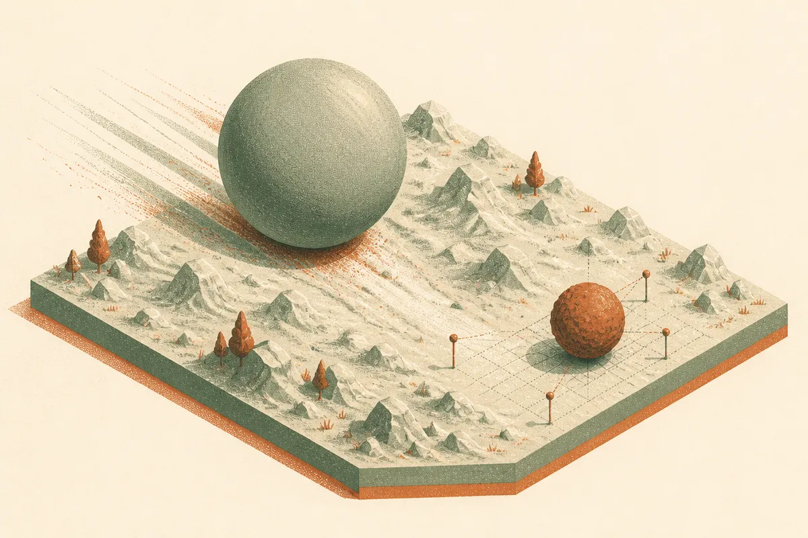
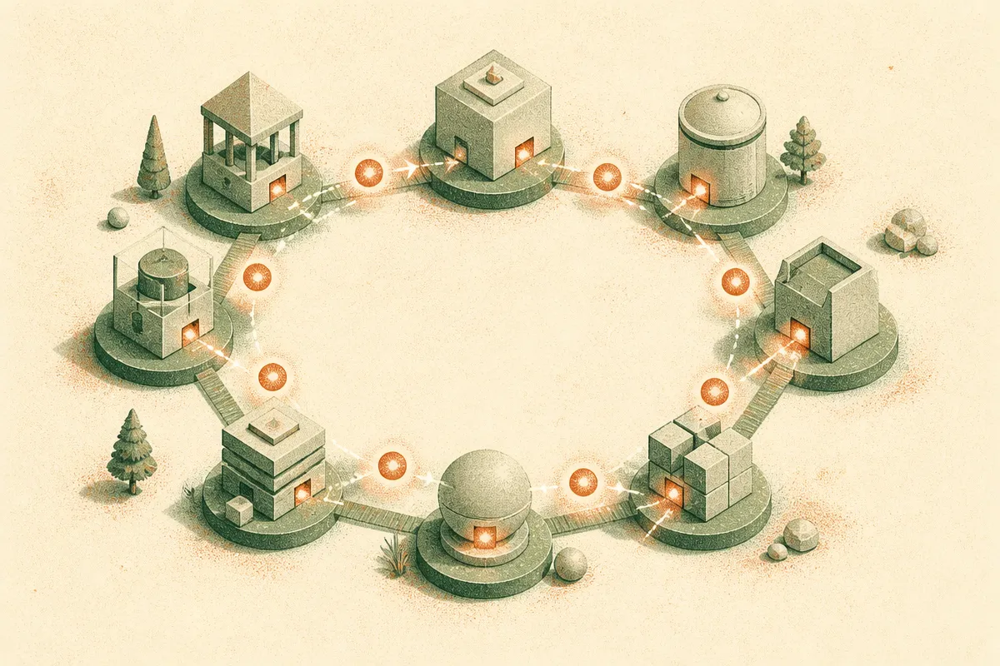

TL;DR: Writing a hard task and solving a hard task are different skills, and the paper "Environment Duels: A Microcosm of LLM Co-Evolution" shows the strongest solver models are often weak authors, while smaller models write the trickiest environments, which changes how you should pick models to generate training data.

Most evals ask one question: can the model solve the thing? That framing has quietly shaped how we rank models, how we build synthetic data pipelines, and how we think about which model to put where. "Environment Duels: A Microcosm of LLM Co-Evolution," posted to arXiv under cs.AI and cs.CL, pulls that framing apart. It treats a model as two separate workers. One writes tasks. One solves them. And it turns out those two workers do not have the same resume.

The setup is clean. Each model authors interactive environments, and each environment ships with a privileged hint. The goal of a good environment is specific: a capable solver should fail without the hint and pass with it. That gap, the hint lift, is the whole game. It measures whether the author built something genuinely hard but learnable, not just impossible or trivial.

## What does Environment Duels actually measure?

The benchmark runs models against each other head to head across nine frontier LLMs. Each one plays two roles. As a solver, it attempts environments other models wrote. As an author, it writes environments meant to stump other solvers unless they get the hint.

The key signal is not raw pass rate. It is the hint lift: how much a solver's success jumps when you hand it the author's hint. A well-designed environment produces a big lift, because the task sits right at the edge of the solver's ability. Too easy and the solver passes without help. Too hard and the hint does not rescue it. The sweet spot is the narrow band where a good hint is the difference.

This is a smarter design than it first looks. By making the hint the measured object, the paper forces authors to understand their solver's failure modes, not just produce difficulty. Anyone can write an unsolvable problem. Writing one that cracks open exactly when you add the right clue takes a model that models the solver's mind.

## Why are the best solvers not the best authors?

Here is the finding that should make you re-check your assumptions. Across those nine models, solving and authoring came apart. The strongest solvers were not the strongest authors. And smaller models, the ones you would expect to lose, wrote the hardest environments and the most useful hints.

Read that again, because it cuts against the default instinct in every synthetic data pipeline I have seen. The reflex is to reach for the biggest, smartest model to generate your training tasks, on the theory that the best solver must also understand problems best. This paper says no. The authors report that smaller models learn more from how others played, and that experience seems to translate into writing better challenges.

There is a plausible mechanism here. A model that struggles more has richer firsthand data about where things break. It has felt the failure. A top solver glides past the exact difficulties that make a task instructive, so it may be worse at reconstructing them deliberately. The skill of authoring is partly the skill of remembering what hard felt like.

The paper also notes some reassuring structure. Head-to-head outcomes were transitive, so you get a stable ranking rather than rock-paper-scissors chaos. And independent authors converged on the same environment designs, which suggests the benchmark is measuring something real about task structure, not just the quirks of one model's style.

## Can one model's hard tasks actually train another model?

This is the part that moves the paper from interesting to useful. The authors ran a reinforcement-learning study with a model they call Qwen3.8-27B. The result: the learner's hint lift on an author's environments tracked how much training on those environments improved it on held-out reasoning and agentic benchmarks.

In plainer terms, the in-benchmark signal predicted out-of-benchmark learning. If a set of environments produced a big hint lift for the learner, training on those environments tended to make the learner genuinely better on tasks it had never seen. And this held whether the environments came from the model itself or from another model.

That is the bridge most synthetic data work is missing. We generate tasks, we train, we hope the gains transfer. Here the hint lift acts as a cheap proxy for whether a given batch of generated environments is worth training on. You do not have to run the full downstream eval to guess if the data is any good. You measure the lift first.

The caveat is scope. This is one RL study on one model family, inside a controlled benchmark. The abstract does not hand us the magnitude of the correlation or how it holds across other learners. So treat the predictive claim as a promising result from this specific setup, not a settled law. The code is open at github.com/LLM-Duels/EnvDuels, which is the right move and lets people actually test whether the pattern generalizes.

## What does this change for people building with AI?

The broader framing in the paper is co-evolution. Models absorb what their predecessors and competitors produce, through training data, through the open web, through synthetic pipelines. Environment Duels stages that messy process under controlled conditions and gives it structure. The duels become a microcosm of how models teach, challenge, and learn from each other in the wild.

I like the honesty of that framing. We talk about model improvement as if each lab trains in a vacuum. In practice every frontier model is drinking from a pool the others filled. A benchmark that measures the teaching relationship directly, not just the solving skill, is overdue.

Practitioner's take: if you build synthetic training data or agentic evals, stop auto-assigning your biggest model to the author role. Run a small version of this experiment yourself. Pick two or three models, have each generate a batch of hard tasks with hints, and measure the hint lift on your target model instead of measuring raw difficulty. A task where your model fails cold but passes with a clue is a task it can learn from. A task it fails even with the clue is noise, and a task it passes without the clue is wasted compute. The lift is the filter. The catch most people will miss is that the author role rewards a different thing than the leaderboard does: you may find a cheaper, smaller model is your best task writer, which saves money and happens to produce better data. Test it before you assume the big model wins. It usually does not here.
