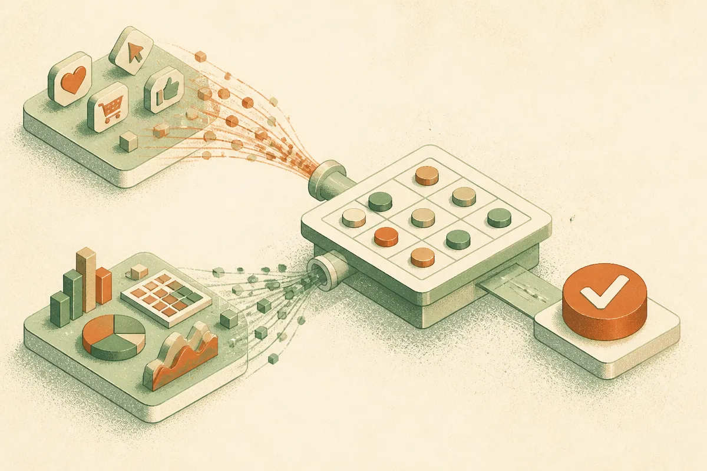

TL;DR: AI will not fix marketing measurement if the dashboard still stops at clicks, conversions, CAC, and ROAS instead of connecting customer understanding to revenue, margin, and profit.

## What question is the CEO actually asking?

Martech’s “Your CEO wants answers your dashboard can’t give” names a problem most marketing teams already feel. The CEO is not really asking, “Did the campaign perform?” The CEO is asking, “Did this create business value?”

Those are not the same question.

A dashboard can show reach, traffic, leads, conversion rate, acquisition cost, and ROAS. Useful stuff. I would not run paid media, email, lifecycle, or content without it. But Martech’s point is that these metrics mostly answer promotional questions. Which message worked? Which button converted? Which interaction should come next?

They do not automatically answer whether the company made more profit, retained better customers, protected margin, improved pricing power, or learned something useful about what customers actually need.

That gap gets hidden because campaign metrics are visible and tidy. Missed opportunity is not. The customers who never bought, the feature they would have paid for, the bundle they needed, the price point that protected margin, none of that shows up as a clean line item.

So marketing walks into the boardroom with precision around activity, then gets judged on ambiguity around value. Bad trade.

## Why does AI make this worse before it makes it better?

AI is very good at speeding up the part marketing already measures.

Generate more variants. Test more subject lines. Rewrite landing pages. Segment audiences. Summarize calls. Score leads. Adjust bids. Trigger journeys. All of that can be useful. Some of it is already table stakes.

But if the machine is optimizing against thin goals, it can produce thin wins faster.

Martech frames this as fast data versus slow data, borrowing from Daniel Kahneman’s distinction between fast and slow thinking. Fast data supports immediate campaign decisions. Slow data supports deliberate judgment about customer needs, revenue, margins, and long-term value.

That distinction matters because AI loves fast data. It has lots of feedback, clear labels, and immediate reward signals. Clicked or did not click. Converted or did not convert. Opened or did not open. Bought with a discount or ignored the offer.

The danger is not that AI “takes over marketing.” The danger is that marketing hands AI a scoreboard that rewards shallow behavior. Then everyone celebrates motion.

A campaign can improve ROAS while discounts, returns, product costs, and service costs eat the profit. A conversion can look good while the customer never returns. A lead can look cheap because the wrong people are easy to acquire.

## What should marketing measure instead?

The fix is not to throw away campaign dashboards. Fast data is still necessary. The fix is to connect it to slower, more strategic questions.

A useful AI-era marketing stack should help answer questions like: which customer needs are growing, which segments create margin, which offers bring repeat buyers, which messages change willingness to pay, which channels create profitable customers rather than cheap transactions, and which product or pricing decisions marketing can inform before promotion begins.

That last part is the real mandate problem. Martech argues that marketing has lost influence across product, price, place, and promotion, leaving the CMO mainly responsible for demand generation after other teams have made the big decisions. I think that is exactly where many AI marketing programs will disappoint. They will automate promotion while marketing keeps losing the customer intelligence function.

The better pattern is to treat AI as an analysis layer across customer research, sales conversations, support tickets, cohort behavior, pricing tests, returns, churn, and margin data. Not just an execution layer for more creative variations.

That requires boring work. Data definitions. Finance alignment. Customer segmentation that survives contact with revenue reports. Experiments designed around profit, not just response. A shared view of what a “good customer” means.

Practitioner’s Take: keep the fast dashboard, but add one slow-data review every month that ties campaign results to margin, repeat purchase, retention, sales quality, or product insight. Then point AI at that combined picture. The catch most teams miss is that AI cannot infer the business model from CTR. You have to give it the scoreboard that the CEO actually uses.
