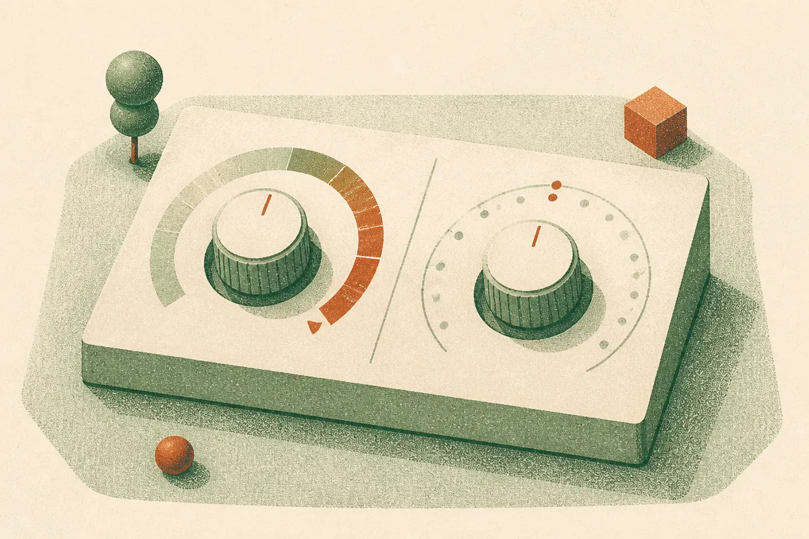

TL;DR: When wrong answers cost more than asking a human, the right question is not "how accurate is the model" but "does it know when to shut up and defer," and a plain TF-IDF classifier with a tuned abstention threshold beat four prompted LLMs on that test.

The paper is "Cost-Aware Abstention for LLM-Based IT Ticket Classification," posted to arXiv across cs.AI, cs.CL, and cs.LG. It is not a new model or a clever algorithm. It is an evaluation framework, and the honesty about that scope is part of why it is worth your time. The authors built a way to ask a deployment question most teams skip: given explicit costs for being right, deferring to a human, and being wrong, which routing policy actually saves money on held-out data?

That reframing matters more than any single number in the paper.

## Why does accuracy lie about automation?

Accuracy treats every mistake as equal. Real routing does not. Send a ticket to the right queue: cost zero. Send it to a human triage desk: small cost. Send it to the wrong queue: large cost, because now it bounces, gets re-triaged, and the customer waits.

The paper encodes exactly that with an illustrative cost model of (c_ok, c_triage, c_wrong) = (0, 1, 5). A wrong route costs five times a human handoff. Under that model, the whole optimization changes. You no longer want the policy that is right most often. You want the policy that avoids expensive wrong routes, even if that means handing more tickets to a person.

This is where abstention comes in. An abstaining classifier can say "I am not confident, send this one to triage." The question is whether the model's confidence is trustworthy enough to make that call.

## What actually won, and by how much?

The headline result is almost anticlimactic, which is the point. On a public corpus of 47,837 tickets across eight classes, TF-IDF with logistic regression and an abstention threshold of 0.60 (selected on calibration data, then frozen) cut test cost from 0.763 to 0.472. That is a 38.1% relative reduction, with a bootstrap 95% confidence interval of [35.7%, 40.4%]. Wrong routes dropped from 15.3% to 3.5%.

Read that again. A technique from before the deep learning era, bag-of-words features into logistic regression, delivered the win. Not because it is smarter, but because its confidence scores are calibrated well enough that a threshold means something. When it says 0.60, that roughly corresponds to a real probability, so a threshold lets you trade coverage for safety in a predictable way.

The frozen calibration-selected policies also beat both naive baselines, always-route and always-defer, in 14 of 16 settings across a cost-parameter sweep. That is the practically important claim. Picking a threshold under one cost assumption and testing it under others, it mostly held up.

## Why did the big prompted models fold?

Here is the part that should make anyone building LLM classifiers pause. The strongest prompted LLM configuration reached 0.477 accuracy on a stratified 1,000-ticket test subset. A fine-tuned DistilBERT hit 0.879 on the same tickets. That is not close.

But raw accuracy is not even the worst of it. The paper separates two things that teams constantly conflate: discrimination (can the model rank right answers above wrong ones) and calibration (do its confidence numbers mean anything). LLMs failed on both fronts in ways that break abstention.

GPT-4o-mini in the few-shot setup produced effectively one confidence value, before and after isotonic recalibration, with a correctness AUROC of 0.500. An AUROC of 0.500 is a coin flip. The model's confidence carries zero signal about whether it is right. You cannot build a cost-aware abstention policy on top of that, because there is nothing to threshold.

And the cost math punishes this hard. At the analytically derived break-even probability of 0.80, seven prompted configurations just deferred every single ticket. They knew, implicitly, that their own guesses were not worth the risk. Haiku few-shot routed only 19 of 1,000. That is not automation. That is an expensive API call that forwards almost everything to a human anyway.

Isotonic recalibration, the usual fix, did not save them. It lowered expected calibration error, the headline calibration metric, without reliably improving discrimination. This is a quiet but important warning: a better ECE number can make a model look safer while doing nothing to fix whether its confidence actually tracks correctness. The authors report correctness AUROC and a tie-aware risk-coverage area alongside ECE precisely because ECE alone will mislead you here.

## How should an operator read this?

The temptation is to turn this into "LLMs are bad at classification." That is the wrong lesson, and the authors are explicit that the findings are scoped to this dataset, these prompts, these specific model endpoints, and these illustrative costs. Different prompt engineering, a fine-tuned LLM instead of a prompted one, or different cost ratios could shift the picture. DistilBERT, a fine-tuned transformer, won accuracy outright, so this is not even an argument against neural methods. It is an argument against assuming a prompted general model gives you trustworthy confidence for free.

The real lesson is about the missing step in most LLM deployments: nobody prices the abstention. Teams measure accuracy, see 70-something percent, and ship. They never ask what a wrong answer costs relative to a human handoff, and they never check whether the model's confidence is calibrated enough to defer intelligently. This paper is a template for doing both offline, before production, on frozen policies you can actually defend.

Practitioner's take: before you put any classifier in a routing or triage loop, write down three numbers, the cost of a correct auto-action, the cost of a human handoff, and the cost of a wrong auto-action. Then run the cheapest possible baseline first. TF-IDF plus logistic regression takes an afternoon and gives you calibrated confidence scores that threshold cleanly, which is exactly what abstention needs. Sweep the threshold on calibration data, freeze it, and score it once on held-out data against both always-route and always-defer. If a prompted LLM cannot beat that frozen policy under your real cost model, it does not belong in the loop, no matter how good its accuracy looks in a demo. The catch most people miss: check correctness AUROC, not just ECE or accuracy. A model can post a tidy calibration number while its confidence is a flat line that tells you nothing, and that flat line is the difference between smart automation and an API bill that forwards everything to a human anyway.
