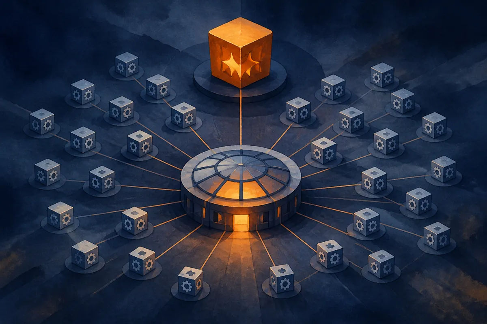

TL;DR: The anthropic-sdk-python v2.3.0 release is a maintenance bump on its face, but the new Claude Tag endpoints, per-user usage and cost reports, and work queue descriptions tell you Anthropic is building the admin and accounting layer that enterprises demand before they commit.

Most changelogs are noise. You skim them, bump the version, move on. But a changelog is also the most honest roadmap a company ships, because it describes what engineers actually built, not what marketing wishes they had. The anthropic-sdk-python v2.3.0 notes, published to the anthropics/anthropic-sdk-python repo, are worth reading closely for exactly that reason. There is no product launch here, no blog post, no keynote. Just a list of features, fixes, and chores. And that list points in one direction: Claude for big companies.

## What actually changed in anthropic-sdk-python v2.3.0?

The headline feature is short: "add Claude Tag endpoints for Claude Enterprise organizations." That is the only new feature in the list. Everything else is a bug fix, a chore, or a documentation reword.

The bug fix that matters is "send user profiles requests to the organization endpoint." The chores include carrying endpoint path query params to the request layer, reading a beta route qualifier instead of a `beta=true` query, and stopping the SDK from sending hardcoded query params in endpoint paths. The documentation changes reword descriptions for work queue, skill, and external key, improve the code execution tool and its encrypted results, and update per-user usage and cost reports.

Individually, none of these is a story. A query param moving from the URL to the request layer is the kind of thing only the SDK maintainers care about. But group them by theme and a pattern shows up. Organization endpoints. Per-user usage. Per-user cost. Work queues. Tags. These are not model capabilities. They are the fixtures of a multi-seat enterprise deployment, the stuff an IT admin needs before finance signs the contract.

## Why do tags and per-user cost reports matter for enterprise AI?

Tags sound trivial until you have run anything at scale. In an enterprise Claude deployment, you are not one developer with one API key. You are hundreds or thousands of users, dozens of teams, multiple projects, and a procurement department that wants to know who spent what. Tags are how you slice that. Tag a request by team, by project, by cost center, then roll it up into a report.

That is why the per-user usage and cost reports show up in the same release. Anthropic calls them out in the documentation chores: "update descriptions of the per-user usage and cost reports." Put tags and per-user accounting together and you have the beginnings of chargeback, the internal billing model every large company uses to allocate shared infrastructure spend back to the teams that consume it. Without chargeback, an AI budget is a black hole that the CFO eventually freezes. With it, each team owns its own number.

This is the unglamorous machinery that decides whether a pilot becomes a platform. OpenAI, Google, and Anthropic can all demo a smart model. The question enterprises actually ask is different: can I govern this, bill it internally, and prove to an auditor who used what. The v2.3.0 changelog is Anthropic answering that question in code rather than in a press release.

## Is this a real enterprise strategy or just plumbing?

Fair skepticism. A changelog is thin evidence. I am reading intent into a list of commits, and I want to be honest about the limits of that. The changelog does not tell you pricing, it does not tell you which customers have access, and it does not tell you how complete the Claude Enterprise feature set is. The term "Claude Enterprise organizations" appears in the release, but for the actual scope, tiers, and availability of that offering you have to go to Anthropic's own enterprise documentation, not infer it from an SDK bump. I am not going to invent numbers the changelog does not give.

What the changelog does give is direction, and direction is cheap to fake in marketing but expensive to fake in code. You do not add organization endpoints, user profile routing, and per-user cost reporting unless real customers are asking for them. Engineering time is the most honest signal a company sends. The "work queue" and "skill" and "external key" rewords point the same way: work queues suggest batched or asynchronous jobs at volume, external keys suggest bring-your-own-key or managed credential arrangements, both of which are enterprise concerns, not hobbyist ones.

The honest read is this: the changelog is plumbing, and the plumbing reveals the strategy. Anthropic is not trying to win developers one API key at a time anymore. It is building the controls that let a company with a thousand Claude users treat Claude the way it treats any other sanctioned enterprise tool, with reporting, attribution, and governance baked in.

## What should a builder do with this?

If you run Claude inside a company, the practical move is to go check whether these endpoints are live on your account and start tagging now, before your usage sprawls past the point where retroactive attribution is painful. Tags are worth almost nothing on day one and worth a great deal six months in, when finance asks which team is responsible for a surprising bill. Set a tagging convention early: team, project, environment. Treat it like you would treat labels on cloud resources.

Two catches most readers will miss. First, the feature being in the SDK changelog does not mean it is enabled on your plan. "Claude Tag endpoints for Claude Enterprise organizations" is scoped to enterprise, so confirm with Anthropic's own docs or your account team before you build reporting on top of it. Second, per-user cost reports are a governance feature, not a cost-reduction feature. They tell you where the money went, not how to spend less. The savings come from what you do with the data: killing dead projects, rate-limiting runaway agents, moving cheap tasks to cheaper models. The SDK gives you the meter. Reading the meter and acting on it is still your job.

The broader lesson holds beyond Anthropic. When you want to know what a lab is actually prioritizing, skip the keynote and read the commits. v2.3.0 is a maintenance release that quietly tells you Anthropic is playing the long enterprise game, one unglamorous endpoint at a time.
