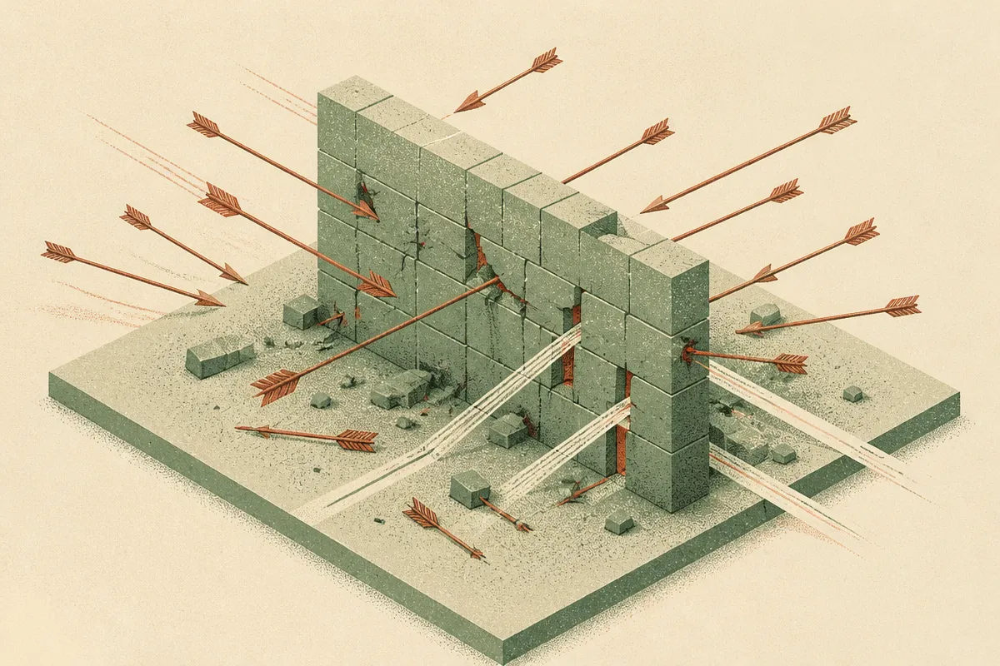

TL;DR: OpenAI is treating the training and evaluation environment itself as an attack surface, and the practical lesson for anyone running capable models is that containment lives in your infrastructure, not in the model's good behavior.

The primary source here is OpenAI's blog post, "Securing our frontier model training environment," which describes how the company strengthened containment around how it trains and evaluates frontier models. That includes offline environments and high-compute red-teaming. It is a short note, light on specifics, so I want to be careful about what it does and does not say. But the framing is worth sitting with, because it points at a shift in how the serious labs think about risk.

## What is OpenAI actually securing?

The thing being protected is not the finished model. It is the environment where the model is trained and tested.

That distinction matters. Most people picture AI security as "stop the chatbot from saying bad things" or "stop someone from jailbreaking the API." OpenAI is describing something upstream of that: the compute, the data pipelines, the evaluation harnesses, and the sandboxes where a model under development runs code and gets probed. Per OpenAI, the work includes offline environments, which means isolating training and evaluation so the systems doing the work are cut off from the open internet and from the rest of the company's network.

Why isolate? Two reasons, and they run in opposite directions. One is keeping things out: model weights are extremely valuable, and a training environment connected to everything is a bigger target for theft. The other is keeping things in: as models get better at writing and running code, the environment where you evaluate them is also an environment where a capable system could, in principle, try to do something you did not intend. An offline sandbox limits the blast radius in both directions.

OpenAI does not, in this post, claim a specific model has tried to escape anything. I want to be clear about that. The framing is precautionary. They are building the containment before they need it, which is the correct order of operations and also the boring, unglamorous part of safety work that rarely gets a launch event.

## Why does high-compute red-teaming matter here?

The phrase that caught my attention is "high-compute red-teaming." OpenAI uses it to describe the adversarial testing they do against these environments.

Red-teaming is just structured attack: you pay smart people to try to break the thing before someone hostile does. The "high-compute" qualifier is the interesting part. It suggests they are not only having humans poke at the system, they are throwing serious compute at finding weaknesses, which usually means automated or model-assisted attacks run at scale.

That is a meaningful change from how security testing has traditionally worked. A human red team finds the clever exploits a checklist misses. A compute-heavy red team finds the exploits that only show up after ten thousand attempts, the ones that depend on a rare timing window or an unlikely sequence of actions. For a system that will itself be used to generate and run enormous amounts of code, testing it with proportional firepower is the only honest way to do it. You cannot defend a machine-scale system with human-scale testing and call it covered.

The catch, and OpenAI's note does not resolve this, is that red-teaming proves the presence of holes, never their absence. A clean red-team run tells you the attacks you tried did not work. It says nothing about the attack you did not think to run. So "we red-teamed it heavily" is reassuring in the way a strong lock is reassuring: better than no lock, not the same as safe.

## What can a builder actually take from this?

Most of us are not training frontier models. But the mental model transfers cleanly to anyone running agents or letting a model execute code, and that is a growing share of real work.

The core idea is: assume the model is untrusted inside its own runtime. Not malicious, necessarily. Just capable, and therefore capable of doing the wrong thing at scale if your boundaries are loose. OpenAI isolating its training environment is the same instinct as you sandboxing the agent that runs shell commands against your codebase.

Concretely, that means a few things. Run code-executing agents in a container that cannot reach your production network or your secrets. Give them the narrowest credentials that still let them do the job, not your admin key "for now." Log what the agent actually does, not just what it was asked to do, so you can reconstruct a bad run. And test the setup adversarially: have someone try to get your agent to exfiltrate a file or escalate its own permissions, because if it is easy for your teammate it is easy for a prompt injection buried in a webpage the agent reads.

The part most readers will miss is that this is an infrastructure problem, not a prompt problem. You cannot write a system prompt that reliably says "do not do anything dangerous" and trust it the way you trust a firewall rule. The lesson from OpenAI treating containment as environment design, rather than model behavior, is exactly this: the guarantee has to come from the layer the model cannot reason its way around. A model can be talked out of its instructions. A network it is not connected to cannot be talked into existing.

I will not oversell what OpenAI published. It is a direction-setting note, not a technical paper, and the specifics on what the offline environments look like, what the red-teaming found, and what the residual risks are stay inside the company. Treat it as a statement of intent from a lab that has the most to lose, not as a verified blueprint.

Practitioner's take: start by drawing the boundary before you add the agent, not after. Pick one workflow where a model runs code or touches real systems, and ask the OpenAI question of it: if this thing tried to do the worst reasonable thing, what stops it, and is that stop a prompt or a wall? If the answer is a prompt, you have a containment gap. Move the guarantee down into the infrastructure: a locked-down container, scoped tokens that expire, an allowlist of commands, and an audit log you actually read. Then try to break it yourself for an afternoon. The gap you find in a quiet test is the one you do not want to meet in production.
