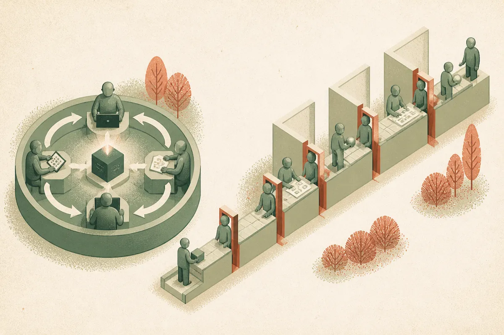

TL;DR: If AI is not showing payoff outside tech, the likely bottleneck is workflow redesign, measurement, and adoption depth, not raw model capability.

## What does “no payoff” actually mean?

The prompt here is thin but useful. The supplied primary source is a Hacker News (AI) item titled “No signs of AI payoff outside the tech sector.” That is not enough to establish the claim as fact. It is enough to frame the question operators keep running into: why does AI feel obvious inside software companies and strangely foggy everywhere else?

My read: tech companies get payoff first because their work is already instrumented. Code ships through logs, tests, pull requests, deployment metrics, issue trackers, and support queues. When a coding assistant saves time or an agent closes a ticket, the work leaves a trail.

Most non-tech companies do not have that kind of operational telemetry. A claims adjuster writes notes. A sales manager updates a CRM late. A procurement analyst emails three vendors. A legal team edits documents in loops that nobody times. AI may help in each pocket, but the company often cannot see whether cycle time, rework, quality, or throughput changed.

That creates a measurement trap. No visible payoff does not always mean no payoff. It can also mean the work was never measured well enough to detect one. But the reverse is also true. A team can feel faster because everyone enjoys the tool, while the business sees no improvement because the bottleneck moved somewhere else.

## Why do tech companies capture value faster?

Tech firms have three advantages.

First, they can place AI inside the production system. Developers use AI in the editor, in code review, in test generation, in incident response, and in documentation. The model is close to the unit of output.

Second, the work is modular. A function, query, test, bug report, or support macro can be improved without rethinking the whole company. That is not true in many operating businesses. If AI drafts a mortgage document but compliance review, title checks, and customer follow-up still move at the old pace, the end-to-end process may barely change.

Third, tech teams tolerate tool churn. They are used to swapping frameworks, editors, APIs, and workflows. Many non-tech departments buy software like furniture. Once installed, it sits there for years.

This is why I am skeptical of broad “AI ROI” claims, positive or negative. The average hides too much. A support team using AI to classify tickets is different from a hospital trying to change clinical documentation, which is different from a manufacturer using computer vision on a line, which is different from a law firm drafting first-pass memos.

## What should operators measure instead?

Do not start with “AI productivity.” Start with a named workflow.

Pick one recurring process with a clear input and output. Examples: inbound lead qualification, monthly close variance notes, contract redlines, help desk triage, product listing cleanup, renewal risk summaries. Then measure the boring things before and after: elapsed time, touches, error rate, review time, backlog, customer response time, and handoff count.

Also measure adoption honestly. A company does not get AI payoff because 500 employees have logins. It gets payoff when the tool changes the default path of work. If employees use chatbots on the side, then paste results into the old process, you may get individual convenience without organizational gain.

The bigger miss is management design. If AI reduces drafting time by 40 percent but approvals still happen every Friday, the customer sees no speedup. If AI helps analysts produce twice as many reports but nobody reads them, output went up and value did not. If AI creates more work for reviewers, the bottleneck got worse.

My practitioner’s take: choose one workflow where speed or quality already matters, instrument it for two weeks, then insert AI at the narrowest point and compare the whole process, not the prompt result. The catch most readers miss is that AI payoff usually requires deleting steps, changing approvals, or shifting responsibility. If the organization refuses to change the work, better models will mostly produce better-looking friction.
