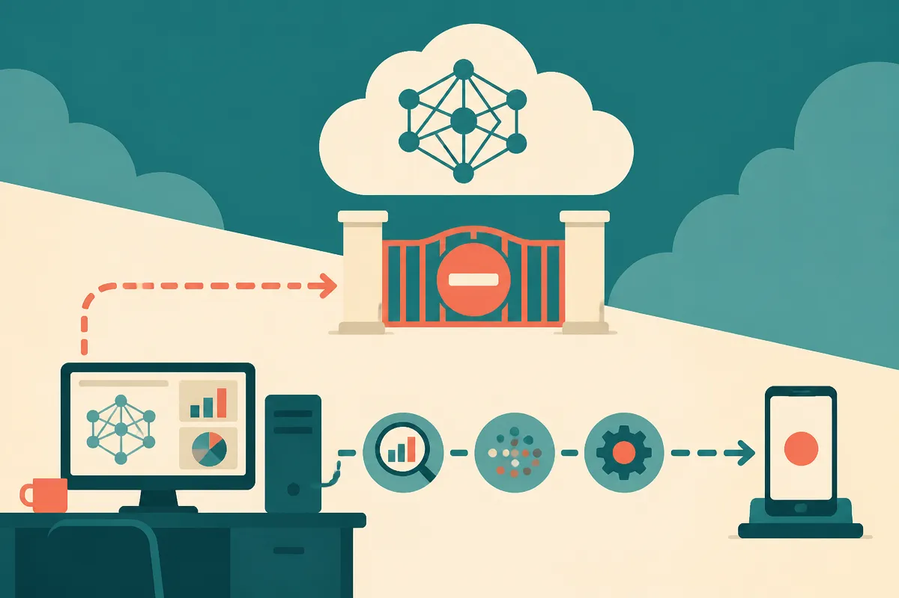

TL;DR: If your security or privacy workflow depends on a hosted model, expect some legitimate reverse engineering work to get caught by safety filters, and plan a local, auditable fallback.

## What actually happened with the smart TV reverse engineering claim?

The primary source here is the r/LocalLLaMA post titled “OpenAI and Anthropic blocked the reverse engineering of smart TVs spying on us.” It points to an X post from AbhinavXJ and says “REA (Reserve Engineer Anything) was blocked by Claude one day later.”

That is not enough to prove a broad OpenAI or Anthropic policy shift. I have not seen a first-party OpenAI or Anthropic statement in the supplied material explaining what was blocked, why it was blocked, or whether the block was a model refusal, account action, product guardrail, or something else.

So the clean version is this: a practitioner claims that AI-assisted reverse engineering of smart TVs, framed as investigating spying, ran into blocks from major hosted AI systems. The local model crowd read that as another reason to “own the weights.”

That reaction is predictable. Reverse engineering sits in the messy middle of AI safety. The same workflow can find privacy abuse in a consumer device, or help someone exploit firmware. Static analysis, decompilation, unpacking binaries, protocol tracing, hidden API discovery, credential hunting, jailbreak extraction, all of it can be benign or harmful depending on intent and target.

Hosted models are bad at intent. They see patterns.

## Why do cloud models refuse security work that may be legitimate?

Cloud AI companies have to draw product lines around cyber assistance. If they do not, they get models that can help scale malware, phishing, credential theft, and exploit chains. If they draw the lines too tightly, they block security researchers, repair advocates, journalists, privacy engineers, and internal red teams.

That is the trade.

For reverse engineering, the hard part is not whether the task is “good” or “bad.” It is context. A prompt like “analyze this firmware blob and identify network exfiltration behavior” could be consumer protection. A prompt like “extract the private API endpoint and bypass device checks” could be abuse. Sometimes they are steps in the same investigation.

The r/LocalLLaMA framing turns this into a local AI argument, and I think that is partly right. Not because local models are magic or morally cleaner. They are not. But local models give researchers more control over the workflow. They can run on private data. They can be version-pinned. They can be inspected, logged, sandboxed, and combined with deterministic tools.

The catch is that “run it locally” does not remove responsibility. It moves responsibility from the platform to the operator. That is a big shift. If you use an open model to automate reverse engineering, you need your own rules, your own scope control, and your own evidence trail.

## What should builders do when hosted AI blocks the work?

The practical answer is not “use only cloud” or “use only local.” It is split the job.

Use hosted models for safer surrounding work: summarizing public documentation, explaining processor architectures, writing test harnesses, organizing notes, generating checklists, and translating findings into reports. Keep sensitive binaries, device captures, credentials, and exploit-adjacent analysis inside a controlled environment.

For the local side, pair an open model with standard reverse engineering tools rather than asking the model to be the tool. Let it comment on Ghidra output. Let it help cluster suspicious strings. Let it draft hypotheses. Let it compare observed network behavior against a privacy policy. Do not let it blindly execute suggestions against live targets.

Also document refusals. If a hosted model blocks a legitimate security task, capture the exact task framing, the refusal, and the narrower version that worked or failed. That gives you a policy map over time. It also helps separate real platform overreach from sloppy prompting that looked malicious.

The builder move is simple: treat cloud models as helpful but unreliable assistants for security research, not as infrastructure you control. For privacy audits, device analysis, and anything involving proprietary firmware, build a local lane with pinned models, sandboxed tools, and human review. The catch most readers miss: the model refusal is not the whole story. The real dependency risk is building a workflow where one opaque policy change can stop your investigation cold.
