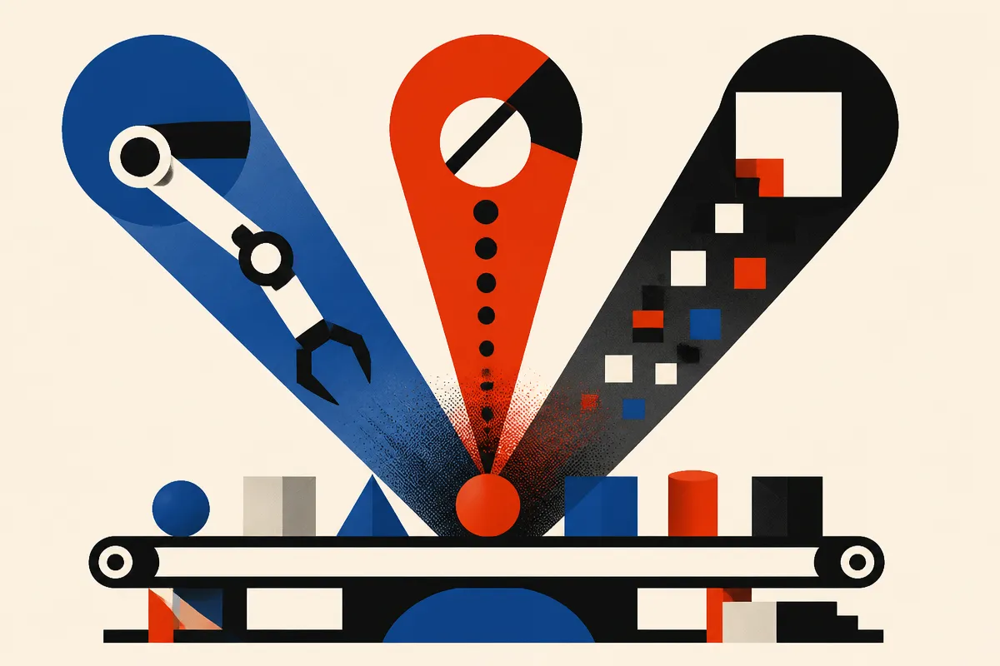

TL;DR: The useful question is not whether AI caused 200,000 lost creative jobs, it is which parts of the creative production stack AI is compressing, and which losses come from older business problems wearing an AI mask.

## Did AI cause the 200,000 job-loss number?

A Hacker News item titled “America has lost 200k of jobs in media, film and the arts. How much is AI?” frames the debate well, but the number alone does not tell us much.

Without the underlying labor series, time period, categories, and method, “200k” should be treated as a prompt, not a causal finding. Media, film, and the arts are not one labor market. A newsroom copy editor, a background actor, a storyboard artist, a podcast producer, a game trailer editor, and a freelance SEO writer all sit inside different hiring loops.

That matters because AI does not hit them the same way.

Some jobs are exposed because the task is text-heavy and easy to review: first drafts, rewrite passes, metadata, summaries, headline variants, ad copy, low-stakes social posts. Some are exposed because AI helps one senior person do what previously required a small support crew: rough concepts, mood boards, animatics, translations, cleanup, transcription, b-roll search. Some are less exposed because the work is embodied, relationship-driven, rights-sensitive, taste-sensitive, or tied to live production constraints.

The lazy version is: “AI took the jobs.” The equally lazy counter is: “AI had nothing to do with it.” I do not buy either one.

AI is very likely part of the story. It is also not cleanly separable from streaming economics, ad budgets, search and social distribution, studio consolidation, interest rates, labor disputes, and the long shift from staffed roles to project work. If a company freezes hiring, asks the remaining team to publish the same volume, and gives them generative tools, is that an AI layoff? Operationally, yes. Statistically, maybe not.

## Where is AI actually replacing labor?

The clearest displacement is not “artist versus model.” It is workflow compression.

A team that used to pass work through five stages can now collapse the first two or three. Research briefs, outlines, transcripts, image references, script polish, versioning, resizing, formatting, and campaign variants all move faster. That does not remove the need for judgment. It removes paid hours around the judgment.

This is why the impact often shows up first in freelance budgets, entry-level roles, and vendor spend. Not because junior people have no value. Because junior work is where organizations can most easily convert “good enough with review” into lower cost.

There is a catch, though. AI output still needs taste, rights awareness, fact checking, brand judgment, and audience sense. When companies pretend those controls are optional, quality drops. When they keep the controls and automate the prep work, headcount pressure rises.

That is the uncomfortable middle. AI can make good creative teams better and smaller at the same time.

## What should we measure instead?

If we want to understand AI’s effect, the headline job count is too blunt. I would rather see task-level data.

How many articles per editor? How many design variants per designer? How many minutes of finished video per production employee? How much freelance spend moved in-house after AI tools were adopted? Which roles were not refilled after attrition? Which departments kept output flat while headcount fell?

Those questions get closer to the operating truth.

They also avoid the morality play. AI adoption is not one event. It is a thousand small procurement and staffing decisions: do we renew this agency contract, do we hire another associate producer, do we pay for transcription, do we outsource localization, do we need three concept passes or one?

For builders, the practical move is to map your creative workflow by task, not job title. Mark what AI can draft, what a human must approve, what carries legal or reputational risk, and what your audience can actually tell the difference on. Then test one narrow compression point, like briefing, versioning, or post-production cleanup. The catch most readers miss: the savings are real only if the review layer is strong. Otherwise you are not reducing cost, you are moving the cost into rework, brand damage, and quieter audience churn.
