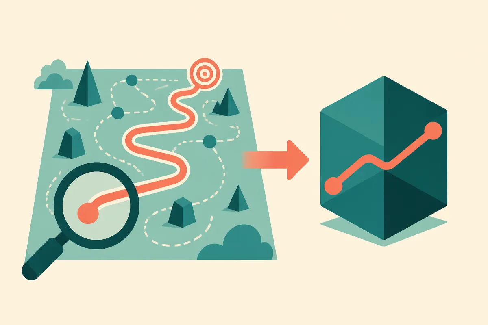

TL;DR: dSpark speeds up diffusion language models by teaching them the order in which to reveal tokens, prioritizing reveals that make other positions easier to predict, and reports up to 10.12x speedups on GSM8K without losing task performance.

Most of the speed conversation around language models is about autoregressive models: the GPT-style, one-token-at-a-time machines that everyone ships. Diffusion language models are the other branch. They generate many tokens in parallel, starting from a mostly masked sequence and unmasking positions over several rounds. The promise is obvious: fill in a whole response in a handful of passes instead of hundreds of sequential steps. The catch is just as obvious in practice. They often need many decoding rounds anyway, and that eats the parallelism advantage.

The paper I want to walk through is "Learning When to Commit: Schedule Distillation for Fast Diffusion Language Models," which proposes a method the authors call dSpark. Code is at github.com/VILA-Lab/dSpark. The core insight is simpler than the title suggests, and it reframes what "fast" means for this model family.

## What is the actual bottleneck in diffusion language models?

The naive mental model is that you unmask the tokens you are most confident about first. Easy tokens get committed, hard tokens wait. That sounds right and it is incomplete.

The authors make a distinction that is easy to miss. A token being easy to predict is not the same as a token being useful to reveal. A highly predictable token might add almost nothing to the context the model needs for the rest of the sequence. Meanwhile a less predictable token, once you commit to it, can collapse the uncertainty on several neighboring positions at once. Reveal it and three other blanks suddenly become obvious.

So the bottleneck is not raw prediction difficulty. It is information flow. Which commitment unlocks the most downstream certainty? That is the question that decides how many rounds you actually need.

If you only ever commit the safe, obvious tokens, you keep the risky-but-informative ones masked, and the model stays uncertain about everything that depended on them. You grind through round after round. The order of commitment is the lever, and standard confidence-based schedules pull it the wrong way.

## How does dSpark change the decoding order?

dSpark is a schedule distillation framework. Two moves.

First, it constructs better unmasking schedules. Instead of ranking tokens purely by confidence, it builds schedules that prioritize tokens whose reveal makes other positions easier to predict. The goal is to reduce uncertainty earlier in the decoding process, so fewer rounds are left to resolve. Think of it as front-loading the high-leverage commitments.

Second, it distills those schedules back into the model so the model learns to produce them at inference time. You do not want to run an expensive search for the optimal reveal order on every request. That would defeat the purpose. Distillation bakes the behavior in, so the model samples quickly in parallel on its own. To keep the faster sampling from degrading output, they add a KL-divergence regularizer, which is a standard way to keep the distilled model's output distribution close to the original's. That is the quality guardrail.

The combination is the point. Better schedules alone are a search problem. Distillation alone has nothing good to learn from. Together you get a model that commits in a smart order without paying a search tax at generation time.

## How big are the reported speedups, and are they real?

On GSM8K, the grade-school math reasoning benchmark, the authors report 10.12x speedup on LLaDA-8B-Instruct and 5.12x on Dream-7B-Instruct over their baselines, while maintaining superior task performance. They evaluate across mathematical reasoning and code generation tasks, which are the two domains where this should help most, because both have structure that lets an early commitment cascade into downstream certainty.

A few things to keep in mind before you treat those numbers as settled.

The speedups are measured over specific baselines on specific models. 10x on LLaDA versus 5x on Dream tells you the gain depends heavily on the base model and how its default schedule behaves. A model that already decodes efficiently has less slack to recover. So "up to 10x" is the ceiling they found, not a number you should expect everywhere.

GSM8K and code generation are structured tasks. Reasoning chains and syntactically constrained code are exactly where committing one token makes neighbors predictable. Open-ended generation, long freeform text, dialogue with weaker local structure: those may not cascade the same way. The paper's own framing (reveal one token, unlock several) depends on that dependency structure existing. I would want to see results on tasks without it before assuming the gain transfers.

And these are arXiv results with public code, not a product benchmark run by a third party. The code release is a real plus here, because the whole claim is reproducible in a way marketing numbers never are. That is the right bar.

## Why this matters even if you never run a dLLM

Most builders are not deploying diffusion language models today. The ecosystem, the tooling, the hosted endpoints all lean autoregressive. So why care?

Because the idea generalizes. The real lesson is that commitment order is a tunable axis for generation speed, and confidence is a poor proxy for value. "Reveal the thing that makes the most other things easy" is a scheduling principle, not a diffusion-only trick. It shows up anywhere you decode in parallel or plan a sequence of decisions where each one changes the difficulty of the rest.

Diffusion models are the most natural fit because they already decode non-sequentially, which gives them the freedom to reorder. Autoregressive models mostly cannot, they are locked into left-to-right. But speculative decoding, parallel sampling schemes, and any agent that plans a batch of actions all share the same underlying question: what do you commit to first so the rest gets cheaper? dSpark is a clean, measured answer in one setting, and the framing is portable.

The honest caveat: this is a research result, not a shipped capability in any model you are calling through an API. Diffusion LLMs remain a smaller, less mature branch than the autoregressive mainstream. If your interest is practical throughput today, this is a signal about where efficiency gains are hiding, not a tool you can plug in this week.

Practitioner's Take: if you are experimenting with diffusion language models (LLaDA, Dream, and similar open checkpoints), clone the dSpark repo and reproduce the GSM8K numbers on your own hardware before trusting the headline multiplier, because the gain clearly varies by base model, 10x versus 5x in their own results. Point it at your actual task distribution, not just the benchmark, since the whole mechanism depends on tasks where one revealed token makes neighbors predictable, which math and code have and freeform chat may not. For everyone still on autoregressive stacks, the takeaway is conceptual: when you design any multi-step generation or planning loop, stop ordering by confidence and start ordering by how much each decision shrinks the remaining uncertainty. That reframe is free and it transfers. The catch most readers miss is that a 10x speedup on a model family almost nobody serves in production is a research signal about method, not a throughput win you can book this quarter.
